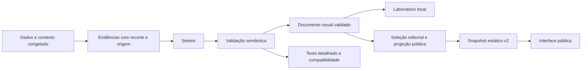

# Plano de evolução para análise visual — 06/10/2026

**Status: proposta de arquitetura e execução, baseada em inspeção do código.** Não altera o contrato vigente da Spec, não autoriza publicação e não registra implementação futura como concluída. A próxima sessão deve começar pelo checkpoint da entrega local pendente e pelos contratos propostos aqui.

Premissa de produto: priorizar quem quer entender rapidamente um confronto da NFL, com evidências e explicações opcionais. O laboratório interno serve para experimentar essa mesma apresentação e comparar resultados. A prioridade foi proposta ao usuário; ainda não houve resposta à escolha de público/uso. Tema escuro com lima preservado; interface nova inicialmente em português, com vocabulário e glossário consistentes. A decisão de idioma do produto público deve ocorrer antes da migração das páginas públicas.

## 1. Decisão central

A unidade principal do produto passa a ser um **achado sustentado por evidências**, apresentado por um título curto, um gráfico, contexto da amostra e uma ressalva. Os quatro parágrafos deixam de definir a navegação e permanecem disponíveis como leitura detalhada/legada durante a migração.

Reaproveitar aquisição de dados, processamento Python, PostgreSQL, Java, React/Vite, evidências tipadas, validadores, arquivos imutáveis e snapshots estáticos. A mudança não exige outro framework, backend público, modelo de linguagem, novo banco ou modelo preditivo.

Há três resultados distintos:

1. **Protótipo visual local:** compreensível e fiel aos contextos congelados atuais; sem depender de dados novos.
2. **Produto visual publicável:** contrato público novo, origem temporal verificável, processo de seleção e compatibilidade com o histórico.
3. **Produto analítico enriquecido:** volume por fundamento, agregações corretas, temporada versus recência e, depois, situações/postgame.

Esses resultados devem ter entregas e critérios separados. Um gráfico funcionar no laboratório não torna o conteúdo elegível para publicação.

## 2. Auditoria do estado atual

Inspeção sobre HEAD `0eb25a0`, somada à entrega local ainda não commitada. Fontes, migrations e snapshots locais foram lidos; não houve consulta ao banco remoto nem conferência do deploy vivo. Os gates 118 Java/48 frontend/15 Python pertencem à entrega anterior; nesta análise foram executadas apenas reproduções pontuais e leituras.

| Achado confirmado | Fonte no projeto | Consequência no plano |
| --- | --- | --- |
| API local retorna identidade e quatro textos; candidatos, claims e contexto ficam em arquivos internos | `LocalGenerationService`, `LocalResultStore.Response` | Criar projeção visual tipada; não extrair números dos textos |
| A geração já guarda contexto, seleção, claims, textos e resultado com hashes | `LocalResultStore` | Reutilizar rastreabilidade e estender artefato com versão explícita |
| Claims v5 continuam obrigadas a quatro seções, mesmo sendo tipadas | `ClaimSelection`, `LocalRuleSelector`, `SignalClaimValidator` | Começar com adaptador v5; desacoplar seções em etapa posterior, sem invalidar v3/v4/v5 |
| Seletor examina seis encontros, preserva empates, não calcula ranking numérico e não prevê vencedor | `MatchupAssessment`, `LocalRuleSelector` | A UI não pode inventar força, ranking, probabilidade ou desempate |
| Contexto usa até três semanas disponíveis anteriores; política de cobertura espera semanas numéricas consecutivas | `AnalysisContextBuilder`, `EditorialParameters` | Não oferecer temporada inteira; tratar byes/lacunas antes de reformular recência |
| `asOfDate` é registrado, mas não filtra a consulta por disponibilidade histórica | `AnalysisContextBuilder.slice` | Diferenciar corte declarado, dados observados e reconstrução point-in-time |
| Normalização local retira datas opcionais do contexto canônico | `FrozenContext` | Metadados do catálogo não podem virar garantia temporal da análise |
| Painel tático compara ataque contra ataque; defesa disponível não participa | `TacticalComparison` | Redesenhar em ataque A × defesa B e ataque B × defesa A |
| Comprimento da barra usa valor absoluto do EPA | `TacticalComparison`, linhas 53–57 | Substituir por escala assinada com zero explícito |
| Seleção de métrica pode retornar semana futura e exibir dados antigos com o rótulo da semana do jogo | `MatchupDashboard.metricForWeek`, linhas 24–36 | Correção temporal prioritária; retirar fallback silencioso |
| Overview corta os textos por caracteres | `OverviewPanel.trim` | Gerar frases curtas como campos próprios; evitar perder ressalva por truncamento |
| Público passa por JSON dentro de `markdownText` e tipo `Predicao` | `types.ts`, `staticDataClient`, `MatchupDashboard` | Isolar adaptador legado e introduzir tipos de análise descritiva |
| Snapshot v1 só publica quatro textos por jogo e parte das métricas | `SnapshotContract`, `SnapshotAssembler` | Definir v2 antes da publicação de evidências estruturadas |
| Aprovação exige `analysisCacheId`, `promptHash` e linhas do cache | `EditorialManifest`, `ApprovedAnalysisSelector` | Criar referência neutra para artefatos locais, sem fabricar cache Gemini |
| `analysis_cache` exige `model_name`, `prompt_hash`, `response_text` | migration baseline | Preservar histórico; não usar esses nomes como contêiner genérico das novas análises |
| ETL guarda contagens totais, mas não denominadores de passe/corrida | `etl-pipeline/load_metrics.py`, migration baseline | Não mostrar total de jogadas como amostra de um fundamento |
| Early-down EPA e explosividade existem no schema, mas não no INSERT/cálculo desse ETL | `TeamWeekMetrics`, `load_metrics.py` | Não prometer gráficos desses campos só porque há coluna |
| Recharts está instalado, sem importação nas telas inspecionadas | `web-ui/package.json`, busca em `src` e `local-editorial` | Experimentar a dependência existente; não introduzir outra biblioteca agora |
| CI versionado tem workflow Java e ETL semanal; frontend/Python não possuem gates próprios nesses workflows | `.github/workflows` | Acrescentar gates adequados quando o contrato visual entrar |

**Reprodução pontual do corte temporal:** a função real de seleção foi extraída, transpilada e executada isoladamente. Com série contendo apenas semana 4 e jogo na semana 3, retorna semana 4. Com apenas semana 2, retorna semana 2, enquanto o painel recebe `game.week = 3`. Com semana 3 disponível, usa a própria semana do jogo. Esse último comportamento exige separar apresentação pregame de dados do jogo encerrado; não deve alimentar uma leitura pregame retroativamente.

**Reprodução da barra:** EPA −0,400 e +0,100 resultam em comprimentos 100% e 25%. O sinal ainda aparece no número, mas a geometria favorece uma leitura errada.

**Snapshot local inspecionado:** schema 1, 272 jogos, 64 linhas de métricas nas semanas 1 e 2, 52 análises. Manifesto interno: 69 seleções. O trecho “Publicação atual” de `docs/static-snapshot-contract.md` ainda relata números anteriores; os números do arquivo local não comprovam o estado do deploy atual. Atualizar essa distinção documental na próxima entrega.

## 3. O que preservar, transformar e retirar

| Componente | Destino | Condição/justificativa |
| --- | --- | --- |
| Aquisição nflverse, Parquet, política de temporadas, scores/mercado atômicos, idempotência | Preservar | São infraestrutura útil; não dependem da forma editorial |
| PostgreSQL, JPA e migrations existentes | Preservar | Acrescentar schema somente quando o novo contrato de dados exigir |
| `Evidence`, `EvidenceWindow`, catálogo semântico | Preservar e ampliar | Já oferecem números, recorte, origem, agregação e referências |
| Validadores semânticos e testes de propriedades | Preservar | Gráficos precisam da mesma disciplina factual |
| Seletor local 2.0.0 | Preservar no primeiro experimento | Não misturar teste de apresentação com mudança na tese selecionada |
| Renderer textual 5.0.2 | Manter como saída detalhada/legada | Retirar sua obrigatoriedade como apresentação principal |
| CLI, serviço compartilhado, store imutável, loopback, proxy | Preservar e estender | Reaproveitar geração, histórico e limites operacionais |
| React/Vite e separação build-time de Production | Preservar | Página pública continua lendo somente snapshots |
| Tema, calendário, navegação por jogo, estados neutros e cálculo fair do mercado | Preservar | Mercado fica em seção independente, sem validar a tese |
| `TacticalComparison` atual | Substituir e depois remover | Correções de sinal/tempo e mudança de comparação precisam de novo componente |
| `OverviewPanel` orientado a mercado + três parágrafos truncados | Redesenhar | Priorizar confronto/evidências; mercado segue acessível |
| `AnalysisSections` e `Analysis` local como apresentação inicial | Tornar detalhe; depois consolidar | Componentes compartilhados evitam duas implementações divergentes |
| `Predicao`/parse de `markdownText` | Encapsular no adaptador legado; retirar do fluxo novo | Nome/shape atuais induzem previsão e prosa como domínio |
| Gemini, caches e claims antigas | Congelar como caminho opcional/legado | Sem investimento no MVP visual; manter leitura e testes do histórico |
| Scripts/páginas antigas de inspeção | Arquivar quando substituídos | Manter fixtures, resultados selecionados e reprodutibilidade |
| CSS duplicado, helpers e dependências sem consumidores | Remover após migração comprovada | Busca de referências, build e regressão antes da remoção |
| S3/AWS legado, projeto temporário, Handoff antigo | Manutenção posterior | Não são pré-requisito da guinada visual |

Não apagar snapshots, aprovações, contextos congelados, migrations, baselines de testes ou caches para simplificar a mudança. Não regravar textos antigos como se tivessem sido produzidos pelo motor novo. A remoção de código exige substituto integrado, ausência de consumidores e estratégia de rollback.

## 4. A experiência pretendida

### Página do confronto

1. **Identificação:** times, data, status e momento da análise (pregame; postgame somente quando existir).
2. **Leitura rápida:** achado principal ou grupo de achados equivalentes, frase curta e ressalva visível.
3. **Quatro encontros:** passe e corrida de cada ataque contra a defesa correspondente. Layout compacto; informação ausente aparece no encontro correspondente, sem sumir silenciosamente.
4. **Detalhes:** semanas/jogos observados, contagens conhecidas, valores, definição da métrica e método de agregação.
5. **Mercado:** seção separada, com probabilidades derivadas de cotações e seu timestamp.
6. **Histórico editorial:** versões disponíveis, sem misturar evidências novas com um texto antigo.

No mobile, os cartões são empilhados; a ordem deve continuar explícita. Não esconder o outro time atrás de um gesto sem indicação. Evitar quatro gráficos densos simultâneos: o cartão compacto mostra o essencial e expande suas observações.

### Cartão de evidência

- Título curto factual; exemplo: “EPA positivo nos dois recortes de passe”.
- Subtítulo que identifica ataque, defesa adversária, temporada e semanas.
- Pontos dos valores observados, zero e unidades explícitos.
- Uma interpretação curta vinculada à claim.
- Principal limitação/contraponto sempre visível; detalhes adicionais expansíveis.
- Ação “Ver dados e definição”, com tabela acessível.

O tamanho do texto é um orçamento de interface, não licença para cortar ressalvas. Proposta inicial para testar: título de até duas linhas e uma frase explicativa; se o conteúdo não couber, mudar sua hierarquia e agrupamento. Não impor corte por caracteres a textos já gerados.

Empates continuam visíveis como equivalência. Se não há base para escolher um destaque, a página apresenta panorama ou insuficiência. Uma oportunidade independente do adversário não deve receber o rótulo “refutação”. `NONE/INCONCLUSIVE` permanece sem tradução visual para palpite.

### Comparação e review no laboratório

A comparação entre duas tentativas deve mostrar primeiro **o que mudou**: dados/recorte, seleção/relações ou apresentação. Duas colunas ou alternância acessível, com a mesma escala, mostram somente os encontros alterados por padrão; os demais ficam disponíveis com contagem explícita. A limitação relevante permanece ao lado do achado em ambas as versões.

Vincular a comparação a tentativas concretas e às identidades de contexto, análise e projeção. Não chamar uma mudança de fonte de melhoria do motor. Legados v3 sem documento visual continuam no modo textual identificado. O painel de auditoria completo existe sob expansão, sem ser o conteúdo inicial. Essa funcionalidade atende diretamente ao problema de revisão cansativa sem exigir geração de prosa por LLM.

### Laboratório e produto público

Os gráficos e cartões são compartilhados. O laboratório acrescenta controles de geração, IDs internos e comparação entre tentativas. O público recebe apenas dados e explicações autorizados. Desabilitar um botão em Production não é suficiente: módulos de geração e proxy continuam fora do bundle público.

## 5. Gramática visual e semântica

| Informação | Representação inicial | Regra obrigatória |
| --- | --- | --- |
| EPA semanal de ataque/defesa | Dois pequenos painéis de pontos com a mesma escala dentro da comparação | Zero explícito; preservar sinal; separar séries e identificar times/papel |
| Variação entre semanas | Pontos por semana, com ausências explícitas | Duas observações não recebem rótulo de tendência/consistência |
| Faixa mínima–máxima | Detalhe opcional, identificado como faixa observada | Nunca chamar de intervalo de confiança |
| EPA médio do recorte | Número acompanhado do método | Média das médias semanais continua assim rotulada enquanto faltar denominador |
| Success rate | Percentual e, quando possível, sucessos/jogadas elegíveis | Não inferir controle das trincheiras ou mecanismo causal |
| Frequência de passe | Distribuição percentual separada de eficiência | Sem vencedor, nota de qualidade ou causalidade |
| Volume | Contagem por fundamento, quando realmente conhecido | Distinguir número de semanas/jogos de número de jogadas |
| Cobertura | Valores factuais: semanas observadas/esperadas; denominador disponível ou ausente | Sem nova nota/bucket de confiança |
| Evidência histórica | Bloco explicitamente separado da temporada atual | Não preencher lacuna atual com histórico sem rótulo |

Escalas incluem todos os extremos; sem suavização, clipping silencioso, valor absoluto ou normalização individual de cada time. Cartões colocados para comparação usam uma política de escala comum explicitamente definida. Taxas ficam entre 0 e 100%; valores ausentes não viram zero. Um valor muito pequeno mantém sinal na apresentação; não deve parecer zero exato nem uma diferença relevante só por ser positivo.

A defesa mantém a unidade **EPA permitido**: menor é melhor para a defesa. Não inverter sinais sem identificação nem colocar “bom” à direita automaticamente em todos os gráficos. Zero é referência do EPA, não média atual da liga. Dois painéis observados não estimam o EPA esperado daquele confronto; não somar ataque + defesa, subtrair como um edge, contar métricas correlacionadas como votos ou criar um vencedor visual.

Evitar no MVP: radares, velocímetros, notas 0–100, heatmaps de força, probabilidades próprias, ranking por cor, intervalos estatísticos improvisados e linhas de tendência com amostra curta. Ajuste por adversário, shrinkage e modelo de confiança exigem desenho e validação próprios.

**Acessibilidade:** rótulos e formas distinguem séries; cor não é o único canal. Resumo textual curto, tabela de valores, teclado, foco visível, conteúdo essencial independente de hover e contraste verificado. A W3C recomenda alternativas textuais que preservem a informação de gráficos complexos e contraste adequado dos elementos gráficos essenciais. Fontes: [gráficos/imagens complexas](https://www.w3.org/WAI/tutorials/images/complex/) e [contraste não textual](https://www.w3.org/WAI/WCAG22/Understanding/non-text-contrast.html).

As buscas da skill de design retornaram padrões genéricos de dashboard e tipos de gráfico pouco adequados a sinais de EPA. Não foram adotados como especificação. A gramática acima é uma proposta deliberada para este domínio, a validar com os casos reais e tarefas de compreensão.

## 6. Contrato técnico novo

### Fluxo de destino



### `VisualAnalysisDocument` v1, interno

Proposta a fechar na entrega E1, com schema, fixtures e exemplos válidos/inválidos:

| Bloco | Conteúdo |
| --- | --- |
| Identidade | `schemaVersion`, `gameId`, resultado de origem, versão do projetor, momento pregame/postgame, identificador do conjunto de dados |
| Contexto | Times, temporada/fase/semana, recorte observado, corte declarado e garantia temporal realmente disponível |
| Evidências | IDs, métrica/definição, time, papel, período, valor, unidade, sinal exato, amostra conhecida, ausência explícita |
| Séries | Referências às observações, semanas/jogos, agregação e denominador; nenhuma cópia independente de número sem validação |
| Achados | ID, claim de origem, título e interpretação de vocabulário finito, referências de evidência, relação entre sinais |
| Restrições | Origem da restrição, tipo, referências, relação com o achado e prioridade de exibição |
| Apresentação | Grupos equivalentes, encontros disponíveis/indisponíveis, destaque válido e ordem estável sem mérito por nome de time |

`valor decimal canônico`, `sinal` e `texto formatado` devem preservar a semântica dos cálculos Java. A coordenada numérica usada pelo gráfico é somente representação; não recomputa classificação ou relevância com floats arredondados. O contrato deve definir comportamento para valores não finitos/inrepresentáveis, zero exato e valores positivos/negativos que arredondariam a zero.

Separar um **achado validado** de um **estado de cobertura**. Um encontro sem claim por falta de comparabilidade pode aparecer como indisponível; não criar uma claim falsa para preencher o cartão. Datas/adversários que não existem na evidência atual permanecem ausentes.

### Responsabilidades

- ETL: observações, denominadores e proveniência corretos.
- Java: recorte elegível, agregação, relações, seleção e frases curtas validadas.
- Projetor visual: montar séries/cartões a partir do resultado validado; conferir referências, unidades, amostras e coerência entre texto e pontos.
- Frontend: layout, escala gráfica, interação, tradução de rótulos estáticos e acessibilidade; sem selecionar tese ou reconstruir dados por parsing da prosa.
- Exportador: projeção pública por allowlist e publicação atômica.

Não confiar cegamente em `selection.candidates` gravados: o caminho de claims valida o documento e reconstrói candidatos, enquanto a seleção contém também informações de auditoria. A projeção deve partir de uma representação validada/resolvida, ou validar explicitamente todo campo adicional exposto.

### Organização de código proposta

Nomes abaixo são propostas, não arquivos implementados:

```text
core-api/.../editorial/
  visual/
    VisualAnalysisDocument.java
    VisualAnalysisProjector.java
    VisualAnalysisValidator.java
    ShortInsightRenderer.java
  local/
    LocalGenerationService.java      # preserva fluxo e integra projeção
    LocalResultStore.java            # leitura por versão e hashes
    LocalAnalysisServer.java         # consulta visual por tentativa

web-ui/src/features/analysis-visual/
  contract.ts
  components/
    MatchupEvidenceGrid.tsx
    InsightCard.tsx
    WeeklyEpaPlot.tsx
    EvidenceDetails.tsx
    CoverageNotice.tsx
  formatting/
  fixtures/
  tests/

web-ui/local-editorial/              # shell local, geração, histórico, comparação
web-ui/src/services/                 # adaptadores público/legado, sem geração
core-api/.../snapshot/               # futura projeção pública v2
```

O pacote `visual` precisa de acesso controlado à representação validada: hoje `SignalClaimValidator.Validated` é interno ao pacote. Criar uma interface/DTO validado com invariantes, sem tornar toda a auditoria pública por conveniência. `ClaimSelection` também referencia `MatchupAssessment.Candidate` no pacote `local`, e falhas editoriais usam tipos de `llm.GenerationFailure`; a neutralidade do domínio é parcial. Desacoplar esses tipos durante a evolução do contrato, preservando adaptadores de exceções e contratos anteriores. Isso prepara outros seletores no futuro sem instalar ou executar modelos agora.

Não introduzir um monorepo adicional ou pacote npm separado para quatro componentes. Compartilhar no `web-ui` existente, com imports que não puxem o cliente de geração para Production. Centralizar tokens de cor/espaçamento/tipografia e formatação; evitar nova cópia do CSS inteiro da página pública.

### Compatibilidade e persistência

1. Preservar claims v5 e adaptar as quatro seções para destaque, relações e detalhe no primeiro protótipo. Nenhuma nova política de ranking nessa entrega.
2. Adicionar uma versão do artefato interno com `insights.json` e hash, sem alterar os artefatos v3 existentes. O leitor atual exige exatamente cinco hashes; precisa de dispatch explícito por versão.
3. Preservar o POST/GET textual atual e acrescentar consulta visual por tentativa, por exemplo `GET /api/v1/local-analysis/{gameId}/{attemptId}/insights`. Atualizar o proxy somente para a rota exata necessária, mantendo todos os limites anteriores.
4. Artefato antigo sem documento visual retorna estado de compatibilidade explícito. Não renderizar silenciosamente com regras atuais como se o resultado fosse histórico. Uma projeção retroativa opcional precisa de novo artefato derivado, versão e vínculo ao original; não regrava o pai nem ocorre como mutação implícita de GET.
5. Separar identidade da análise da identidade da apresentação. CSS não deve invalidar a análise; mudança de textos curtos/agrupamento deve ter versão e identidade de projeção.
6. Quando o formato estiver validado, evoluir o contrato de domínio para achados/relações independentes das quatro seções. Leitores v3/v4/v5 continuam versionados; o renderer legado vira adaptador.

## 7. Dados: o que já dá para mostrar e o que falta

| Capacidade | Situação atual | Ação |
| --- | --- | --- |
| EPA ataque/defesa por passe e corrida por semana | Disponível nos contextos atuais | Usar no protótipo com período e ausência de denominadores explícitos |
| Número de semanas, sinal e faixa observada | Disponível | Exibir diretamente; não traduzir em força/confiança |
| Total de jogadas ofensivas/defensivas | Disponível no domínio/contexto em métricas correspondentes; público v1 incompleto | Expor somente onde o denominador é válido |
| Success rate geral | ETL/domínio têm; snapshot público v1 não expõe | Nova projeção antes de visual público |
| Contagens/success rate por passe/corrida | Não persistidos separadamente | Contrato e extensão ETL/schema |
| Temporada ponderada e comparação com recência | Contexto local limitado a três semanas | Novo contrato de janelas, somas e contagens |
| Byes versus falhas de ingestão | Ausência semanal insuficiente para distinguir | Cruzar calendário/status com cobertura da fonte |
| Referência da liga e percentis | Não implementados | Dataset de referência com mesmo filtro e corte; adiar |
| Ajuste por adversário e incerteza estatística | Não implementados | Trabalho estatístico separado; adiar |
| Pressão/rotas/trincheiras/posse | Sem evidência específica no núcleo atual | Não representar como fatos inferidos de EPA/success rate |

**Semântica de passe precisa de decisão explícita.** O ETL chama de `dropback_rate` a proporção `play_type == pass` entre jogadas válidas. Na documentação da fonte, `play_type=pass` inclui sacks, `run` inclui scrambles, enquanto `qb_dropback` cobre também scrambles. Portanto o campo atual não mede exatamente o universo descrito pelo seu nome. No protótipo preservar o cálculo e identificar “frequência de jogadas classificadas como passe”; uma mudança para dropbacks verdadeiros requer definição/versionamento/backfill próprios. [Referência primária nflfastR](https://nflverse.r-universe.dev/nflfastR/doc/manual.html).

### Contrato de métricas a fechar

Para cada métrica: população de jogadas, numerador, denominador, unidade, direção, tratamento de null/não finito, kneels, spikes, sacks, scrambles, penalties/no-play, tentativas especiais, overtime, garbage time, fase da temporada, data de conhecimento e versão da definição.

Proposta inicial: manter comparabilidade com a definição atual e documentar OT/garbage time incluídos enquanto não houver filtros específicos e dados necessários. Não alterar vários filtros junto com a UI. Definir denominadores distintos de jogadas de passe/corrida e sucessos por fundamento. Guardar somas/contagens necessárias à agregação; não reconstruir contagens arredondando taxas nem anunciar média de temporada a partir de média simples das médias semanais.

### Persistência recomendada em etapas

- **Protótipo:** nenhuma migration; usar contextos congelados atuais.
- **Primeiro enriquecimento:** migration aditiva para contagens/numeradores por fundamento e versão/proveniência do cálculo. Validar se a linha semanal existente comporta o contrato antes de criar outras estruturas.
- **Granularidade por jogo:** introduzir `team_game_metrics` quando o recorte preciso por jogos, distinção de fase e postgame exigirem. É a direção recomendada para o produto completo; o schema semanal pode permanecer como projeção de compatibilidade. Não somar os mesmos fatos nas duas camadas.
- **Reprodutibilidade:** materializar o contexto usado pela análise com fingerprint da origem, definição e datas. Um hash sem o conteúdo preservado não reproduz o passado. Disponibilidade histórica desconhecida deve permanecer desconhecida; não retropreencher `availableAt` com gameday como se fosse conhecimento real.

O desenho final das novas colunas/chaves pertence ao contrato de dados, antes da migration. Manter migrations incrementais, RLS e acesso JDBC/psycopg2; esta guinada não exige habilitar Data API nem adicionar credenciais ao browser. Nenhum backfill deve regravar contextos/editoriais já congelados.

## 8. Publicação, BASIC/FULL e histórico

### BASIC/FULL

Separar **profundidade editorial**, **cobertura disponível** e **estado da publicação**. Uma análise FULL pode ter pouca evidência; a regra não autoriza inventá-la. Uma BASIC não pode ocultar uma ressalva que muda a leitura.

Proposta: BASIC apresenta os encontros disponíveis e explicação curta; FULL habilita exploração adicional de períodos/evidências realmente disponíveis. A diferença exata deve ser fechada após testar os cartões, antes de conectar o novo motor ao planejador/publicador. No laboratório inicial usar “análise descritiva local”, sem aplicar esses rótulos antecipadamente.

### Snapshot público v2

Recomendar versão pública nova quando entrar a apresentação estruturada. Manter v1 intacto até a migração, com cliente que distingue versões e representação legada. O novo snapshot deve incluir payloads seguros por análise/versão, sua cobertura e momento editorial; game/market/calendário continuam disponíveis independentemente de análise.

Referências visuais públicas precisam ser próprias do contrato público. Não exportar `context_json` completo, prompts, caminhos, tabela/chave interna, modelo ou hashes de prompt. Projetar somente métricas, recortes, unidades, definições e referências que o usuário precisa para entender o gráfico.

A seleção de publicação precisa referenciar artefato + identidade de conteúdo + política/decisão de publicação. O manifesto atual baseado em cache Gemini continua para legados. Não preencher `model_name` ou `prompt_hash` fictícios para fazer uma análise local caber nele.

Evitar vincular uma análise histórica à série mais recente de `metricsByTeam`: os gráficos devem usar o mesmo conjunto de evidências da versão analisada. Legados sem evidência recuperável continuam como texto histórico, sem gráfico de sustentação inventado.

Publicação: gerar candidatos → validar → selecionar lote → exportar para diretório de revisão → verificar conteúdo e compatibilidade → versionar → publicar → conferir o deploy. Preservar writer atômico e rollback. A operação inicial pode exigir aprovação do lote conforme o plano anterior, mas não impõe reescrita manual de cada análise. Checks automáticos tratam materialidade e exceções.

Mercado permanece independente. O motor descritivo atual não possui uma previsão de vencedor comparável à probabilidade de mercado; não introduzir badge “modelo discorda do mercado” a partir de uma vantagem localizada.

## 9. Entregas propostas e dependências

| ID | Entrega | Dependências | Porte relativo | Critério de saída |
| --- | --- | --- | --- | --- |
| E0 | Checkpoint da UI local, inventário e backlog de correção temporal/geométrica | Nenhuma | Pequeno | Escopo da entrega anterior separado dos arquivos históricos; base reproduzível para a equipe |
| E1 | Contrato visual v1, matriz de estados e wireframes desktop/mobile | E0 | Médio | Exemplos válidos/inválidos; decisões de escala, sinal, ausência, empates e ressalvas fechadas |
| E2 | Projetor Java, artefato versionado e consulta visual local | E1 | Médio | Números/claims/pontos reconciliados; legado preservado; GET não regrava tentativas |
| E3 | Cartões/gráficos compartilhados e laboratório visual | E1; integração final com E2 | Médio | Fluxo real com leitura rápida, detalhe, histórico e acessibilidade |
| E4 | Avaliação de compreensão e propriedades visuais | E2 + E3 | Médio | Nenhuma distorção material; resultados de compreensão registrados; ajustes versionados |
| E5 | Contrato e implementação do núcleo de métricas/recortes | Contrato pode iniciar após E1; implementação após decisões | Grande | Denominadores, agregações, cobertura e corte temporal testados; backfill controlado/idempotente |
| E6 | Política BASIC/FULL e publicação neutra de artefatos locais | E4; dados mínimos definidos em E5 | Médio/Grande | Elegibilidade, revisões, seleção e preservação de histórico independentes de Gemini |
| E7 | Snapshot v2 + integração na página pública | E4 + E6; correções temporais obrigatórias | Grande | v1/legados legíveis, v2 seguro, cliente estático sem geração, preview e rollback verificados |
| E8 | Home visual, publicação de lote e processo semanal | E7 | Médio | Navegação compreensível, publicação íntegra e correspondência artefato/commit/deploy |
| E9 | Situações, postgame, avaliação longitudinal e limpeza final | Núcleo visual e dados consolidados | Grande, fracionar | Contratos próprios; nenhuma reutilização indevida de evidência pregame/postgame |

Dependência de implementação: a mudança visual de E3 pode usar fixtures de E1, mas não é considerada integrada sem E2. O contrato de métricas pode ser trabalhado em paralelo, porém mudanças de significado/recorte exigem novas fixtures e versões antes de entrarem no mesmo lote avaliado. A E7 deve definir o subconjunto exato de E5 necessário para publicação; funcionalidades de temporada/volume ficam indisponíveis se esse subconjunto ainda não estiver pronto.

Porte expressa escopo/incerteza, não prazo prometido. Reestimar após E1; evitar iniciar todas as frentes simultaneamente.

**Primeira fatia funcional:** E0 → E1 → E2/E3 → E4. Resultado: a mesma análise local examinada visualmente, com detalhes e sem alterar a regra editorial. Essa fatia não depende de ampliar o ETL, adquirir dados ou financiar um LLM.

**Correções atuais:** sinal de EPA, fallback temporal e rótulo do período merecem issue prioritária independente; fazer o diagnóstico e testes de falha na E0/E1. Podem ser corrigidos em um PR pequeno antes da nova página. A existência de um plano maior não deve justificar manter esses comportamentos na próxima publicação.

## 10. Divisão de trabalho

| Frente | Responsabilidade | Arquivos/áreas principais | Limite |
| --- | --- | --- | --- |
| Produto/UX | Hierarquia, vocabulário, perguntas de compreensão, protótipo e matriz de estados | Contrato visual, fixtures de apresentação, tokens | Não altera regra estatística para fazer o layout caber |
| Domínio/API | Projetor validado, formato visual, persistência, consulta e compatibilidade | `editorial`, `editorial/local`, testes Java | Não publica payload bruto de auditoria |
| Frontend | Cartões compartilhados, gráficos, laboratório, adaptadores e acessibilidade | Novo `src/features/analysis-visual`, entrada local, depois páginas públicas | Não calcula ranking, força ou corte temporal próprio |
| Dados | Definições, denominadores, qualidade, janelas, proveniência e backfill | ETL, migrations, entidades/repositórios | Não sobrescreve histórico congelado |
| Integração/qualidade | Fixtures de fronteira, propriedades, testes completos, exportação e rollback | Testes, scripts, snapshots, CI | Não altera critérios depois de abrir reservados sem registrar novo ciclo |

Configuração inicial enxuta: responsável integrador + frente backend/contrato + frente frontend. Dados pode avançar no inventário e contrato em paralelo, sem bloquear o protótipo. Revisão independente pode ser feita por uma pessoa/sessão que não ajustou o caso; não requer outra API de modelo.

Fluxo de branches: primeiro versionar o checkpoint da UI local; depois branches `codex/visual-contract`, `codex/visual-projection`, `codex/visual-ui` e, quando oportuno, `codex/metrics-foundations`. Worktrees não recebem automaticamente mudanças não commitadas: não abrir frentes sobre um HEAD que ainda não contém o proxy/API/catalogo necessários.

Um dono integra alterações de contratos compartilhados, `Spec.md`, `types.ts` e `pom/package` para evitar mudanças concorrentes incompatíveis. Cada entrega contém objetivo, versão de contrato, arquivos sob responsabilidade, exemplos, testes, limites e critério de aceite. Contratos fechados permitem frontend usar fixtures enquanto backend implementa; a entrega só termina quando as fixtures são confrontadas com HTTP real.

## 11. Validação e critérios de aceite

### Integridade semântica

- Todo ponto chega a uma evidência concreta do contexto da mesma análise.
- Toda frase factual chega a claim válida, ou a estado de cobertura validado claramente separado.
- Totais, taxas, médias e unidades reconciliam com a origem; zero e ausência são distintos.
- Trocar nomes/ordem dos times muda posição/rótulo, sem mudar mérito analítico.
- Adicionar odds não muda seleção, frases táticas, sinais ou gráficos.
- Remover evidências nunca aumenta a cobertura aparente nem cria uma certeza nova.
- Adicionar semana futura não muda o pregame congelado.
- Permutar evidências ou repetir ID idêntico não muda resultado; ID conflitante é rejeitado.
- Sinal oposto, zero e valor próximo de zero conservam significado e posição.
- Empates, contrapontos e oportunidades nos dois lados continuam representados.
- Byes, atraso da fonte, PBP ausente e histórico separado têm estados distintos quando a origem permite distinguir; caso contrário, indisponibilidade não recebe causa inventada.
- Não usar quantidade de cartões verdes como pontuação do jogo.

### Casos e resistência a ajuste editorial excessivo

Reutilizar os 21 casos conhecidos para regressão, deixando explícito que já foram vistos. Manter propriedades sintéticas para oposição ataque/defesa, variação semanal, empate, zero, outliers, ausência, denominador incompatível e histórico misto.

Separar uma amostra adicional de jogos/contextos não usados no ajuste, cobrindo início/meio de temporada e lacunas. Seleção e protocolo congelados antes de inspecionar resultados. Os antigos dois reservados já abertos não voltam a ser chamados de holdout. Se não houver fontes independentes disponíveis localmente, registrar a pendência em vez de declarar generalização.

### Compreensão e interface

Comparar a leitura textual atual e os cartões com tarefas iguais: identificar achado, time/fundamento, período, ressalva e dado ausente. Contrabalançar a ordem para reduzir efeito de aprendizado. Meta inicial de design: localizar o achado e sua principal limitação em cerca de 10–15 segundos, sem interpretar a tela como previsão. Esse tempo é hipótese de usabilidade, não limiar estatístico.

Fazer uma pequena rodada de teste com pessoas do público desejado quando possível; registrar tempo, acerto e interpretação equivocada. Inspeção interna é útil, mas deve ser identificada como tal. O usuário não precisa revisar manualmente toda nova rodada de análises para usar o sistema.

Desktop/mobile, zoom de texto, teclado, tabela alternativa, foco, contraste, expandir/recolher, dados longos, API indisponível, resposta perdida, histórico e troca rápida de contexto entram no aceite. Nenhuma informação necessária deve existir só em tooltip.

### Operação e publicação

Manter gates Java/frontend/Python apropriados, testes de contrato cruzados e integração HTTP real. Acrescentar verificação do bundle público sem módulos de geração. O CI Java atual filtra mudanças por `core-api/**`; ampliar o gatilho para fixtures e contratos externos consumidos por testes, para que uma alteração apenas em `editorial/` também seja verificada. Medir payload e tempo de leitura/renderização antes de fixar um orçamento de performance; lazy loading de detalhes pode ser decidido com esses números.

Para publicar: revisão do lote, snapshot completo, compatibilidade v1/v2, nenhum vazamento de campos internos, build estático, rollback e conferência de amostra representativa de jogos com/sem mercado/dados/análise. A aprovação mecânica não comprova qualidade editorial, precisão preditiva ou confiabilidade de uma fonte externa.

## 12. Relação com as sete famílias do feedback

| Problema original | Contribuição da guinada | Trabalho que continua necessário |
| --- | --- | --- |
| Linguagem forte demais | Títulos finitos e interpretação curta com evidência próxima | Política de relevância e amostra; gráfico também pode exagerar |
| Amostra curta/outliers | Pontos semanais, cobertura e extremos visíveis | Denominadores, desenho de recência e eventual estimação regularizada |
| Semântica das métricas | Unidade, direção, definição e tipo de gráfico explícitos | Corrigir contrato passe/dropback e decidir filtros |
| Red Flag sem oposição | Relações tipadas entre achado, contraponto e limite | Seleção da restrição mais relevante; evitar alertas genéricos repetitivos |
| Circularidade com mercado | Área e fonte independentes | Não anunciar divergência entre sinais que não estimam a mesma coisa |
| Causalidade inventada | Observações e claims rastreáveis | Novos mecanismos exigem métricas próprias; gráficos não os demonstram |
| Incerteza/divergência ocultas | Empates, dados ausentes e sinais mistos apresentados | Avaliação independente e eventual modelo estatístico, em outra iniciativa |

## 13. Reordenação do plano anterior

| Etapa anterior | Destino proposto |
| --- | --- |
| 1. Atualizar Weeks 3/4 e publicar | Replanejar pela data/calendário real, disponibilidade e formato aprovados. O lote congelado da Week 3 é material de avaliação, não semana atual presumida |
| 2. Auditar análises | Achados já alimentam E1/E4; transformar em propriedades e tarefas de compreensão |
| 3. Contrato de métricas | E5, com definições de display antecipadas em E1 |
| 4. ETL | E5, após fechar população/denominadores |
| 5. Java | E2 para projeção visual; E5 para dados enriquecidos |
| 6. Interface | Antecipar o protótipo local E3; interface pública em E7/E8 |
| 7. Regenerar/comparar | E4 visual + comparação de versões após mudanças de dados; sem depender de Gemini |
| 8. Situacionais | E9, priorizadas por pergunta real de produto |
| 9. Postgame | E9, contrato e granularidade próprios |
| 10. Automação semanal | E8, depois do caminho manual reproduzível |
| 11. Provar confiabilidade | Continua exigindo execução manual, três ciclos semanais e falha controlada; UI não cumpre esses gates sozinha |
| 12. Limpeza | Remoções incrementais após migração; infraestrutura legada ao final |

## 14. Decisões de partida e pendências

**Recomendadas para começar:** manter stack e produção estática; priorizar leitura rápida; preservar regra editorial no protótipo; cartões com pontos semanais e ressalva; contexto/claims como origem; novo contrato visual independente; dados ampliados em etapa própria; nenhuma nota de confiança.

**Fechar na E1:** público/idioma, hierarquia de cartões empatados, política de escalas, título factual para cada relação, representação de ausência, orçamento de texto, IDs/versão do documento e protocolo de avaliação.

**Fechar antes de publicar:** corte temporal verificável, semântica passe/dropback, mínimos de cobertura apresentados, BASIC/FULL, referência neutra de seleção, schema v2, leitura do histórico e compatibilidade de deployment.

**Adiar conscientemente:** Llama/Gemini para prosa, previsão probabilística, ajuste por adversário, shrinkage, rankings, pressão/rotas, autenticação pública, novos serviços cloud e substituição da stack.

Primeiro pacote de trabalho concreto: checkpoint da UI local + contrato visual v1 + estados de exemplo + wireframes + testes de falha dos dois problemas existentes de sinal/tempo. Depois, backend e frontend podem trabalhar em paralelo sobre o mesmo contrato.

## 15. Fontes e alcance da análise

Código consultado: ETL de métricas; baseline/hardening local; entidades e serviços Java; construtor de contexto; evidências/janelas; seletor, validadores e renderers; persistência/API local; clientes React; páginas e componentes públicos; manifesto, snapshot e seleção editorial; workflows e documentação operacional.

Referências externas limitadas à documentação primária W3C e nflfastR citada acima. Changelog Supabase consultado para conferir contexto da plataforma; não se propõe migração de produto/versão Supabase nesta entrega. Nenhuma informação externa foi usada para alterar números ou contextos locais.

Este arquivo e a [evidência pontual associada](2026-10-06-visual-analysis-audit.json) são planejamento. Não houve refactor, exclusão, migration, geração editorial, alteração de snapshots ou publicação nesta etapa.
