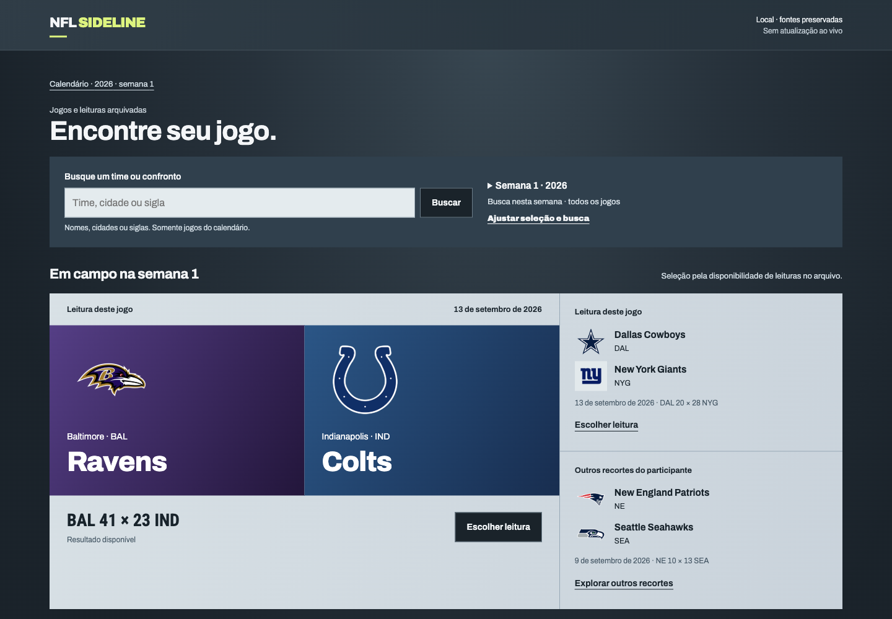

# Descoberta visual, busca e identidade completa

Implementação local sobre a base exata 4f6095fd205da9230abc8c82e8a3a457a47bbaba, em worktree gerenciada nova e branch codex/broadcast-discovery-assets-v3. Commits de implementação: **4e5b1d500d97d1421403ae6eafc3973540893332** (identidade/ativos/Logo) e **bd25dfa9c2ae8c098fdb5f4a72e75a00a9a30144** (descoberta/busca/painel/testes). Evidências e relatório têm commit próprio posterior. Sem merge, push, deploy ou publicação.

## O que mudou

A central abre com um confronto dominante e até dois acessos menores sobre superfície contínua. Logos e nomes ganham presença; ações são links explícitos. A seleção prioriza relações individuais, depois inclusivas, lacuna e outros arquivos, desempata pela ordem do calendário e não atribui importância esportiva. Não há preenchimento para chegar a três quando faltam outros destinos de arquivo. O fallback sem arquivo apresenta somente um jogo real.

Os restantes estão em “Todos os jogos da semana”, fechado inicialmente. Contagens distinguem total da seleção, já apresentados e restantes. O estado aberto usa explore=open; abertura de confronto, retorno e recarga preservam a exploração sem duplicar jogos.

Busca textual por nome, cidade, apelido e sigla, sem API nova ou LLM. Normalização de caixa, acentos e espaços, termos dos dois participantes e conectores usuais. Busca por confronto exige que todos os termos correspondam aos participantes de um jogo existente. Siglas curtas são termos exatos, evitando NE como fragmento de nomes. LAR/WSH são aliases somente de busca; LA/WAS continuam literais no catálogo e na matriz de relações.

O escopo semana/temporada está identificado junto à busca e pode ser alterado em “Ajustar seleção e busca”. Semana e filtro também estão nessa seleção. Consulta q, scope, page, semana, filtro e origem acompanham confronto/leitura/retorno. Resultados compactos, com oito por página, mostram participantes, semana/data, resultado disponível e abertura nominal. Ausência oferece mudar escopo, incluir jogos sem recortes ou limpar. Limpar devolve foco ao campo.

Identidade completa dos 32 times: oito logos reutilizados, 24 adquiridos das URLs já registradas no snapshot. Metadados exclusivamente visuais, arquivos locais no runtime, sem fixtures para nomes/cores. DAL/NE/BAL preservados. Suporte claro para LA/NYG/NYJ após revisão de contraste. O PNG NYJ é originalmente 4096×4096 apesar do segmento 500 na URL; foi conservado sem redimensionamento, com dimensões reais no inventário. Os demais originais são 500×500. Logo não emite img para src vazio; trocar time/URL reinicia sua falha.

## Duas rodadas reais e correções

1. **Composição e destinos:** a [primeira inspeção em 1440 px](evidence/round1-1440.png) mostrou que o título em duas linhas e contexto inicial atrasavam a ação principal. Título reduzido para “Encontre seu jogo.”, contexto mais curto, navegação redundante removida da central. Preservadas as diferenças entre leitura individual e outros períodos.
2. **Busca, logos e responsividade:** a [inspeção em 390 px](evidence/round2-390.png) mostrou excesso de controles antes do confronto. Filtro recolhido e, após inspeção específica em 320 px, semana/escopo reunidos em controle explícito, com valores atuais sempre visíveis. A ação passa antes do placar no mobile. O painel dos logos revelou baixo contraste em LA/NYG/NYJ; receberam suporte claro. Texto a 200% revelou 0,9 px de overflow em Indianapolis, corrigido por reflow do rótulo. O teste de lacuna também levou a substituir um rótulo genérico “Confronto agendado” por siglas quando o placar falta; o estado continua vindo do calendário.

Não se trata de contar capturas repetidas como refinamento: as mudanças acima corrigem problemas observados. A revisão final conferiu a composição após as correções.

## Antes e depois nas mesmas condições

Mesma temporada 2026, semana 1, filtro all, fontes locais carregadas, raiz 16 px, device scale 1, topo da página. Antes: servidor anterior intacto em 18093. Depois: servidor próprio em 18094. A diferença proposta é de descoberta e hierarquia; altura não foi usada como critério único.

| Condição | Antes | Depois |
|---|---|---|
| 1440×1000 | [captura anterior](evidence/before-1440.png) | [captura final](evidence/calendar-1440-text100.png) |
| 390×844 | [captura anterior](evidence/before-390.png) | [captura final](evidence/calendar-390-text100.png) |
| 320×844 | — | [captura final](evidence/calendar-320-text100.png) |
| 320 px, texto 200% | — | [controles e reflow](evidence/settings-320-text200.png) |

## Verificação

- **223 testes frontend em 22 arquivos**, nove novos testes comportamentais, incluindo busca por termos reais, confronto inexistente, limites da seleção, ausência de duplicação, prioridades de relação, preservação de URL, paginação, src vazio e estado de placar ausente. Cinco it.fails legados intactos. [Log](checks/tests.log).
- Lint sem erros/avisos. Builds percurso, real anterior, experiência e público passaram. O build do percurso foi repetido após o último refinamento. [Logs](checks/).
- **56 layouts:** central, busca, arquivo aberto, confronto, leitura, sem resultados e controles expandidos × 1440/900/390/320 × texto 100/200%. Nenhum overflow horizontal de página. Texto 200% foi testado alterando temporariamente a fonte raiz por CDP; não alegamos zoom nativo. Ajustes de emulação/texto foram restaurados. [Medições](evidence/layouts.json).
- Busca por DAL/Cowboys/DÁLLÁS, ausência, limpeza, escopo temporada, paginação, abertura, leitura nominal, recarga e retorno. Caso final: origem semana 3, busca em temporada, jogo da semana 1; retorno conserva semana 3, filtro e consulta. [Fluxos](evidence/flows.json).
- Arquivo: três selecionados e 13 restantes, 16 IDs distintos, expansão preservada após abrir SF–LA, voltar e recarregar. [Registro](evidence/archive.json).
- Teclado: Tab até busca, envio por Enter, foco de 3 px, Tab até ajuste, Espaço expande ajuste/filtro, selects acessíveis, link de abertura alcançável. [Busca e foco](evidence/keyboard.json), [controles finais](evidence/keyboard-final.json).
- **32 logos carregados localmente**, dimensões reais conferidas contra os arquivos. [Painel](http://127.0.0.1:18094/logos.html), [captura](evidence/logos-32.png), [registro](evidence/logos.json). Falha real de URL → fallback FAIL → troca para IND carrega 500 px. [Registro](evidence/logo-recovery.json).
- Lacuna sem valores/barras; histórico archive com 2025 POST explícito; período includes com dois membros; confronto incompatível bloqueia leitura e valores. IND sem observação não recebe leitura fabricada. [Relações](evidence/relations.json).
- Prova HTTP repetida mesmo sem alterar transporte: reader completo, backup, pins, 48 projeções e 48 respostas exatas, 16 recusas preservadas, sessão exigida e sem CORS wildcard. Bundle/backup intactos. [Prova](evidence/http.json).

## Preservação e limites

[Gate de isolamento](verify.py) e [resultado](checks/isolation.json) conferem allowlist, snapshots byte a byte, cinco falhas esperadas, integridade/alpha dos 32 PNGs, evidências e artefatos públicos JS/CSS idênticos à base. ETL, backend, banco, contratos, adaptadores, matriz de relações, leitura/decimais, fixtures, transporte, processo semanal e fontes não mudaram. A worktree anterior continua limpa no commit 4f6095f e seu processo 39598 segue ativo.

O arquivo real continua limitado a 48 observações de BAL/DAL/NE e aos períodos originais. Cobertura, completude, modelo EPA e conhecimento temporal permanecem UNKNOWN onde faltam provas. Logos dos 32 clubes não significam observações para os 32 clubes. Nenhum agregado novo, ranking, previsão ou tese pregame foi criado.

Controles novos usam HTML nativo, alvos de pelo menos 44 px e não dependem de hover. O navegador disponibilizou emulação coarse/maxTouchPoints, mas não suporta despacho nativo de eventos de toque; a ativação por clique nessa emulação não serviu como prova de toque. O fluxo foi validado por teclado e ponteiro. **Validação em dispositivo tátil físico permanece pendente**, sem declarar que ela foi realizada. [Limite registrado](evidence/touch.json).

Capacetes: somente plano e pesquisa limitada, sem compra, assinatura ou aquisição. A política pública do fabricante não licencia automaticamente imagens varejistas; os candidatos e a pendência de autorização estão no [plano](HELMET-PILOT.md). Não foram coletados retratos.

Não houve avaliação humana de clique/compreensão, aceite visual humano nem aceite operacional público. As capturas são candidatas para essa avaliação. [Comandos de inicialização e encerramento](README.md).
