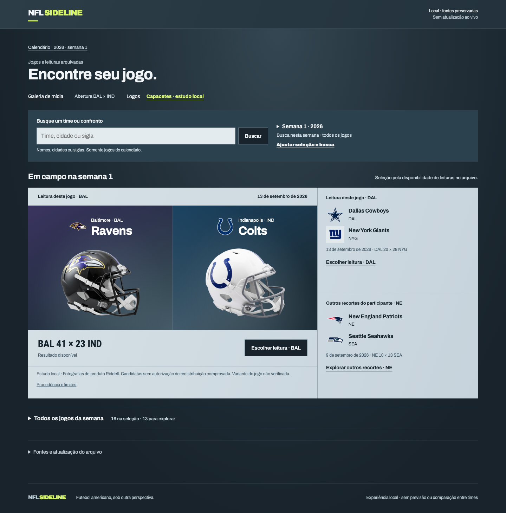

# Entrega local: orientação inicial e acervo visual

Implementada na base exata 13597af9dafb910e345ef0bcc519f3d1352ca941. Sem merge, push, deploy ou publicação. [Operação e links](README.md).

## Comportamento entregue

Sem escolha explícita válida, o seletor usa as relações dos documentos validados: individual → inclusivo → lacuna → outro recorte → outro arquivo. Empates entre participantes usam ordem literal de sigla, independente de visitante/mandante e de mérito esportivo. Sem documento validado, não anuncia leitura confirmada; eventual sigla selecionada é somente fallback visual. Escolha explícita válida prevalece, mesmo sem leitura. Recorte nominal continua sendo resolvido por entry+observation e não é substituído pelas preferências do seletor.

Central/busca identificam o único participante disponível junto à oferta, por exemplo “Leitura deste jogo · BAL”. NO × BAL abre inicialmente BAL, mas não abre sua observação. Usuário ainda escolhe a ação. Inclusivos, lacunas e arquivos separados conservam seus destinos/períodos; a matriz de relações não foi editada. Contexto week/q/scope/filter/page/explore acompanha abertura, leitura, retorno e recarga.

Galeria local com quatro capacetes e quatro retratos, arquivos locais e procedência consultável ao lado de cada candidato. ZERO dos oito foi declarado qualificado para publicação. Família Speed padrão, orientações originais e tamanhos reais preservados. Identificadores e vínculo roster/2026 dos retratos estão no inventário; nenhuma afirmação de participação ou desempenho. Retratos ficam na galeria.

A abertura principal BAL × IND ganha uma opção local explícita media=helmets; versão com logos segue padrão. Logos, nomes, resultado do calendário e acesso à leitura de BAL ficam claros em planos distintos. A opção é preservada ao navegar/voltar/recarregar e só aplica a composição ao jogo-alvo. Crédito/estado de candidato ficam visíveis e conduzem aos limites. Não houve reformulação geral da central.

## Duas rodadas reais de revisão

1. [Primeira composição desktop](evidence/round1-helmets.png), [logos](evidence/round1-logos.png) e [galeria](evidence/round1-gallery.png): controle local em fieldset destacado chamava atenção demais; nomes estavam pequenos sobre os objetos. Refinamentos: controle discreto em linha, nomes com mais presença, luz radial tênue para a silhueta preta. CTA permanece explícita no primeiro plano, sem alvos invisíveis no objeto.
2. [Mobile 390](evidence/round2-390.png) e [320/texto200 antes do ajuste](evidence/round2-320-text200.png): nomes fragmentavam excessivamente em duas colunas. Refinamento: colunas dimensionadas em rem e empilhamento conforme o espaço disponível, também nos apoios. [320/texto200 final](evidence/helmets-320-text200.png). A inspeção final do confronto revelou o placar absoluto junto ao logo BAL; colocamos o placar em linha própria. O teste mede ausência de interseção com logos/nomes nas oito condições de confronto. [Fluxo final](evidence/flow-no-bal.png).

A galeria foi percorrida de fato: cada retrato lazy foi levado à viewport e decodificado antes da captura final. Uma captura full-page sem rolar não seria prova de carregamento dos retratos fora da viewport. Falha real de URL de capacete/retrato foi induzida, seguida de troca/recarga e decodificação bem-sucedida. No retrato testado o frame permaneceu 287×206,796875 CSS px antes/depois da falha. Associação insuficiente não emite a foto, conserva identidade do time e proporção.

Não usamos apenas altura como critério: foram revistos hierarquia da ação, presença dos nomes/objetos, silhueta, orientação, reflow, carregamento e contexto editorial.

## Comparação nas mesmas condições

Calendário 2026/semana1/filter=all; raiz 16 px, DPR1, fontes prontas e topo da página. Servidor anterior 18094 preservado; seu commit posterior 1b2fd1a tem somente ajuste no confronto e documentos, a abertura central mantém a composição anterior. Não é anunciado como checkout exato da base solicitada. A versão com logos desta entrega também está disponível para comparação direta por URL.

| Condição | Abertura anterior | Logos nesta entrega | Estudo com capacetes |
|---|---|---|---|
| 1440 px | [antes](evidence/before-1440.png) | [logos](evidence/logos-1440-text100.png) | [capacetes](evidence/helmets-1440-text100.png) |
| 390 px | [antes](evidence/before-390.png) | disponível pela URL sem media | [capacetes](evidence/helmets-390-text100.png) |

## Verificação executada nesta sessão

- 235 testes frontend/23 arquivos passaram, incluindo 12 regressões novas. Cinco expected-failure legados preservados byte a byte, sem remoção/conversão. [Log](checks/tests.log).
- Lint e builds journey/real/experience/público passaram; journey repetido após refinamentos. [Logs](checks/). Revisão React: estado de erro isolado por chave de time/tipo/fonte, HTML nativo para controles, proporção reservada e side effects de rede apenas na carga existente. Nenhuma biblioteca adicional.
- [48 layouts](evidence/browser.json): seis telas × 1440/900/390/320 × texto100/200. Sem overflow horizontal. Texto ampliado pela fonte raiz, não alegação de zoom nativo ou dispositivo físico.
- Busca real BAL com origem semana3, NO × BAL, BAL inicialmente, NO explícito após recarga, documento nominal BAL mantido com preferência NO, bloqueio nominal incompatível, inclusivo e lacuna sem promoção, retorno/página2, arquivo HTTP indisponível, opção media preservada, teclado/Enter/foco e reduced motion. [Registro](evidence/browser.json).
- Oito imagens do acervo decodificadas no navegador com dimensões corretas, todas locais; falha/troca/recuperação de mídia e logos. 32 logos decodificados, SHA-256 anteriores intactos. Capturas técnicas, sem alegar reconhecimento facial ou aceite humano.
- [Prova HTTP repetida](evidence/http.json): reader completo e backup, 48 projeções reconciliadas, 48 respostas HTTP exatas, 16 recusas, sessão e limites de origem. Fontes/backup não alterados. Completude/cobertura/temporal/modelo EPA continuam UNKNOWN. Não se reutilizou apenas uma prova antiga.
- [Gate de isolamento](checks/isolation.json): allowlist, snapshots, cinco testes legados, 32 logos, fontes preservadas por diff e arquivos públicos JS/CSS idênticos aos hashes da base.

## Limites

[Oito alvos e direitos](ASSETS.md): todos tecnicamente validados, todos candidatos locais, permissão específica não verificada. Roster não prova participação; foto sem data não prova aparência histórica; capacete não prova variante do jogo. Fotografias originais grandes permanecem locais e lazy, sem tratá-las como payload público adequado. TheSportsDB e Wikimedia foram examinados como alternativas; licença de uma foto Titans/2021 não a transforma em retrato BAL/2026.

Nenhum novo cálculo, comparação qualificada, ranking, previsão ou tese pregame. Matriz, fontes das 48 observações, snapshots, fixtures, backend, ETL, banco e processo semanal não mudaram. Não há serviços de mídia, chamadas externas de imagem na navegação, publicação, aceite visual humano ou prova de melhora de compreensão. Revisão em dispositivo físico/tátil e avaliação humana continuam pendentes.

## Registro Git local

- `33ecbb561d24117fb82a28ce3dea49d6ab5b29ee`: orientação por disponibilidade, identificação do participante e regressões de contexto.
- `dcfcb14bdd10bd8884ccc5dddbdad7094ada591f`: catálogo/arquivos candidatos, galeria, opção de capacetes, fallback e refinamentos visuais.
- Commit posterior próprio: documentação, inventário, evidências e gates. O HEAD final é informado na entrega após gravá-lo, evitando autorreferência de hash dentro do próprio commit.

Branch local codex/broadcast-media-pilot-v4; nenhum merge/push/deploy. Servidor próprio PID64983 permanece em loopback. Worktree anterior limpa na verificação final; processos anteriores preservados.
