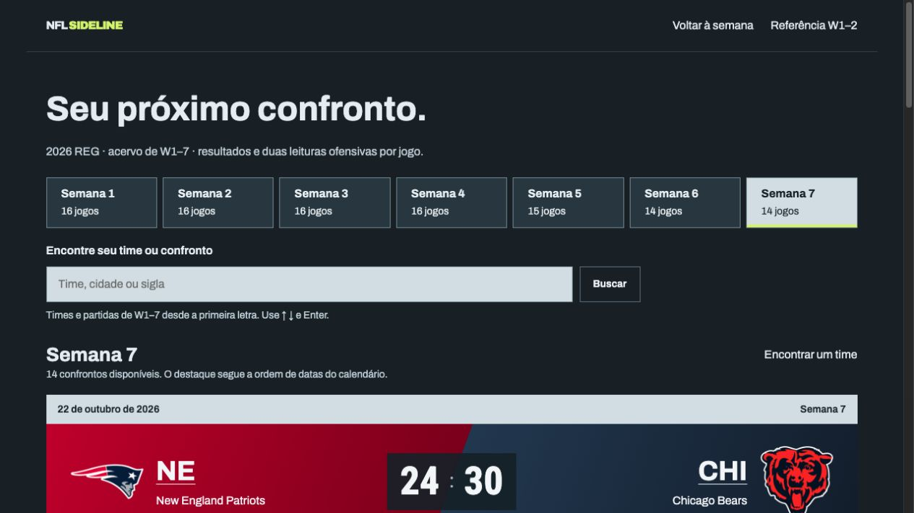

# NFL Sideline · acervo W1–7

[Abrir W7](http://127.0.0.1:18109/?season=2026&week=7) · [W5, com folgas](http://127.0.0.1:18109/?season=2026&week=5) · [DAL × PHI W7](http://127.0.0.1:18109/?view=matchup-season&game=2026_07_DAL_PHI) · [BUF, seis jogos](http://127.0.0.1:18109/?view=team-season&team=BUF&returnWeek=7).

107 jogos, 32 times, análises existentes ampliadas. [Relatório, fontes e limites](REPORT.md). [Plano anterior à implementação](PLAN.md).



## Conferência sugerida

1. Alterne W1/W5/W7 no hub. Confira 16/15/14 jogos e a indicação de folgas.
2. Abra DAL × PHI W7. Troque Geral/Passe/Corrida diretamente no bloco e use voltar/avançar do navegador.
3. Entre em BUF pelo nome/logo. Deve mostrar seis jogos, folga na W7 e agregado W1–7, sem componente inventado.
4. Abra [NE × CHI](http://127.0.0.1:18109/?view=matchup-season&game=2026_07_NE_CHI#mr-third). NE tem taxa; CHI apresenta insuficiência. Expanda a classificação: CHI sem posição, quatro times de folga fora do universo.
5. Na red zone, campanhas e EPA usam bases distintas e mantêm evidências expansíveis.
6. [MIN × TB W3](http://127.0.0.1:18109/?view=matchup-season&game=2026_03_MIN_TB&q=MIN&scope=season) → MIN → jogo W1 → Voltar à semana. Deve retornar à W3 com busca MIN.

## Inicialização e encerramento

Worktree: `/Users/pedrocollet/.codex/worktrees/broadcast-w1-7-v1/NFL Sideline`. Branch `codex/broadcast-w1-7-v1`.

```bash
cd '/Users/pedrocollet/.codex/worktrees/broadcast-w1-7-v1/NFL Sideline'
./docs/plans/broadcast-w1-7-v1/run-local.sh
```

O script usa somente fontes privadas configuradas, sem banco/Gemini/download no startup, em `127.0.0.1:18109`, strictPort e sem proxy. Dependências já instaladas são reutilizadas por symlink ignorado. Não houve instalação de biblioteca ou framework. Servidor desta execução: PID 71559; confira antes de encerrar:

```bash
lsof -nP -a -p 71559 -iTCP:18109 -sTCP:LISTEN && kill -TERM 71559
```

Se iniciado no seu terminal, use Ctrl+C naquele terminal. Não use comandos por nome de processo que possam encerrar as outras versões.

## Pacote e recuperação

Fonte durável: `/Users/pedrocollet/Downloads/NFL Sideline/editorial/local-artifacts/broadcast-w1-7-v1/20261027-v1/bundle`.

Cópia física: `/Users/pedrocollet/Downloads/NFL Sideline/editorial/local-artifacts/broadcast-w1-7-v1/20261027-v1/verified-copy`.

Reprodução: `/Users/pedrocollet/Downloads/NFL Sideline/editorial/local-artifacts/broadcast-w1-7-v1/20261027-v1/reproduced-from-copy`.

Pin: `sha256:77af196874e984bfa85a270da8733073f97836e959b6dd3d2cd2ec8a98bc7a0c`. O índice pinado inclui hashes de todos os documentos, dos Parquets e dos receipts. `COMPLETED.json` inventaria todos os bytes. Configuração explícita em [source-config.json](source-config.json). Se for necessário recuperar, valide uma cópia e altere explicitamente o caminho na configuração, mantendo o pin; não existe fallback automático.

```bash
export PYTHONPATH="$PWD/etl-pipeline/src"
export PYTHONDONTWRITEBYTECODE=1
TASK_PYTHON='/Users/pedrocollet/Downloads/NFL Sideline/etl-pipeline/.venv/bin/python'
"$TASK_PYTHON" -B -m nfl_sideline_etl.season_analysis verify --source '/Users/pedrocollet/Downloads/NFL Sideline/editorial/local-artifacts/broadcast-w1-7-v1/20261027-v1/bundle' --pin 'sha256:77af196874e984bfa85a270da8733073f97836e959b6dd3d2cd2ec8a98bc7a0c'
"$TASK_PYTHON" -B -m nfl_sideline_etl.season_analysis reproduce --source '/Users/pedrocollet/Downloads/NFL Sideline/editorial/local-artifacts/broadcast-w1-7-v1/20261027-v1/verified-copy' --output /tmp/nfl-w17-nova-reproducao
# O destino precisa ser novo e separado da origem.
"$TASK_PYTHON" -B docs/plans/broadcast-w1-7-v1/reconcile.py
python3 docs/plans/broadcast-w1-7-v1/check-http.py
python3 docs/plans/broadcast-w1-7-v1/verify-isolation.py
```

## Testes

```bash
export NFL_SEASON_QA_BUNDLE='/Users/pedrocollet/Downloads/NFL Sideline/editorial/local-artifacts/broadcast-w1-7-v1/20261027-v1/bundle'
"$TASK_PYTHON" -B -m pytest etl-pipeline/tests/test_season_analysis.py -q
npm --prefix web-ui test -- broadcast-journey/season/season.test.tsx
npm --prefix web-ui run lint
web-ui/node_modules/.bin/tsc -p web-ui/tsconfig.season.json
web-ui/node_modules/.bin/tsc -p web-ui/tsconfig.node.json
web-ui/node_modules/.bin/vite build --config web-ui/vite.season.config.ts
npm --prefix web-ui run build
```

Os testes completos de regressão também configuraram as fixtures W1–2 antigas; os logs indicam quais verificações foram reexecutadas. [Python completo](checks/python-all.log), [privados anteriores](checks/python-private-previous.log), [25 finais](checks/python-season-final.log), [frontend final](checks/frontend-final.log), [HTTP](checks/http.json).

Produto público, contratos antigos e referência [18108](http://127.0.0.1:18108/?season=2026&week=1) preservados. Sem merge, push ou deploy. A avaliação visual humana desta ampliação permanece aberta.
