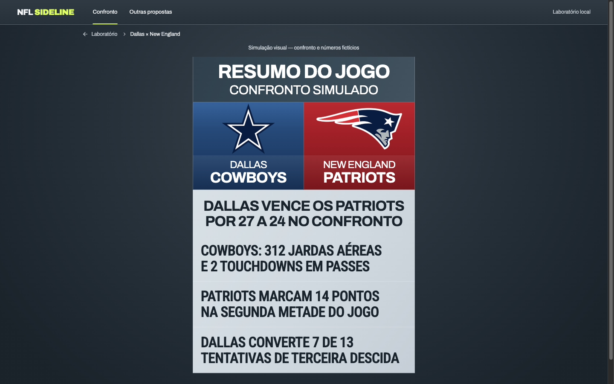

# Piloto de identidade visual — Dallas × New England

[Piloto integrado no NFL Sideline](http://127.0.0.1:18083/)



Candidata local, inspecionada em 21/10/2026. Aceite visual humano e aceite operacional do orquestrador **pendentes**. A direção foi a referência 03, não a implementação rejeitada. A imagem original não integra a tela do produto.

## Identidade e reprodução

- Base conferida limpa antes de editar: `92cda64b3680f8b621bc0e77361db2adfcd67257`.
- Branch: `codex/broadcast-matchup-pilot`.
- Worktree isolada: `/Users/pedrocollet/.codex/worktrees/broadcast-matchup-pilot/NFL Sideline`.
- HEAD de código inspecionado: `1970451e0f308501da3e5983c38f9321255dc7d7` (`fix(lab): complete touch targets in pilot navigation`); implementação em `c90b1821cafc119269d442159ab1863ca8cc0060`. O commit documental que contém este relatório é o HEAD de entrega; consultar `git rev-parse HEAD` nesta worktree. O SHA final também é informado na resposta de entrega.
- Origem: worktree `visual-broadcast-refinement-e5c43`, conforme o pedido. Nenhum arquivo da branch rejeitada `codex/broadcast-reference-replica` foi lido ou incorporado.
- Entrada principal: `/`. Versões anteriores e leitura real: `/?screen=lab`. Prova no próprio laboratório: `/?screen=type-proof`.

```bash
cd '/Users/pedrocollet/.codex/worktrees/broadcast-matchup-pilot/NFL Sideline'
# Dependências: npm --prefix web-ui ci (se ainda não houver node_modules).
# O piloto visual funciona sem backend, configuração de arquivo ou chave.
npm --prefix web-ui run editorial:dev
```

Para acessar também o arquivo real preservado, iniciar com as variáveis explícitas abaixo. Este é o servidor mantido na porta 18083 ao concluir a entrega. Apenas o processo desta entrega foi reiniciado; os servidores preexistentes 18084/18085 foram preservados.

```bash
NFL_OBSERVATION_CONFIG='/Users/pedrocollet/Downloads/NFL Sideline/docs/plans/metrics/e5c-3r/lab-config.json' \
NFL_OBSERVATION_PYTHON='/Users/pedrocollet/Downloads/NFL Sideline/etl-pipeline/.venv/bin/python' \
npm --prefix web-ui run editorial:dev
```

O `node_modules` ignorado desta worktree usa um symlink para o checkout original, como na base anterior. Nenhuma dependência foi instalada ou alterada. A prova das fontes usa arquivos locais próprios e existentes.

## Composição implementada

`MatchupPilot.tsx` integra marca, navegação, retorno ao laboratório, aviso de simulação e placa. `RecapBoard.tsx` separa `BroadcastHeader`, `TeamIdentity`, `EditorialBody` e `FactRow`. A entrada pública e o transporte não importam esses componentes. `App.tsx` monta a leitura anterior apenas na rota explícita do laboratório; o piloto é a proposta principal mesmo quando há uma preferência anterior de observações.

A placa tem duas colunas de identidade iguais, logos protagonistas, nome regular e apelido forte. O corpo é uma superfície contínua, sem cartões ou gráficos. A manchete fica centrada; os fatos têm margem e âncora à esquerda. Os nomes e fatos são texto web, com semântica de títulos/lista e reflow.

A referência foi aberta integralmente e preservada em [reference-original.png](evidence/reference-original.png), com SHA-256 em [preservation.json](preservation.json). Para comparar, foi enquadrada só a placa: aproximadamente x=24, y=16, largura=736, altura=1044 px. A ferramenta mantém a cópia integral, recortando apenas sua exibição por CSS. Normalização comparável: 520 px de largura, cerca de 738 px de altura na referência; implementação final **520 × 740,73 px**. A medição é aproximada nas bordas fotografadas da referência, não uma alegação de equivalência pixel a pixel.

| Região | Aplicação e resultado observado |
| --- | --- |
| Cabeçalho | Ardósia azulada com gradação curta, título branco 700 e contexto 400. Cerca de 107 px, próximo aos 107 px normalizados da referência. |
| Logos | Região de ~125 px por lado. Dallas ganhou ocupação óptica e depois respiro; NE usa largura maior pela forma horizontal do ativo. Proporções e cores originais intactas. |
| Nomes | Faixa de ~80 px, cidade regular e apelido forte, sem condensação artificial. Divisão logo/nome reconhecível, com luz local. |
| Manchete | Duas linhas no desktop, ~108 px de região, com texto e números derivados da fixture. Centralizada, distinta do alinhamento dos fatos. |
| Fatos | Três linhas editoriais de ~107 px cada, duas linhas tipográficas por fato no desktop; condensada própria em peso 600. |
| Divisórias | 1 px, branco de baixa opacidade, somente entre fatos. Sem contornos luminosos ou sombras por linha. |
| Corpo cinza | Variação fria #D6E1E6 → #CED9E0 → #C3CED7, tinta #15232C. Continuidade do início da manchete ao último fato. |
| Integração | Mesmo cenário ardósia e tipografia na navegação, breadcrumb e prova; lima limitado à assinatura, seleção e foco. Aviso imediatamente acima da placa. |

Dallas usa azul/navy #2463A0 → #164A7C → #0B3057, com prata/branco do logo preservados. NE usa vermelho #C90827 → #B00020 → #870016, com navy/prata do ativo. As faixas dos nomes recebem variação de luz local sobre a cor do time. São escolhas de material para o piloto, não certificação de paleta oficial vigente. Não há mistura cromática entre os dois times.

## Fixture e ativos

[fixture.ts](../../../../web-ui/local-editorial/matchup/fixture.ts) é a única origem dos números: Dallas 27, NE 24; Dallas 312 jardas aéreas, dois TDs em passes e 7/13 terceiras descidas; NE 14 pontos no segundo tempo. `recapCopy` deriva manchete e fatos desses campos. Não existe temporada, data, ID de calendário, DTO, bundle ou associação com métricas reais.

O aviso **“Simulação visual — confronto e números fictícios”** fica visível junto ao confronto. “Confronto simulado” também contextualiza a placa. A fixture não é uma análise aprovada nem uma afirmação de que este jogo ocorreu. Não houve LLM, banco, nova métrica ou alteração de contrato.

Logos reutilizados: `broadcast/assets/dal.png` e `ne.png`, PNGs locais 500×500 já existentes, originalmente `https://a.espncdn.com/i/teamlogos/nfl/500/dal.png` e `ne.png`. Procedência anterior em [ASSETS.md da 4.2](../e5c-4.2/ASSETS.md), hashes conferidos em preservation.json. Nenhum ativo foi redesenhado, recolorido ou espelhado. As marcas pertencem aos titulares; a procedência anterior não registra licença aberta de redistribuição. Esta entrega permanece local.

## Tipografia comprovada

A [prova integrada](http://127.0.0.1:18083/?screen=type-proof) compara três pares no **mesmo componente**, texto, largura, tamanho e pesos 700/400: Archivo + Roboto Condensed; IBM Plex Sans + Condensed; Barlow + Condensed. A [captura da prova](evidence/type-proof-final.png) inclui acentos, vírgula, percentual, sinais, números e pontuação. Os pesos dos fatos são 700 para as três opções na prova controlada. Na peça final, Roboto Condensed 600 aproxima a densidade das hastes da referência.

Escolha: Archivo apresenta largura e formas de grotesca mais próximas do cabeçalho e da manchete; Plex tem caráter técnico e Barlow fica mais estreita no mesmo espaço. Roboto Condensed mantém os fatos densos sem aplicar condensação ao nome e à manchete. Esta é avaliação visual do agente, sem identificação da fonte ESPN.

| Papel final | Arquivo e configuração | Prova no navegador |
| --- | --- | --- |
| Título, apelido e manchete | Archivo-Variable.ttf, peso 700, largura nativa 100% | `ArchivoRoman-Bold`, custom font |
| Contexto, cidade e controles | Mesmo arquivo, peso 400, largura 100% | `ArchivoRoman-Regular`, custom font |
| Fatos e números editoriais | RobotoCondensed-Variable.ttf, peso 600 | `RobotoCondensed-SemiBold`, custom font |

Arquivo Archivo versão **2.001**, Roboto Condensed **3.008; 2023**. Fontes adicionais obtidas do repositório oficial [google/fonts](https://github.com/google/fonts/tree/47d54ca1ebb14fd864695f1d39dc734f39017c33), revisão fixa `47d54ca1ebb14fd864695f1d39dc734f39017c33`. URLs imutáveis, hashes e bytes: [font-sources.json](font-sources.json); nomes internos/eixos/versões: [font-metadata.json](font-metadata.json). Licenças SIL OFL 1.1 junto aos arquivos. Arquivo variável preserva eixo de largura em 100%, sem `scaleX`, instalação global ou serviço externo em runtime. O nome legado interno “Archivo SemiBold” é metadado do arquivo variável; o CDP confirmou instâncias Regular e Bold nos pesos usados.

Plex e Barlow usam os WOFF2 e licenças da base 4.2. [browser.json](evidence/browser.json) registra `CSS.getPlatformFontsForNode` para os papéis finais e para as três candidatas, todos com fontes customizadas. A inspeção detectou que o subtítulo da prova herdava Archivo em todas as opções; a herança foi corrigida e a contraprova agora mostra Plex/Barlow Regular nos respectivos subtítulos e amostras de glifos.

## Rodadas reais no navegador

Inspeção pelo navegador integrado do Codex, com CDP para dimensões, capturas e fontes. Não houve participantes humanos. Cada rodada confrontou referência e implementação em escala comparável, seguida de correção e nova captura. As imagens da ferramenta de comparação são evidência; a implementação é a tela React integrada.

| Rodada | Diferenças concretas e correções | Antes / depois |
| --- | --- | --- |
| 1 · estrutura | Placa inicial 520×817,56 px; manchete com três linhas e último fato com linha excedente. Ajustados textos, peso 700, contexto mais curto e estrela de Dallas maior. Resultado intermediário 520×761,38. | [antes](evidence/round1-before-comparison.png), [depois](evidence/round1-after-comparison.png); tela [antes](evidence/round1-before-desktop.png), [depois](evidence/round1-after-desktop.png) |
| 2 · tipos e materiais | Fatos estavam menores e a placa longa. Aumentado corpo para 6,6cqw, reduzidas alturas/paddings e saturados os materiais azul/vermelho. Uma tentativa de alongar o texto criou quatro linhas; revertida antes do resultado final. Mantidos dois planos de identidade e corpo frio contínuo. Resultado 520×740,70. | [antes](evidence/round2-before-comparison.png), [depois](evidence/round2-after-comparison.png); [tela final da rodada](evidence/round2-after-desktop.png) |
| 3 · acabamento/mobile | Estrela excessivamente próxima dos limites; escala final 52% da coluna. No mobile, junção livre de frases criava quebras ruins; restauradas linhas editoriais com reflow permitido, reduzido vazio após a manchete. Texto 200% revelou sobreposição dos nomes; acrescentada quebra interna e regiões flexíveis. Corrigida a herança tipográfica da prova após inspeção CDP. | [antes](evidence/round3-before-comparison.png), [depois](evidence/round3-after-comparison.png); mobile [antes](evidence/round3-before-mobile.png), [depois](evidence/mobile-390.png), [320 px](evidence/mobile-320.png) |

Ferramenta separada e reproduzível de comparação (não necessária para abrir o piloto):

```bash
python3 -m http.server 18086 --bind 127.0.0.1 \
  --directory docs/plans/metrics/broadcast-matchup-pilot/evidence
# http://127.0.0.1:18086/compare.html?round=round3-after
```

O HTML apenas enquadra a referência e capturas do painel produzidas pelo navegador. O servidor auxiliar de comparação foi encerrado ao concluir; a porta 18083 mantém a implementação.

## Desktop, mobile e acessibilidade

- [1440×900](evidence/desktop-1440.png): placa inteira na primeira tela; [página completa](evidence/desktop-full.png) mostra os links de prova abaixo dela.
- [390×844](evidence/mobile-390.png): duas identidades lado a lado, texto editorial legível, conteúdo da placa integral e aviso próximo. [320×844](evidence/mobile-320.png): dois times preservados, fatos com mínimo 20 px e quebra adicional no último fato/manchete. Nenhum overflow horizontal medido.
- [Texto 200% em 320 px](evidence/text-200-mobile.png): tipografia cresce via rem, nomes podem quebrar dentro da coluna, fatos ganham altura. Contraprova com retângulos de texto: nenhum texto saindo da placa. É ampliação de texto via tamanho raiz, não uma certificação de todos os comportamentos de zoom de cada navegador. A página não desativa zoom.
- [Foco por teclado](evidence/keyboard-focus-mobile.png): link Confronto com contorno sólido #D7FF3F; alvos de navegação com pelo menos 44 px. Link de salto para main focável. Ordem de navegação acompanha a tela.
- Reduced motion confirmado, zero animações. Logos carregados integralmente, dimensões naturais 500×500. Nenhum erro de console na inspeção final.
- Navegação por Enter abriu o laboratório real, trocou 4.3 → 4.2 e retornou ao piloto. O mesmo observationId foi preservado. [Leitura real em mobile](evidence/laboratory-return-mobile.png); metadados exatos em browser.json. Nenhum parâmetro ou alteração de pin foi introduzido.
- Captura de rede durante reload do piloto: **zero** requisições a `__observations`, `__editorial`, `/api/v1` ou `/data`. A configuração real foi usada apenas ao abrir explicitamente a leitura anterior.

## Verificação técnica

- **151 testes frontend**, 13 arquivos, aprovados. Os cinco `it.fails` legados permanecem inalterados. [tests.txt](tests.txt).
- Lint sem avisos/erros e build TypeScript/Vite aprovados. [lint.txt](lint.txt), [build.txt](build.txt).
- Contraprova existente `verify_production.py` aprovada: build público idêntico sob flags Vite adversas. [production.txt](production.txt).
- JS público SHA-256 `73f18e255b7226e7357acc9e9f81593d1610c6183a27090481a54d8f4f959ad5`; CSS `2b4ae179cefd815c1838e0a7498188a33d39ebad9856ca5e71d84a415344d41d`, iguais à base documentada. Nenhum módulo, logo ou fonte do piloto entrou em Production.
- [preservation.json](preservation.json): diff vazio contra a base nas árvores protegidas, incluindo src público, public/snapshots, transportes/adapter, observações, versões broadcast anteriores, contratos, Java, ETL e Supabase. Referência e ativos com hashes.
- Não foram criados testes que espelham HTML ou constantes. Os testes existentes cobrem os fluxos preservados; a integração nova foi conferida por navegação, rede, teclado, fontes e reflow no navegador.
- Revisão React: cálculos simples derivados no render; fixture importada separadamente; nenhum efeito/fetch novo; único estado interno é fallback de falha do logo; keys estáveis nos times/fatos; componentes exportados reutilizáveis; links reais e foco sem botões inertes.

```bash
npm --prefix web-ui test
npm --prefix web-ui run lint
npm --prefix web-ui run build
python3 docs/plans/metrics/e5c-3/verify_production.py
git diff --check
```

## Diferenças que permanecem

O título português ocupa mais largura e usa uma escala ligeiramente menor que “GAME RECAP” para manter seu papel sem deformação. Os logos NFL são multicoloridos e o Patriots é horizontal, enquanto as marcas universitárias da referência são altas e brancas; sua ocupação óptica não será idêntica. Dallas azul/navy substitui o laranja da referência por decisão de identidade, com prata concentrada no ativo. A referência fotografada tem suavidade e variação de vídeo; a implementação mantém texto web nítido.

Os fatos fictícios têm comprimentos diferentes, portanto as terminações de linha e a distribuição de tinta divergem. A 320 px o texto quebra mais do que na TV, preservando legibilidade e as duas identidades. A placa final fica cerca de 3 px mais alta na normalização desktop. A navegação do produto é uma extensão web da linguagem, sem equivalente direto na captura.

As diferenças acima são limites observados, não aceite visual. A revisão não certifica compreensão humana nem aprovação editorial/operacional. Sem merge, push, deploy, publicação, nova geração editorial ou alteração de dados reais.
