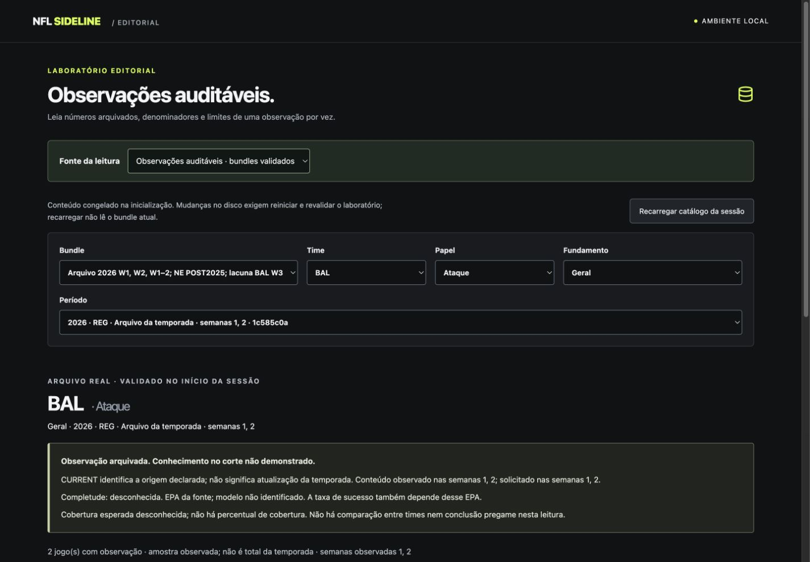
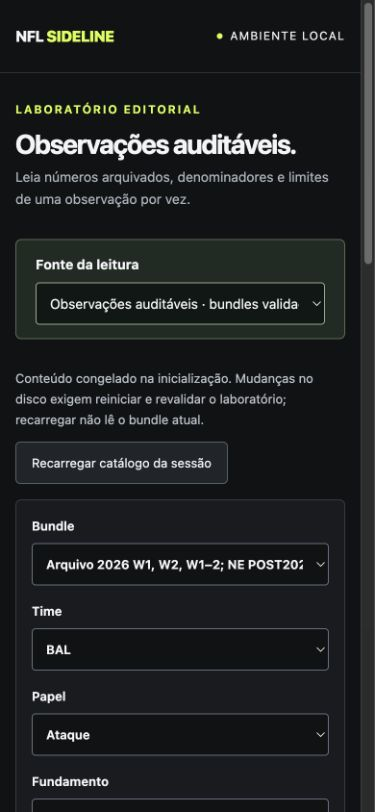
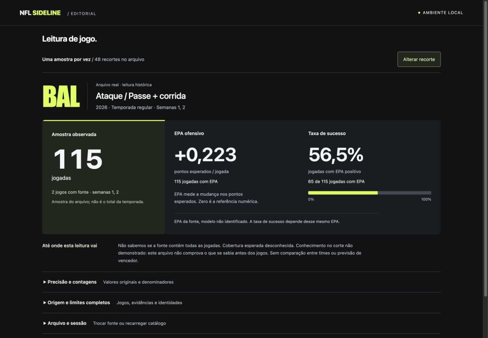
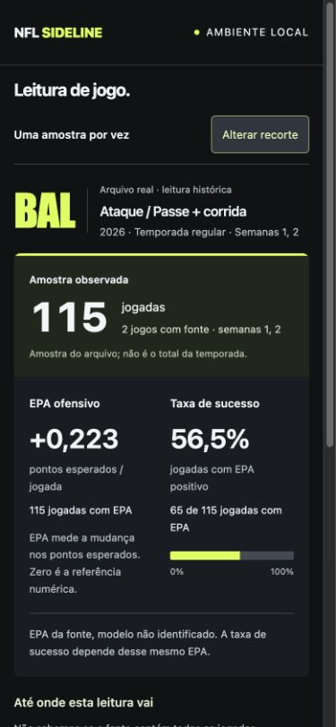

# E5c-4 — leitura visual do laboratório

A experiência abre com o assunto esportivo: time, lado da bola, fundamento, período, tamanho da amostra e números essenciais. A direção é uma ficha editorial esportiva, com fundo escuro, lima, identidade tipográfica forte e números tabulares. Seleção e inspeção são progressivas; hashes e garantias internas deixaram o caminho da leitura inicial.

## Antes e depois
Mesma amostra: BAL, ataque, passe + corrida, W1–2 de 2026. Capturas de viewport, sem recortes artificiais. Viewports solicitados à ferramenta: 1440×1000 e 390×844. O navegador exportou imagens de 1425×990 e 375×812, respectivamente; antes e depois têm as mesmas dimensões.

| Desktop · 1440 × 1000 | Mobile · 390 × 844 |
| --- | --- |
| Antes:  | Antes:  |
| Depois:  | Depois:  |

[DAL defesa W2](evidence/after-dal-desktop.jpg) · [NE POST2025](evidence/after-ne-mobile.jpg) · [BAL sem PBP em 320 px](evidence/after-gap-320.jpg) · [BAL em 320 px](evidence/after-320.jpg) · [1024 px](evidence/round3-1024.jpg) · [Texto a 200%](evidence/text-200-1024.jpg).

## Decisões
- Amostra tem presença própria; EPA e sucesso formam o segundo nível. Não foi criado um hero decorativo.
- Barras mostram a proporção dentro do próprio denominador. Frequência tem seção separada e texto explícito sobre distribuição. EPA é um número com sinal, unidade e referência ao zero, sem domínio inventado ou semáforo de qualidade.
- Defesa mantém os valores permitidos ao ataque adversário. Dados reais conservam limites de completude, cobertura e conhecimento no corte à vista.
- Frações e contagens completas ficam em detalhes nativos; contexto essencial não depende de tooltip. Aritmética de exibição e geometria usa BigInt, preservando valores abaixo do arredondamento.
- Mobile usa amostra horizontal e par compacto de métricas; “Alterar recorte” revela controles. O catálogo único oferece primeiro recorte determinístico somente na primeira visita sem preferência. Seleção removida exige nova escolha; não há fallback silencioso.
- Sem novas dependências, ativos externos ou fontes remotas. Reutilizados React, controles nativos e infraestrutura aceita. A sigla do time dá identidade sem exigir logos.

A escolha entre duas composições e critérios prévios está em [DESIGN.md](DESIGN.md). As três rodadas, problemas encontrados e correções estão em [ITERATIONS.md](ITERATIONS.md).

## Casos conferidos
| Caso | Leitura apresentada |
| --- | --- |
| BAL ataque geral W1–2/2026 | 115 jogadas; EPA +0,223; sucesso 65/115 = 56,5%. |
| DAL defesa/passe W2/2026 | 35 jogadas; EPA permitido +0,035; sucesso 17/35 = 48,6%; frequência 35/67 = 52,2%. |
| NE defesa/passe POST2025 | 160 jogadas; EPA permitido −0,324; sucesso 56/160 = 35,0%; frequência 160/260 = 61,5%. |
| BAL W3/2026 | Fonte ausente; nenhuma conversão de ausência em zero. |
| Sintéticos existentes | Zero conhecido, denominador zero, população completa vazia e EPA negativo próximo de zero; identificação sintética preservada. |

O arquivo de 2026 contém W1–2 históricos. UNKNOWN continua UNKNOWN. Não há ranking, comparação entre times, previsão, análise pregame, soma de janelas sobrepostas ou inferência de tendência.

## Iniciar com os dados reais
Na worktree:

```bash
cd '/Users/pedrocollet/.codex/worktrees/visual-reading-e5c4/NFL Sideline'
NFL_OBSERVATION_CONFIG='/Users/pedrocollet/Downloads/NFL Sideline/docs/plans/metrics/e5c-3r/lab-config.json' \
NFL_OBSERVATION_PYTHON='/Users/pedrocollet/Downloads/NFL Sideline/etl-pipeline/.venv/bin/python' \
npm --prefix web-ui run editorial:dev
```

Abra http://127.0.0.1:18083/. Não precisa iniciar Java, banco ou Gemini. O leitor valida e congela a sessão na inicialização. Nesta worktree, node_modules é um link para a instalação já existente no checkout original; em outra máquina, use `npm --prefix web-ui ci`.

Catálogo aceito e bundle original foram preservados. Pin principal: `sha256:2fae3be2b1ab7e5799287469ec29b9a98ff652a365ccafcb11b46c55d98ace8a`. Caminho: `/Users/pedrocollet/Downloads/NFL Sideline/editorial/local-artifacts/real-recovery/20261019T024130Z-50e03b27/bundle`.

## Validação
- `npm --prefix web-ui test`: 137 testes passaram em 10 arquivos; as cinco regressões legadas `it.fails` permanecem iguais. Não significa que essas regressões foram corrigidas.
- Teste focal de observações: 12 passaram após corrigir a tipagem do novo teste; lint e build final registrados nos logs deste diretório.
- `python3 docs/plans/metrics/e5c-3/verify_production.py`: compara o build normal com flags VITE hostis e procura módulos locais nos assets. Resultado confirmado: STATIC_PRODUCTION_IDENTICAL_WITH_VITE_FLAGS (production.txt).
- Fluxo real: catálogo → seleção → documento → troca → detalhes → recarga. Todos os 48 documentos HTTP foram comparados integralmente com o leitor aceito; 12 recusas de transporte conferidas. Todos os 48 recortes também foram percorridos na UI (BAL 24, DAL 18, NE 6).
- Identidade, sessão antiga, seleção removida, transporte interrompido e resposta atrasada: relatórios em evidence/*.json. A resposta antiga foi abortada pelo navegador; a tentativa de liberá-la retornou interceptor inválido. Não se afirma entrega tardia que não aconteceu.
- Teclado, foco visível, nomes acessíveis, alternativas textuais dos gráficos, reduced-motion e reflow de texto 200% inspecionados. Não foi realizada certificação formal de acessibilidade nem teste com leitor de tela humano.
- Estados sintéticos foram visualizados por interceptação temporária de requisições da aba. Um fixture existente adicional foi materializado somente em diretório sintético isolado; nenhum bundle real foi alterado. Interceptações removidas depois.
- ETL/Java históricos não foram repetidos: mudanças limitadas ao frontend local. Contratos, leitor, adapter, materializador, recuperação, snapshots públicos e análises publicadas não têm alterações nesta branch.

## Pendências e limites
Implementação visual concluída. Compreensão humana permanece **pendente**, sem participantes ou resultados inventados. [Protocolo pronto para execução](HUMAN-COMPREHENSION.md).

A seleção inclui apenas o catálogo aceito. Os limites dos dados não são resolvidos por apresentação; permanecem explícitos. Evidências selecionadas são versionadas aqui; os artefatos extensos de inspeção também estão em `editorial/local-artifacts/e5c-4-evidence` no checkout original (ignorado pelo Git).

## Git e escopo
Base exata: `98cca81929f740cd026737a3acb2d8d625fcecae`. Branch isolada: `codex/visual-reading-e5c4`. Checkout original e seu trabalho não rastreado foram preservados. Implementação: `41c990f3fc8569a0494245309c5285b78025f4a9`. O commit seguinte reúne documentação e evidências; HEAD final informado na entrega. Servidores próprios encerrados ao finalizar. Sem merge, push, deploy ou publicação.
