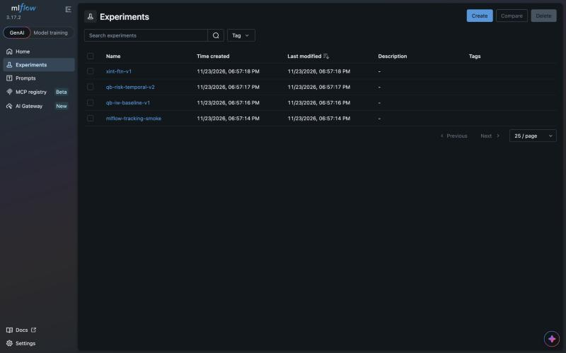
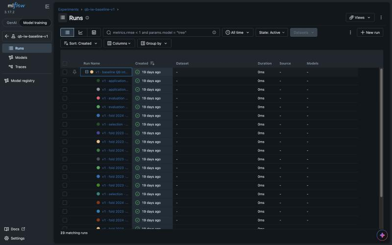
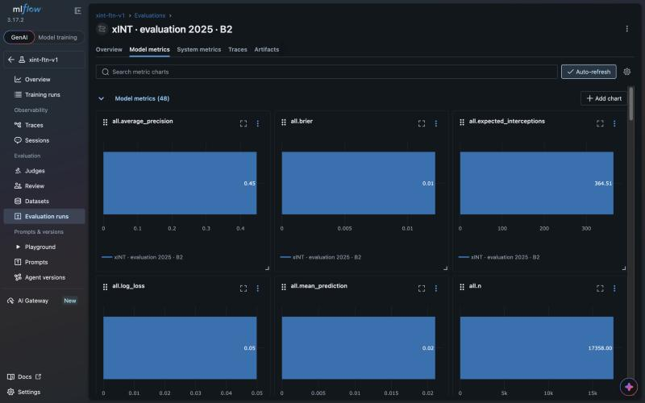
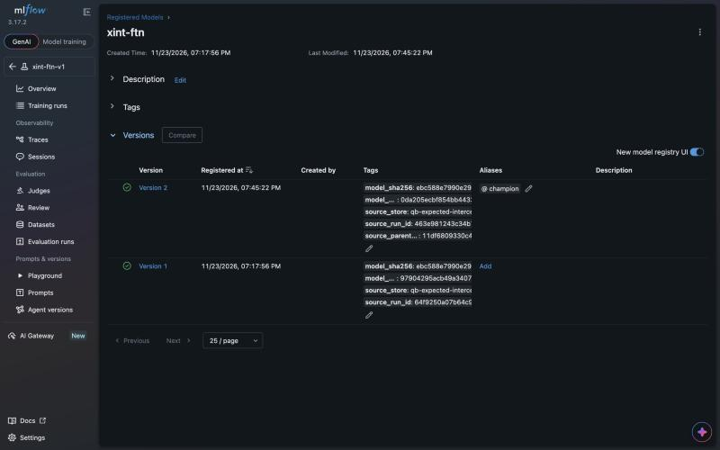

# MLflow local — rastreamento dos experimentos de ML

Índice local (SQLite + arquivos) dos experimentos do laboratório de ML do NFL Sideline, alimentado por um
importador que só lê os stores científicos. Não roda em produção, não usa servidor hospedado e não altera o
código congelado dos experimentos.

| Documento | Para quê |
|---|---|
| [PLAN.md](PLAN.md) | Plano vivo: objetivo, limites, fases e critérios de pronto |
| [GUARDRAILS.md](GUARDRAILS.md) | Regras obrigatórias: o que é somente leitura, onde se pode escrever |
| [DECISIONS.md](DECISIONS.md) | Decisões tomadas, quem decidiu, o que está aberto |
| [CHECKPOINTS.md](CHECKPOINTS.md) | Andamento por fase com evidências |
| [ORCHESTRATION.md](ORCHESTRATION.md) | Agentes Haiku/Sonnet e o ciclo de trabalho |
| [PHASE-0-REPORT.md](PHASE-0-REPORT.md) | Reconhecimento que fundamenta o plano |
| [ADR-011](../../adr/011-local-mlflow-tracking.md) | Decisão arquitetural |

Código: [`research/mlflow_tracking/`](../../../research/mlflow_tracking/) — comandos no README do módulo.

## Como fica na interface

Capturas de `mlflow ui --host 127.0.0.1` sobre o home real, em 23/11/2026.

| | |
|---|---|
|  |  |
| Os três experimentos importados e o smoke | v1: pai, 16 folds, seleção, avaliação e aplicação |
|  |  |
| xINT: métricas da avaliação 2025 do B2 (origem dos números do laboratório) | `xint-ftn` registrado, alias `champion` e tags de proveniência |

## Como adaptar o plano

1. Registre a mudança em DECISIONS.md (o quê, por quê, custo de reverter).
2. Ajuste a fase correspondente em PLAN.md e, se mudar uma regra, em GUARDRAILS.md.
3. Anote em CHECKPOINTS.md quando a mudança entrar em vigor.
