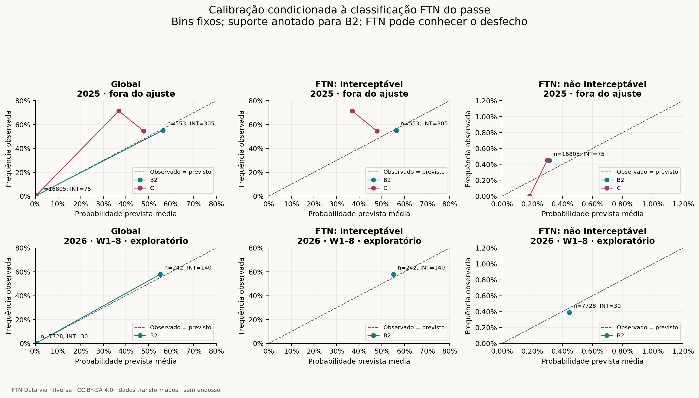
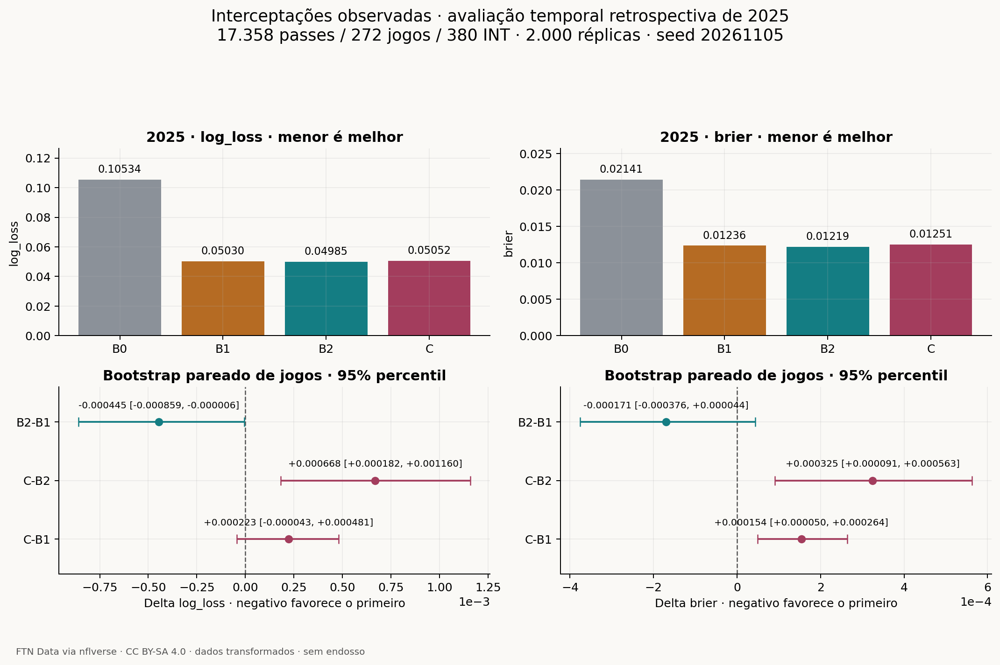
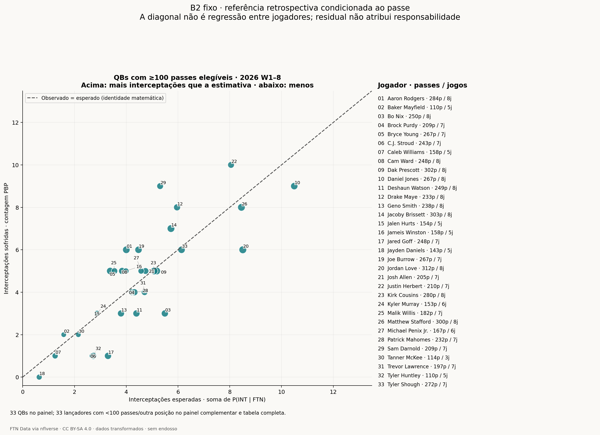
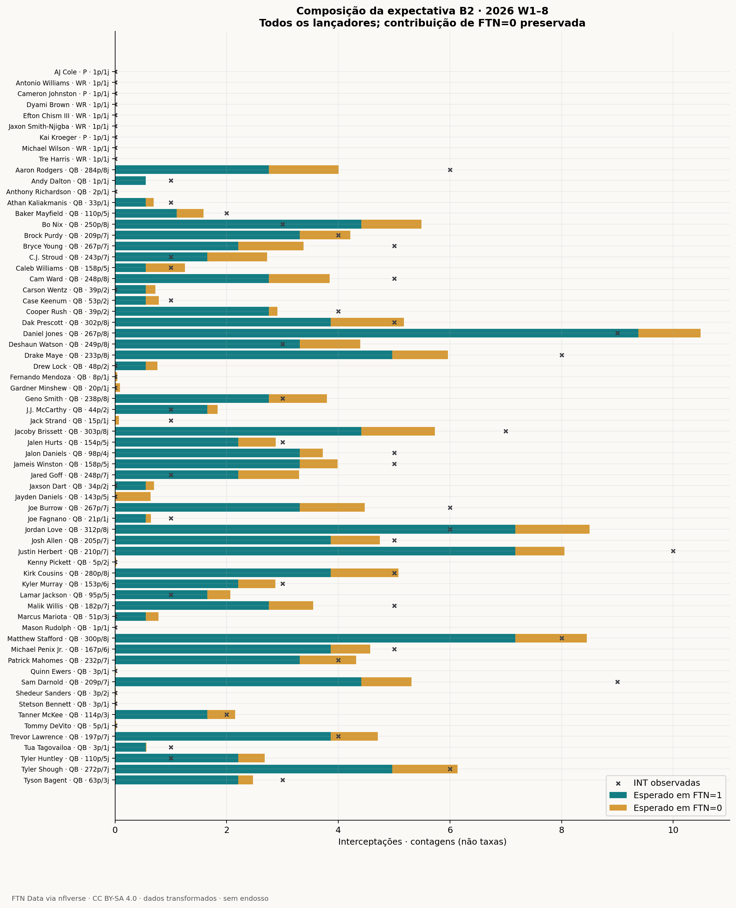

# Interceptações sofridas em relação ao risco dos passes — relatório v1

**Entrega concluída para revisão, 05/11/2026. Escolhido B2, referência recente condicionada à classificação FTN.** A regressão contextual não mostrou ganho defensável. A avaliação temporal de 2025 tem calibração global próxima, mas subestima INT nos passes FTN=0. A aplicação exploratória atual contém 121 jogos de 2026, W1–8, e não altera o laboratório aprovado.

Pergunta respondida: comparar interceptações observadas com uma referência estatística condicionada à classificação retrospectiva de cada passe. O alvo é INT efetiva do PBP. O M3 continua estimando **passes interceptáveis**, com seus parâmetros e previsões preservados. Não transformamos a expectativa do M3 em INT esperadas.

## Escolha antes da avaliação de 2025

O [contrato](RESEARCH-CONTRACT.md) foi versionado em `4c705fb`, antes das novas comparações. O desenvolvimento e os modelos para 2025 foram congelados em `decbc33`, antes da execução da avaliação. Os períodos já tinham contagens examinadas: isto é avaliação retrospectiva temporal fora do ajuste, sem alegar confirmação intocada.

Treinos/avaliações: 2022→2023; 2022–2023→2024; fit 2022–2024→2025. B2 usa apenas a temporada completa imediatamente anterior em cada fold. Jogos inteiros, sem sortear passes. Medianas/escalas/categorias são ajustadas somente no treino. C usa exclusivamente FTN, descida, distância, campo, quarto, relógio e diferença de placar pré-jogada, com as transformações fixas auditadas da pesquisa anterior.

Busca fechada de C: `.01, .1, 1`; escolhido **.1** pela log loss agrupada por passe em 2023/2024. A regra exigia ganho pareado de C sobre B1 **e** B2, Brier sem piora material e O/E entre .8 e 1.25 em cada grupo FTN. C falhou; B2 venceu a comparação predefinida entre referências. Nenhuma alteração estatística após abrir 2025.

| Procedimento | Log loss | Brier | Average precision | ROC-AUC | Prev. % | Média prevista % | Obs. | Esp. | O/E |
| --- | --- | --- | --- | --- | --- | --- | --- | --- | --- |
| B0 | 0.108388 | 0.022187 | 0.022282 | 0.490147 | 2.270 | 2.330 | 817 | 838.496 | 0.974 |
| B1 | 0.046927 | 0.012648 | 0.478432 | 0.924925 | 2.270 | 1.807 | 817 | 650.434 | 1.256 |
| B2 | 0.046574 | 0.012476 | 0.478432 | 0.924925 | 2.270 | 1.923 | 817 | 692.147 | 1.180 |
| C | 0.047022 | 0.012688 | 0.496617 | 0.926127 | 2.270 | 1.812 | 817 | 652.249 | 1.253 |

Em desenvolvimento, C−B2 teve delta de log loss +0.000448, IC descritivo de bootstrap [+0.000165, +0.000753]. O sinal favorece B2. C também falhou na calibração por grupo. [Seleção completa](evidence/selection.json), [métricas por grupo](evidence/development-metrics.csv), [freeze original](evidence/freeze.json).

## Avaliação fora do ajuste em 2025

17.358 passes elegíveis, 272 jogos, 380 INT. B0 é a taxa global de treino; B1 são duas taxas históricas por FTN; B2 são duas taxas de 2024; C é a regressão com configuração congelada. As taxas com suporte interior são empíricas. Bordas zero/todos usam Jeffreys; grupo ausente recorre ao global e é marcado. Esses fallbacks não foram necessários nos grupos reais.

| Procedimento | Log loss | Brier | Average precision | ROC-AUC | Prev. % | Média prevista % | Obs. | Esp. | O/E |
| --- | --- | --- | --- | --- | --- | --- | --- | --- | --- |
| B0 | 0.105335 | 0.021414 | 0.021892 | 0.500000 | 2.189 | 2.287 | 380 | 397.013 | 0.957 |
| B1 | 0.050298 | 0.012358 | 0.447002 | 0.894012 | 2.189 | 1.804 | 380 | 313.133 | 1.214 |
| B2 | 0.049853 | 0.012188 | 0.447002 | 0.894012 | 2.189 | 2.100 | 380 | 364.506 | 1.043 |
| C | 0.050521 | 0.012512 | 0.444712 | 0.901749 | 2.189 | 1.799 | 380 | 312.314 | 1.217 |

Average precision usa `sklearn.metrics.average_precision_score`, com incremento de recall; não é área trapezoidal. ROC-AUC é complementar. B1 e B2 têm as mesmas duas classes ordenadas e por isso empatam em AP/ROC-AUC, apesar de probabilidades/calibração diferentes. O grande ganho sobre B0 depende do rótulo FTN retrospectivo, que pode conhecer o desfecho; não prova previsão independente anterior ao evento.

### FTN=1: 553 passes, 305 INT

| Procedimento | Log loss | Brier | Average precision | ROC-AUC | Prev. % | Média prevista % | Obs. | Esp. | O/E |
| --- | --- | --- | --- | --- | --- | --- | --- | --- | --- |
| B0 | 2.093995 | 0.526831 | 0.551537 | 0.500000 | 55.154 | 2.287 | 305 | 12.648 | 24.114 |
| B1 | 0.698792 | 0.252821 | 0.551537 | 0.500000 | 55.154 | 47.753 | 305 | 264.076 | 1.155 |
| B2 | 0.688114 | 0.247486 | 0.551537 | 0.500000 | 55.154 | 56.345 | 305 | 311.589 | 0.979 |
| C | 0.708747 | 0.257675 | 0.534589 | 0.464014 | 55.154 | 47.428 | 305 | 262.278 | 1.163 |

### FTN=0: 16.805 passes, 75 INT

| Procedimento | Log loss | Brier | Average precision | ROC-AUC | Prev. % | Média prevista % | Obs. | Esp. | O/E |
| --- | --- | --- | --- | --- | --- | --- | --- | --- | --- |
| B0 | 0.039895 | 0.004782 | 0.004463 | 0.500000 | 0.446 | 2.287 | 75 | 384.365 | 0.195 |
| B1 | 0.028958 | 0.004445 | 0.004463 | 0.500000 | 0.446 | 0.292 | 75 | 49.058 | 1.529 |
| B2 | 0.028850 | 0.004445 | 0.004463 | 0.500000 | 0.446 | 0.315 | 75 | 52.917 | 1.417 |
| C | 0.028861 | 0.004445 | 0.005696 | 0.541949 | 0.446 | 0.298 | 75 | 50.036 | 1.499 |

Um total próximo esconde erro: B2 prevê 364,51 INT para 380 (O/E 1,043). Em FTN=1 prevê 311,59 para 305 (O/E 0,979). Em FTN=0 prevê **52,92 para 75** (O/E **1,417**; taxa prevista 0,3149%, observada 0,4463%). Portanto, não declaramos calibração uniforme ou prontidão para produção. Não recalibramos com os rótulos de 2025 para reavaliar o mesmo período.

### Diferenças pareadas de desempenho

Delta = primeiro procedimento menos segundo; negativo favorece o primeiro. Bootstrap de **jogos**, 2.000 réplicas, seed **20261105**, percentis 2,5/97,5, probabilidades pareadas fixas. Não é bootstrap de passes e não estima incerteza de habilidade por jogador.

| Comparação | Delta log loss | 95% | Delta Brier | 95% |
| --- | --- | --- | --- | --- |
| B1-B0 | -0.055037 | [-0.060788, -0.049584] | -0.009055 | [-0.010291, -0.007875] |
| B2-B1 | -0.000445 | [-0.000859, -0.000006] | -0.000171 | [-0.000376, +0.000044] |
| C-B0 | -0.054814 | [-0.060648, -0.049365] | -0.008901 | [-0.010142, -0.007708] |
| C-B1 | 0.000223 | [-0.000043, +0.000481] | 0.000154 | [+0.000050, +0.000264] |
| C-B2 | 0.000668 | [+0.000182, +0.001160] | 0.000325 | [+0.000091, +0.000563] |

C não supera B1 de forma convincente em log loss e é pior que B2 nos dois escores. A vantagem B2−B1 em log loss é pequena, com limite superior próximo de zero; o intervalo Brier cruza zero. Não usar esses intervalos como garantia de vantagem futura. Dependência entre jogos, incerteza dos parâmetros/charting e seleção de C não estão cobertas; sem correção de multiplicidade. [Comparações globais e por FTN](evidence/evaluation-bootstrap.json).

Bins fixos, com suporte/eventos completos em [CSV](figures/calibration_support.csv); bins vazios não são descartados da evidência. B2 tem duas probabilidades e produz somente dois pontos globais/um por grupo. Isso não é uma curva rica de risco dentro de cada grupo. Suporte n≥200 e eventos≥10 é marca descritiva, não certificação.

## Aplicação exploratória atual

Fontes públicas próprias adquiridas até `2026-11-05T17:34:52.773643+00:00`. Último jogo encerrado disponível: **2026-11-02**. **121 de 121 jogos encerrados utilizáveis**, zero lacunas entre eles; 151 jogos ainda sem placar final no calendário. A disponibilidade é do arquivo adquirido, não uma afirmação de que toda a temporada já aconteceu. Aplicação aceita jogos válidos de semanas parciais; não requer fechamento semanal. [Cobertura e todos os jogos](evidence/coverage.json).

**7.970 passes; 242 FTN=1; 170 INT; 66 lançadores, 57 QBs e nove de outras posições (P/WR), estes com um passe cada.** Todas as posições e volumes permanecem na base e na [tabela completa](evidence/players-2026.csv). Identificação GSIS por roster semanal/temporada/equipe; não por nome abreviado. Nenhuma posição desconhecida/conflitante nesta aquisição.

B2 final segue o procedimento escolhido e usa somente **2025**, a temporada completa anterior à aplicação: P(INT|FTN=1) = **0.551537070524** (305/553); P(INT|FTN=0) = **0.004462957453** (75/16.805). O refit do procedimento sobre o período disponível 2022–2025 tem essa janela recente por definição, não o pool de quatro temporadas. Modelo fixo `XINT-FTN-B2-v1-fit2025`, SHA-256 `ebc588e7990e29fb2e5ba8848558c1e5948222d7a6f002f07575a66d38186db8`.

| Procedimento | Log loss | Brier | Average precision | ROC-AUC | Prev. % | Média prevista % | Obs. | Esp. | O/E |
| --- | --- | --- | --- | --- | --- | --- | --- | --- | --- |
| B2 | 0.045407 | 0.011176 | 0.480186 | 0.905226 | 2.133 | 2.107 | 170 | 167.962 | 1.012 |

| Grupo 2026 | Passes | INT observadas | INT esperadas | O/E | Taxa observada % | Taxa prevista % |
| --- | --- | --- | --- | --- | --- | --- |
| all | 7970 | 170 | 167.9617 | 1.0121 | 2.1330 | 2.1074 |
| ftn_1 | 242 | 140 | 133.4720 | 1.0489 | 57.8512 | 55.1537 |
| ftn_0 | 7728 | 30 | 34.4897 | 0.8698 | 0.3882 | 0.4463 |

São 133,471971 esperadas em FTN=1 + 34,489735 em FTN=0 = **167,961706**. O/E global 1,012; FTN=1 1,049; FTN=0 0,870. A calibração atual parece próxima nos agregados, mas não elimina o erro retrospectivo de 2025 nem valida causalidade. Nenhum ajuste usa os rótulos de 2026.

X é INT esperadas; Y é INT sofridas. A linha é a identidade matemática observado=esperado, sem regressão ajustada aos jogadores. Acima significa mais INT que a estimativa; abaixo, menos. O painel principal tem 33 QBs com ≥100 passes; o [painel complementar](figures/small_support_all_positions_2026.png) mostra os outros 33 lançadores sem ocultar amostras pequenas. O corte serve apenas à legibilidade; todas as observações entram nos cálculos. Contagens neste gráfico; taxas separadas na tabela.

## Exemplos determinados pelo contrato

Critérios predefinidos: QB com ≥100 passes mais próximo da igualdade, maior residual positivo, menor residual negativo, menor suporte entre todos os lançadores, e QB com mais INT em FTN=0; empates por GSIS. São exemplos selecionados, não amostra aleatória nem validação de vídeo. Nenhum intervalo individual foi calculado.

| Caso | Jogador / GSIS | Passes / jogos | FTN=1 | INT | Esp. FTN=1 + FTN=0 | Esp. total | Obs−Esp | Por 100 |
| --- | --- | --- | --- | --- | --- | --- | --- | --- |
| near_identity | Kirk Cousins / 00-0029604 | 280 / 8 | 7 | 5 | 3.8608 + 1.2184 | 5.0791 | -0.0791 | -0.0283 |
| above_identity | Sam Darnold / 00-0034869 | 209 / 7 | 8 | 9 | 4.4123 + 0.8971 | 5.3094 | 3.6906 | 1.7659 |
| below_identity | Jordan Love / 00-0036264 | 312 / 8 | 13 | 6 | 7.1700 + 1.3344 | 8.5044 | -2.5044 | -0.8027 |
| low_support | Andy Dalton / 00-0027973 | 1 / 1 | 1 | 1 | 0.5515 + 0.0000 | 0.5515 | 0.4485 | 44.8463 |
| interception_in_ftn_0 | Aaron Rodgers / 00-0023459 | 284 / 8 | 5 | 6 | 2.7577 + 1.2452 | 4.0029 | 1.9971 | 0.7032 |

### Kirk Cousins — near_identity

LV; 2026-09-13 a 2026-11-01. Composição: 7 × 0.55153707 + 273 × 0.00446296 = 5.079147 INT esperadas. Observadas: 5, sendo 5 em FTN=1 e 0 em FTN=0. Cousins fica próximo da referência agregada. Essa proximidade não mede habilidade, responsabilidade ou precisão do modelo por passe.

[Todas as 280 jogadas que sustentam o esperado](evidence/cases/near_identity_all_plays.csv) · [FTN=1 e/ou INT, com descrições originais](evidence/cases/near_identity_events_and_ftn.csv). As linhas sem evento também contribuem para o esperado. Não reconstituímos culpa pelas descrições.

| Jogo | Play ID | FTN=1 | INT | P(INT) |
| --- | --- | --- | --- | --- |
| 2026_01_MIA_LV | 2051 | 1 | 1 | 0.55153707 |
| 2026_01_MIA_LV | 3279 | 1 | 1 | 0.55153707 |
| 2026_02_LV_LAC | 404 | 1 | 1 | 0.55153707 |
| 2026_04_KC_LV | 4580 | 1 | 1 | 0.55153707 |
| 2026_06_BUF_LV | 2457 | 1 | 1 | 0.55153707 |

### Sam Darnold — above_identity

SEA; 2026-09-09 a 2026-11-02. Composição: 8 × 0.55153707 + 201 × 0.00446296 = 5.309351 INT esperadas. Observadas: 9, sendo 7 em FTN=1 e 2 em FTN=0. Darnold está acima da estimativa. Seu total inclui duas INT no grupo FTN=0. O residual positivo não permite atribuir as causas ao jogador ou a uma suposta sorte.

[Todas as 209 jogadas que sustentam o esperado](evidence/cases/above_identity_all_plays.csv) · [FTN=1 e/ou INT, com descrições originais](evidence/cases/above_identity_events_and_ftn.csv). As linhas sem evento também contribuem para o esperado. Não reconstituímos culpa pelas descrições.

| Jogo | Play ID | FTN=1 | INT | P(INT) |
| --- | --- | --- | --- | --- |
| 2026_03_SEA_WAS | 2662 | 0 | 1 | 0.00446296 |
| 2026_03_SEA_WAS | 4262 | 1 | 1 | 0.55153707 |
| 2026_04_LAC_SEA | 89 | 1 | 1 | 0.55153707 |
| 2026_05_SF_SEA | 192 | 1 | 1 | 0.55153707 |
| 2026_05_SF_SEA | 2343 | 1 | 1 | 0.55153707 |
| 2026_06_SEA_DEN | 4092 | 1 | 1 | 0.55153707 |
| 2026_06_SEA_DEN | 4690 | 1 | 1 | 0.55153707 |
| 2026_07_KC_SEA | 2042 | 1 | 1 | 0.55153707 |
| 2026_08_CHI_SEA | 3679 | 0 | 1 | 0.00446296 |

### Jordan Love — below_identity

GB; 2026-09-13 a 2026-10-29. Composição: 13 × 0.55153707 + 299 × 0.00446296 = 8.504406 INT esperadas. Observadas: 6, sendo 6 em FTN=1 e 0 em FTN=0. Love está abaixo da estimativa, mas 13 classificações FTN=1 não significam que deveriam existir 13 INT. Não inferimos interceptações derrubadas pela diferença entre essas contagens.

[Todas as 312 jogadas que sustentam o esperado](evidence/cases/below_identity_all_plays.csv) · [FTN=1 e/ou INT, com descrições originais](evidence/cases/below_identity_events_and_ftn.csv). As linhas sem evento também contribuem para o esperado. Não reconstituímos culpa pelas descrições.

| Jogo | Play ID | FTN=1 | INT | P(INT) |
| --- | --- | --- | --- | --- |
| 2026_01_GB_MIN | 3877 | 1 | 1 | 0.55153707 |
| 2026_03_ATL_GB | 4372 | 1 | 1 | 0.55153707 |
| 2026_04_GB_TB | 3717 | 1 | 1 | 0.55153707 |
| 2026_06_DAL_GB | 922 | 1 | 1 | 0.55153707 |
| 2026_07_GB_DET | 3180 | 1 | 1 | 0.55153707 |
| 2026_08_CAR_GB | 3304 | 1 | 1 | 0.55153707 |

### Andy Dalton — low_support

PHI; 2026-09-28 a 2026-09-28. Composição: 1 × 0.55153707 + 0 × 0.00446296 = 0.551537 INT esperadas. Observadas: 1, sendo 1 em FTN=1 e 0 em FTN=0. Dalton tem somente uma tentativa e uma INT. A taxa por 100 é uma reexpressão aritmética extremamente instável; não é projeção de 100 passes nem evidência de habilidade. Não há intervalo degenerado de zero eventos ou ranking causal.

[Todas as 1 jogadas que sustentam o esperado](evidence/cases/low_support_all_plays.csv) · [FTN=1 e/ou INT, com descrições originais](evidence/cases/low_support_events_and_ftn.csv). As linhas sem evento também contribuem para o esperado. Não reconstituímos culpa pelas descrições.

| Jogo | Play ID | FTN=1 | INT | P(INT) |
| --- | --- | --- | --- | --- |
| 2026_03_PHI_CHI | 1513 | 1 | 1 | 0.55153707 |

### Aaron Rodgers — interception_in_ftn_0

PIT; 2026-09-13 a 2026-11-01. Composição: 5 × 0.55153707 + 279 × 0.00446296 = 4.002850 INT esperadas. Observadas: 6, sendo 1 em FTN=1 e 5 em FTN=0. Rodgers tem cinco das seis INT em FTN=0. A expectativa inclui os dois grupos; não inferimos responsabilidade do recebedor, defensor ou QB pela descrição/nome.

[Todas as 284 jogadas que sustentam o esperado](evidence/cases/interception_in_ftn_0_all_plays.csv) · [FTN=1 e/ou INT, com descrições originais](evidence/cases/interception_in_ftn_0_events_and_ftn.csv). As linhas sem evento também contribuem para o esperado. Não reconstituímos culpa pelas descrições.

| Jogo | Play ID | FTN=1 | INT | P(INT) |
| --- | --- | --- | --- | --- |
| 2026_02_PIT_NE | 3736 | 0 | 1 | 0.00446296 |
| 2026_03_CIN_PIT | 1841 | 0 | 1 | 0.00446296 |
| 2026_04_PIT_CLE | 981 | 1 | 1 | 0.55153707 |
| 2026_04_PIT_CLE | 4673 | 0 | 1 | 0.00446296 |
| 2026_06_PIT_TB | 352 | 0 | 1 | 0.00446296 |
| 2026_08_CLE_PIT | 2962 | 0 | 1 | 0.00446296 |

Daniel Jones também ilustra a distinção da pergunta original: 267 passes, 17 FTN=1, 9 INT, **10.4919 INT esperadas** (9.3761 + 1.1157). O M3 do laboratório trata de outra variável; 17 classificações FTN não implicam 17 INT nem uma contagem de INT derrubadas.

## Integridade, reprodução e limites

Auditoria independente dos quatro cruzamentos em SQL, por temporada/semana/jogo, sem redefinir população. Histórico pinado 2022–2025 confere exatamente nas chaves, GSIS, FTN, INT e contexto autorizado. Novas fontes 2026 têm hashes diferentes das fontes do laboratório, mas o overlap elegível de 7.970 passes não mudou nos campos auditados. Sem duplicatas, alvo/FTN/GSIS ausentes no universo incluído. [Auditoria completa](DATA-AUDIT.md).

**FTN pode conhecer o desfecho. Não há evidência de anotação cega ao resultado.** Esta limitação acompanha contrato, model card e pacote de consumo. O desempenho usando FTN não demonstra previsão independente anterior à INT. Residual não mede automaticamente sorte, culpa, decisão ou qualidade do QB. Ausência de tracking/film/alternativas e de identificação causal impede resolver responsabilidade individual.

2025/2026 já eram conhecidos; previsões fora do ajuste não convertem a avaliação em confirmação intocada. Fontes podem ser corrigidas; join completo não certifica verdade ou completude do charting. B2 não distingue contexto dentro de cada grupo e transporta a taxa de uma temporada; a subestimação em FTN=0 em 2025 é um limite material. Sem calibração pós-hoc, intervalos de habilidade ou promoção a produção.

**33 testes novos + 59 preservados passaram**, em processos separados devido a módulos legados homônimos. Reprodução offline em destino novo: **156 arquivos científicos idênticos em bytes**, incluindo modelos, previsões, agregados e PNG/SVG. Equivalência numérica adicional para CSV/Parquet: atol 1e-12, rtol 1e-10. Igualdade local de bytes não é garantia entre plataformas/BLAS/renderers. Inventários de ambiente são excluídos da identidade científica. [Recibo](evidence/reproduction.json).

Uma falha de I/O ao salvar os exemplos revelou `cases/` ausente. Corrigida somente a criação do diretório, com exceção de hash exata e registrada em [output-fix](evidence/output-fix.json). Freeze original e avaliação de 2025 permanecem intactos. A reprodução refez a seleção e todos os parâmetros: somente o hash do arquivo orquestrador difere no novo freeze; nenhuma configuração/feature/métrica foi corrigida após o teste. A execução parcial e as figuras iniciais continuam preservadas no store.

Pacote completo fora do Git em `/Users/pedrocollet/Downloads/NFL Sideline/editorial/local-artifacts/qb-expected-interceptions-v1/20261105-v1`; [manifest versionado](evidence/package-manifest.json), [contrato de consumo](../../../research/qb_expected_interceptions/consumer-contract.json), [índice revisável](evidence/consumer-index.json). Nenhum ponteiro ativo foi criado no laboratório. [Execução/atualização/reprodução](README.md) e [proposta posterior de integração](HANDOFF.md). Nenhum merge, push, deploy ou publicação externa.
