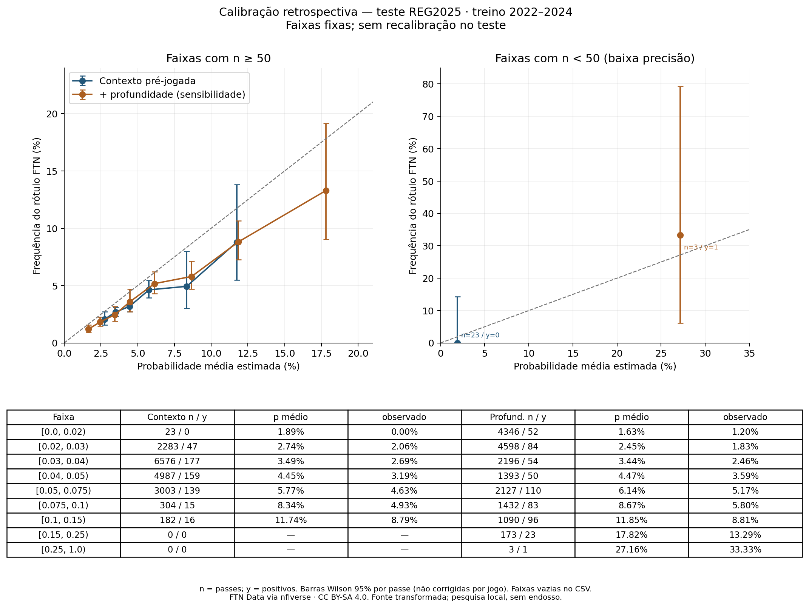
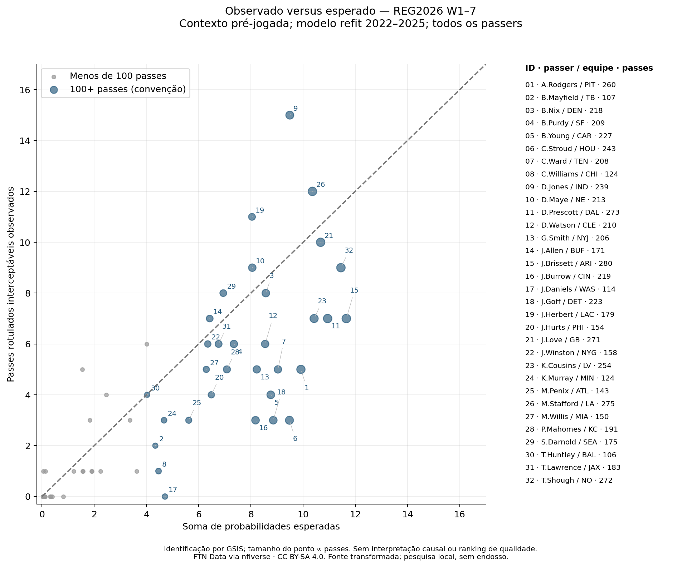
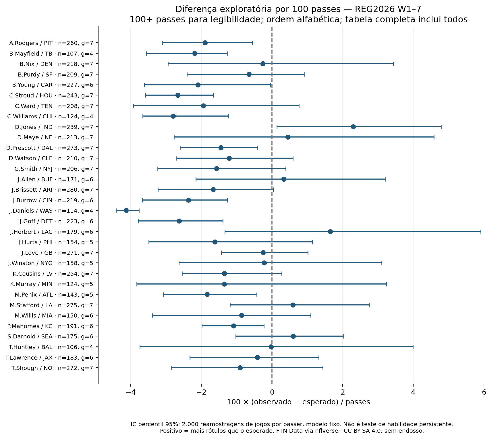
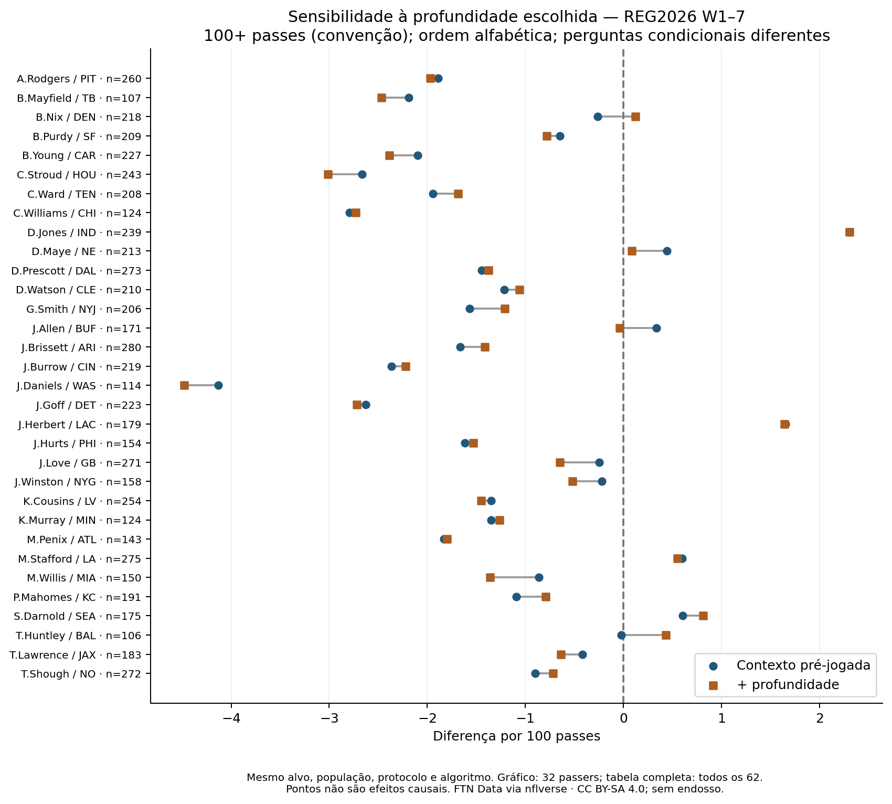

# Passes interceptáveis acima do esperado — primeira entrega

**Conclusão:** a base permite pesquisa retrospectiva reconciliada. O contexto pré-jogada melhora modestamente a log loss fora do treino, mas **as probabilidades superestimam o nível do alvo e não sustentam ranking de qualidade/decisão de QBs**. Entrega concluída como baseline executada, avaliada e reproduzível; não pronta para produção. A variante com air_yards discrimina melhor e responde a outra pergunta, sem resolver o desvio de calibração.

## O que foi observado

| Temporada | Jogos REG | Passes elegíveis | Interceptáveis FTN | Taxa | INT |
| --- | --- | --- | --- | --- | --- |
| 2022 | 271 | 18008 | 941 | 5.225% | 418 |
| 2023 | 272 | 18248 | 738 | 4.044% | 430 |
| 2024 | 272 | 17740 | 591 | 3.331% | 387 |
| 2025 | 272 | 17358 | 553 | 3.186% | 380 |
| 2026 | 107 | 7106 | 219 | 3.082% | 146 |

Zero duplicatas, rótulos elegíveis ausentes ou passers ausentes; reconciliação independente exata em fontes brutas. As pistas anteriores coincidiram sem forçar totais. População mantém throwaways/incompletos, penalidades com tentativa válida, receiver desconhecido e overtime; exclui sacks/scrambles, spikes, anuladas/no_play, conversões e postseason. Dados do site e snapshots não alterados. [Funil/joins/casos especiais](DATA-AUDIT.md).

A frequência cai de5,23% em2022 para3,19% em2025. O mecanismo da queda é desconhecido. Charting é avaliação FTN, não medida incontestável do comportamento do QB. Todos os QBs estão representados no conjunto maior de62 passers identificados, que também inclui lançadores ocasionais; posição de roster não certificada.

## O que foi estimado fora do período de treino

Dois folds expansivos exclusivos de desenvolvimento, sem sorteio de jogadas:

| Validação | Treino | Const. LL | Contexto LL | Profundidade LL | Const. Brier | Contexto Brier | Profundidade Brier |
| --- | --- | --- | --- | --- | --- | --- | --- |
| 2023 | 2022 | 0.17087087 | 0.16912282 | 0.16037567 | 0.03894669 | 0.03880635 | 0.03802414 |
| 2024 | 2022–23 | 0.14819234 | 0.14680295 | 0.13812333 | 0.03237356 | 0.03227239 | 0.03157546 |

Busca pequena predefinida selecionou C=.1 em ambas. Freeze e modelos2022–24 foram commitados antes da avaliação2025. Teste final único, sem recalibrar/reselecionar para consertá-lo:

| Modelo | Log loss ↓ | Brier ↓ | PR/AP ↑ | ROC-AUC ↑ | Prob. média | Soma esperada |
| --- | --- | --- | --- | --- | --- | --- |
| Constante | 0.14254487 | 0.03094721 | 0.031859 | 0.500000 | 4.204% | 729.73 |
| Contexto principal | 0.14120157 | 0.03087377 | 0.044762 | 0.584272 | 4.231% | 734.47 |
| + profundidade | 0.13438312 | 0.03040905 | 0.077416 | 0.702882 | 4.245% | 736.85 |

| Variante | Métrica | Delta modelo−constante | IC95% por jogos |
| --- | --- | --- | --- |
| context | brier | -0.00007344 | [-0.00018132; 0.00002132] |
| context | log_loss | -0.00134330 | [-0.00237655; -0.00038150] |
| depth | brier | -0.00053816 | [-0.00082020; -0.00027112] |
| depth | log_loss | -0.00816175 | [-0.01035563; -0.00613806] |

O ganho principal de LL é aproximadamente0,94% relativo à constante; o ganho de Brier é pequeno e seu intervalo inclui zero. Isso é evidência limitada de informação contextual, não um grande avanço nem boa calibração. Profundidade reduz LL em cerca de5,73% relativo à constante, mas condicionar uma escolha do QB retira da pergunta parte do que queremos examinar. Não a promovemos a principal por produzir métricas ou ordenação mais atraentes.

## Calibração e estabilidade

| Faixa p | n | Positivos | p médio | Taxa observada |
| --- | --- | --- | --- | --- |
| [0.0, 0.02) | 23 | 0 | 1.89% | 0.00% |
| [0.02, 0.03) | 2283 | 47 | 2.74% | 2.06% |
| [0.03, 0.04) | 6576 | 177 | 3.49% | 2.69% |
| [0.04, 0.05) | 4987 | 159 | 4.45% | 3.19% |
| [0.05, 0.075) | 3003 | 139 | 5.77% | 4.63% |
| [0.075, 0.1) | 304 | 15 | 8.34% | 4.93% |
| [0.1, 0.15) | 182 | 16 | 11.74% | 8.79% |
| [0.15, 0.25) | 0 | 0 | — | — |
| [0.25, 1.0) | 0 | 0 | — | — |

734,47 esperados contra553 observados; constante729,73. O contexto não corrige a queda temporal de prevalência. As faixas de suporte alto superestimam consistentemente; não chamamos as probabilidades de razoavelmente calibradas no teste. A faixa profunda de p>=25% tem n3 e incerteza enorme, mostrada separadamente no gráfico para preservar a leitura das faixas maiores. [Faixas das duas variantes](evidence/calibration_context.json), [sensibilidade](evidence/calibration_depth.json).

| Grupo | Faixa | n | Positivos | Delta LL contexto−constante |
| --- | --- | --- | --- | --- |
| down | 1.0 | 6371 | 148 | -0.002576 |
| down | 2.0 | 5977 | 187 | -0.001357 |
| down | 3.0 | 4497 | 178 | +0.001385 |
| down | 4.0 | 513 | 40 | -0.009796 |
| qtr | 1.0 | 3665 | 93 | -0.003588 |
| qtr | 2.0 | 4972 | 157 | -0.001295 |
| qtr | 3.0 | 3729 | 123 | -0.001268 |
| qtr | 4.0 | 4891 | 177 | +0.000162 |
| distance_group | 1-3 | 1725 | 67 | -0.001842 |
| distance_group | 11+ | 2443 | 92 | -0.000500 |
| distance_group | 4-7 | 3693 | 134 | -0.001394 |
| distance_group | 8-10 | 9497 | 260 | -0.001450 |
| score_group | leading1-8 | 3198 | 90 | -0.001884 |
| score_group | leading9+ | 1775 | 50 | -0.002781 |
| score_group | tied | 3153 | 91 | -0.001512 |
| score_group | trailing1-8 | 4991 | 161 | -0.001432 |
| score_group | trailing9+ | 4241 | 161 | -0.000104 |
| roof | closed | 2840 | 86 | -0.000741 |
| roof | dome | 3283 | 100 | -0.000338 |
| roof | outdoors | 11235 | 367 | -0.001789 |

Há ganhos e perdas por grupo; terceira descida eQ4 pioram. Suporte mínimo é convenção de diagnóstico, não garantia. Sem inferência para OT de101 passes/3positivos ou roof open de baixo suporte. Diferenças de distância/score/relógio e cobertura ambiental estão nas [distribuições por ano](evidence/feature_distributions.csv). Não identificamos causa do drift somente com esses agregados; não adicionamos vento nem deslocamento de intercepto usando o teste.

## Aplicação exploratória2026 W1–7

Refit2022–25, configuração já congelada. **7.106 passes/107jogos/219 rótulos**, esperado contextual282,19. Taxa estimada3,971%, observada3,082%; diferença total−63,19 (−0,889 por100). O deslocamento global faz muitos resíduos negativos: não significa que a maioria dos jogadores tenha habilidade superior a uma referência calibrada.

Gráfico alfabético com32 passers de100+tentativas por legibilidade; corte exploratório, não garantia estatística. Tabela abaixo inclui os62 identificadores e todos os volumes. Não se força ordem precisa. Intervalos percentis95% reamostram jogos de cada passer (2.000, seed20261104), modelo fixo; com<3jogos não emitimos IC. `†`: zero positivos torna o bootstrap empírico especialmente degenerado — só reamostra os zeros já vistos, não limita a verdadeira taxa latente. Mesmo os demais ICs ignoram incerteza de treino, seleção, charting e mudança de população; não são intervalos de habilidade persistente nem testes simultâneos de62 jogadores. Jogos nos quais o jogador não lançou não entram no suporte.

| GSIS ID | Nome | Equipes | n | Jogos | FTN obs. | Esp. | Taxa obs. | Taxa esp. | O−E | Por100 | IC95% jogos | INT |
| --- | --- | --- | --- | --- | --- | --- | --- | --- | --- | --- | --- | --- |
| 00-0035190 | A.Cole | LV | 1 | 1 | 0 | 0.09 | 0.00% | 9.24% | -0.09 | -9.24 | sem IC (<3 jogos) | 0 |
| 00-0027973 | A.Dalton | PHI | 1 | 1 | 1 | 0.05 | 100.00% | 4.64% | +0.95 | +95.36 | sem IC (<3 jogos) | 1 |
| 00-0041117 | A.Kaliakmanis | WAS | 33 | 1 | 1 | 1.57 | 3.03% | 4.75% | -0.57 | -1.72 | sem IC (<3 jogos) | 1 |
| 00-0023459 | A.Rodgers | PIT | 260 | 7 | 5 | 9.92 | 1.92% | 3.81% | -4.92 | -1.89 | [-3.10; -0.55] | 5 |
| 00-0041040 | A.Williams | WAS | 1 | 1 | 0 | 0.04 | 0.00% | 3.51% | -0.04 | -3.51 | sem IC (<3 jogos) | 0 |
| 00-0034855 | B.Mayfield | TB | 107 | 4 | 2 | 4.34 | 1.87% | 4.06% | -2.34 | -2.19 | [-3.55; -1.26] | 2 |
| 00-0039732 | B.Nix | DEN | 218 | 7 | 8 | 8.57 | 3.67% | 3.93% | -0.57 | -0.26 | [-2.94; +3.43] | 3 |
| 00-0037834 | B.Purdy | SF | 209 | 7 | 6 | 7.35 | 2.87% | 3.52% | -1.35 | -0.65 | [-2.40; +0.91] | 4 |
| 00-0039150 | B.Young | CAR | 227 | 6 | 4 | 8.76 | 1.76% | 3.86% | -4.76 | -2.10 | [-3.61; -0.05] | 4 |
| 00-0033729 | C.Johnston | PIT | 1 | 1 | 0 | 0.10 | 0.00% | 9.73% | -0.10 | -9.73 | sem IC (<3 jogos) | 0 |
| 00-0028986 | C.Keenum | CHI | 53 | 2 | 1 | 2.24 | 1.89% | 4.23% | -1.24 | -2.34 | sem IC (<3 jogos) | 1 |
| 00-0033662 | C.Rush | ATL | 39 | 2 | 5 | 1.54 | 12.82% | 3.94% | +3.46 | +8.88 | sem IC (<3 jogos) | 4 |
| 00-0039163 | C.Stroud | HOU | 243 | 7 | 3 | 9.48 | 1.23% | 3.90% | -6.48 | -2.67 | [-3.59; -1.66] | 1 |
| 00-0040676 | C.Ward | TEN | 208 | 7 | 5 | 9.04 | 2.40% | 4.34% | -4.04 | -1.94 | [-3.93; +0.77] | 5 |
| 00-0032950 | C.Wentz | MIN | 39 | 2 | 1 | 1.56 | 2.56% | 4.00% | -0.56 | -1.44 | sem IC (<3 jogos) | 0 |
| 00-0039918 | C.Williams | CHI | 124 | 4 | 1 | 4.46 | 0.81% | 3.60% | -3.46 | -2.79 | [-3.66; -1.22] | 1 |
| 00-0036626 | D.Brown | WAS | 1 | 1 | 0 | 0.06 | 0.00% | 5.72% | -0.06 | -5.72 | sem IC (<3 jogos) | 0 |
| 00-0035710 | D.Jones | IND | 239 | 7 | 15 | 9.49 | 6.28% | 3.97% | +5.51 | +2.30 | [+0.14; +4.79] | 7 |
| 00-0035704 | D.Lock | SEA | 48 | 2 | 1 | 1.92 | 2.08% | 4.00% | -0.92 | -1.91 | sem IC (<3 jogos) | 0 |
| 00-0039851 | D.Maye | NE | 213 | 7 | 9 | 8.06 | 4.23% | 3.78% | +0.94 | +0.44 | [-2.77; +4.58] | 8 |
| 00-0033077 | D.Prescott | DAL | 273 | 7 | 7 | 10.94 | 2.56% | 4.01% | -3.94 | -1.44 | [-2.60; -0.41] | 5 |
| 00-0033537 | D.Watson | CLE | 210 | 7 | 6 | 8.55 | 2.86% | 4.07% | -2.55 | -1.21 | [-2.70; +0.60] | 3 |
| 00-0040563 | E.Chism | NE | 1 | 1 | 0 | 0.03 | 0.00% | 3.42% | -0.03 | -3.42 | sem IC (<3 jogos) | 0 |
| 00-0041562 | F.Mendoza | LV | 8 | 1 | 0 | 0.39 | 0.00% | 4.91% | -0.39 | -4.91 | sem IC (<3 jogos) | 0 |
| 00-0030565 | G.Smith | NYJ | 206 | 7 | 5 | 8.23 | 2.43% | 3.99% | -3.23 | -1.57 | [-3.23; +0.39] | 2 |
| 00-0034857 | J.Allen | BUF | 171 | 6 | 7 | 6.42 | 4.09% | 3.76% | +0.58 | +0.34 | [-2.15; +3.20] | 4 |
| 00-0033119 | J.Brissett | ARI | 280 | 7 | 7 | 11.66 | 2.50% | 4.16% | -4.66 | -1.66 | [-3.23; +0.04] | 6 |
| 00-0036442 | J.Burrow | CIN | 219 | 6 | 3 | 8.18 | 1.37% | 3.73% | -5.18 | -2.37 | [-3.66; -1.26] | 3 |
| 00-0039910 | J.Daniels | WAS | 114 | 4 | 0 | 4.71 | 0.00% | 4.13% | -4.71 | -4.13 | [-4.40; -3.77] † | 0 |
| 00-0041251 | J.Daniels | TB | 98 | 4 | 6 | 4.01 | 6.12% | 4.10% | +1.99 | +2.03 | [-0.42; +5.13] | 5 |
| 00-0040691 | J.Dart | NYG | 34 | 2 | 1 | 1.22 | 2.94% | 3.58% | -0.22 | -0.64 | sem IC (<3 jogos) | 0 |
| 00-0033106 | J.Goff | DET | 223 | 6 | 3 | 8.86 | 1.35% | 3.97% | -5.86 | -2.63 | [-3.79; -1.39] | 0 |
| 00-0036355 | J.Herbert | LAC | 179 | 6 | 11 | 8.04 | 6.15% | 4.49% | +2.96 | +1.65 | [-1.33; +5.91] | 8 |
| 00-0036389 | J.Hurts | PHI | 154 | 5 | 4 | 6.49 | 2.60% | 4.21% | -2.49 | -1.61 | [-3.49; +1.14] | 3 |
| 00-0036264 | J.Love | GB | 271 | 7 | 10 | 10.67 | 3.69% | 3.94% | -0.67 | -0.25 | [-1.43; +1.02] | 5 |
| 00-0039923 | J.McCarthy | NYG | 44 | 2 | 3 | 1.83 | 6.82% | 4.16% | +1.17 | +2.65 | sem IC (<3 jogos) | 1 |
| 00-0038543 | J.Smith-Njigba | SEA | 1 | 1 | 0 | 0.03 | 0.00% | 3.28% | -0.03 | -3.28 | sem IC (<3 jogos) | 0 |
| 00-0041194 | J.Strand | ATL | 15 | 1 | 0 | 0.82 | 0.00% | 5.45% | -0.82 | -5.45 | sem IC (<3 jogos) | 1 |
| 00-0031503 | J.Winston | NYG | 158 | 5 | 6 | 6.35 | 3.80% | 4.02% | -0.35 | -0.22 | [-2.64; +3.11] | 5 |
| 00-0029604 | K.Cousins | LV | 254 | 7 | 7 | 10.42 | 2.76% | 4.10% | -3.42 | -1.35 | [-2.54; +0.27] | 5 |
| 00-0040654 | K.Kroeger | HOU | 1 | 1 | 0 | 0.07 | 0.00% | 6.58% | -0.07 | -6.58 | sem IC (<3 jogos) | 0 |
| 00-0035228 | K.Murray | MIN | 124 | 5 | 3 | 4.67 | 2.42% | 3.77% | -1.67 | -1.35 | [-3.83; +3.24] | 2 |
| 00-0038102 | K.Pickett | CAR | 5 | 2 | 0 | 0.31 | 0.00% | 6.12% | -0.31 | -6.12 | sem IC (<3 jogos) | 0 |
| 00-0034796 | L.Jackson | BAL | 94 | 4 | 3 | 3.37 | 3.19% | 3.58% | -0.37 | -0.39 | [-2.21; +0.86] | 1 |
| 00-0032268 | M.Mariota | WAS | 51 | 3 | 1 | 1.89 | 1.96% | 3.71% | -0.89 | -1.75 | [-3.98; -0.43] | 0 |
| 00-0039917 | M.Penix | ATL | 143 | 5 | 3 | 5.62 | 2.10% | 3.93% | -2.62 | -1.83 | [-3.07; -0.43] | 1 |
| 00-0034771 | M.Rudolph | PIT | 1 | 1 | 0 | 0.05 | 0.00% | 4.64% | -0.05 | -4.64 | sem IC (<3 jogos) | 0 |
| 00-0026498 | M.Stafford | LA | 275 | 7 | 12 | 10.36 | 4.36% | 3.77% | +1.64 | +0.60 | [-1.19; +2.76] | 7 |
| 00-0038128 | M.Willis | MIA | 150 | 6 | 5 | 6.29 | 3.33% | 4.20% | -1.29 | -0.86 | [-3.38; +1.10] | 4 |
| 00-0038559 | Mi.Wilson | ARI | 1 | 1 | 0 | 0.06 | 0.00% | 5.74% | -0.06 | -5.74 | sem IC (<3 jogos) | 0 |
| 00-0033873 | P.Mahomes | KC | 191 | 6 | 5 | 7.08 | 2.62% | 3.71% | -2.08 | -1.09 | [-1.98; -0.23] | 4 |
| 00-0039107 | S.Bennett | LA | 3 | 1 | 0 | 0.12 | 0.00% | 3.86% | -0.12 | -3.86 | sem IC (<3 jogos) | 0 |
| 00-0034869 | S.Darnold | SEA | 175 | 6 | 8 | 6.94 | 4.57% | 3.97% | +1.06 | +0.60 | [-1.03; +2.02] | 8 |
| 00-0040668 | S.Sanders | CLE | 1 | 1 | 0 | 0.04 | 0.00% | 3.76% | -0.04 | -3.76 | sem IC (<3 jogos) | 0 |
| 00-0038416 | T.Bagent | CHI | 63 | 3 | 4 | 2.46 | 6.35% | 3.91% | +1.54 | +2.44 | [-0.45; +7.75] | 3 |
| 00-0038476 | T.DeVito | NE | 5 | 1 | 0 | 0.34 | 0.00% | 6.74% | -0.34 | -6.74 | sem IC (<3 jogos) | 0 |
| 00-0040727 | T.Harris | LAC | 1 | 1 | 0 | 0.04 | 0.00% | 3.78% | -0.04 | -3.78 | sem IC (<3 jogos) | 0 |
| 00-0035993 | T.Huntley | BAL | 106 | 4 | 4 | 4.03 | 3.77% | 3.80% | -0.03 | -0.02 | [-3.74; +3.99] | 1 |
| 00-0036971 | T.Lawrence | JAX | 183 | 6 | 6 | 6.76 | 3.28% | 3.70% | -0.76 | -0.42 | [-2.32; +1.33] | 4 |
| 00-0038400 | T.McKee | PHI | 80 | 2 | 1 | 3.62 | 1.25% | 4.52% | -2.62 | -3.27 | sem IC (<3 jogos) | 1 |
| 00-0040743 | T.Shough | NO | 272 | 7 | 9 | 11.45 | 3.31% | 4.21% | -2.45 | -0.90 | [-2.85; +1.44] | 6 |
| 00-0036212 | T.Tagovailoa | ATL | 3 | 1 | 1 | 0.13 | 33.33% | 4.18% | +0.87 | +29.15 | sem IC (<3 jogos) | 1 |

[CSV contextual](evidence/qb_context.csv) preserva precisão total e [CSV com profundidade](evidence/qb_depth.csv) usa os mesmos IDs. Taxas de tabela estão em porcentagem; CSV guarda frações. `INT` é desfecho observado separado, sem modelo de sorte. Positivo em Por100 = mais rótulos FTN que esta baseline contextual esperava, não pior QB.

## Dependência da profundidade escolhida

A variante espera283,69 rótulos no total, também acima de219. Entre os32 com100+passes, a mudança do residual fica entre−0,495 e+0,458 por100. Três sinais mudam perto de zero: J.Allen +0,336→−0,040, T.Huntley −0,024→+0,433, B.Nix −0,263→+0,123. Não tratamos essas trocas como descobertas sobre personalidade ou decisão. [Comparação completa](evidence/qb_sensitivity.csv). Sem escolha de variante a partir de uma lista de nomes; nenhuma tese prévia sobre Herbert/Geno/Darnold foi testada como hipótese a confirmar.

## O que permanece desconhecido

Não conhecemos estabilidade do protocolo FTN entre anos, concordância entre anotadores, completude de todas as jogadas possíveis, disponibilidade histórica exata dos bytes, qualidade da cobertura defensiva/alternativas, instruções de jogada e quem deveria receber responsabilidade. Rótulo positivo e INT discordam legitimamente como variáveis diferentes. O residual mistura contexto não observado, escolha do passe, execução, charting, acaso amostral e possível efeito do QB. Associação não é causalidade. O histórico4anos e a janela7semanas não mostram persistência de habilidade. [Model card](MODEL-CARD.md), [features](FEATURE-AVAILABILITY.md), [licença](NOTICE.md).

## Falhas e correções preservadas

1. 404 ao buscar LICENSE sem extensão: corrigido para LICENSE.md; retomada verifica hashes, sem rebaixar falha silenciosamente.
2. build-v1 abortou por colisão de colunas de agregação no comparador independente; corrigida para sum_y/sum_i; build-v2 refeito em destino novo. Nenhum total foi ajustado.
3. Cinco falhas iniciais de fixture por colocar alvo nos dois lados do join; fixture passou a refletir PBP/FTN separados, sem mudar expectativa de cardinalidade/ausência.
4. NumPy2.2.6/Accelerate produziu avisos espúrios até em ones@zeros; single-thread não resolveu. Somente venv isolado atualizado para2.3.4; desenvolvimento refeito com RuntimeWarning como erro. Conferência inicial de equivalência entre versões com tolerância1e-10 falhou para coeficientes de profundidade (máximo3,97e-9). A avaliação já usou o modelo novo congelado; não houve retuning. Diagnóstico posterior quantificou diferença máxima em probabilidades de treino de1,81e-9, multiplicação independente difere3,55e-15 e não há avisos no ambiente final. Essa diferença entre versões não é alegada como identidade byte a byte; reprodução usa o mesmo lock e deve conferir hashes. [Prova numérica](evidence/numerical-check.json).
5. Figura inicial recortava a faixa de baixo suporte da variante; corrigida com painel separado, preservando todos os suportes e sem mudar métricas. FutureWarning do matplotlib com Series de 1 elemento corrigido convertendo arrays; nenhum aviso foi silenciado globalmente.

Tentativas, logs e saídas intermediárias foram mantidos no store. Contrato/features/protocolo não foram modificados após o teste para melhorar resultado. [Checkpoints](CHECKPOINTS.md) e [reprodução](README.md).

## Decisão e próximo experimento justificável

Manter esta baseline como referência de pesquisa. Antes de exibir resíduos como comparação de QBs, investigar a queda de prevalência e estabilidade do charting. Pré-registrar **um experimento de adaptação/calibração temporal** (p.ex. janela recente e correção de intercepto aprendida somente em previsões temporais anteriores), com o mesmo alvo/contexto e um novo bloco temporal reservado.2025 agora é dado examinado; não reutilizá-lo como teste virgem. Não corrigir níveis diretamente com a taxa2026 para depois apresentar os mesmos QBs como avaliação independente. Em paralelo documental, validar posições por roster e obter definição operacional de anotação; sem construir outro modelo de INT/pressão, sem ampliar algoritmos ou interface. Reservar semanas ainda não examinadas ou temporada posterior e definir critério de calibração/ganho antes de abrir resultados.
