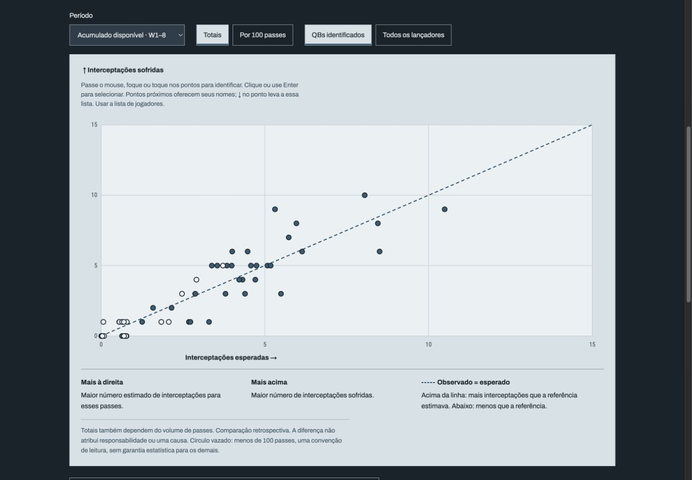
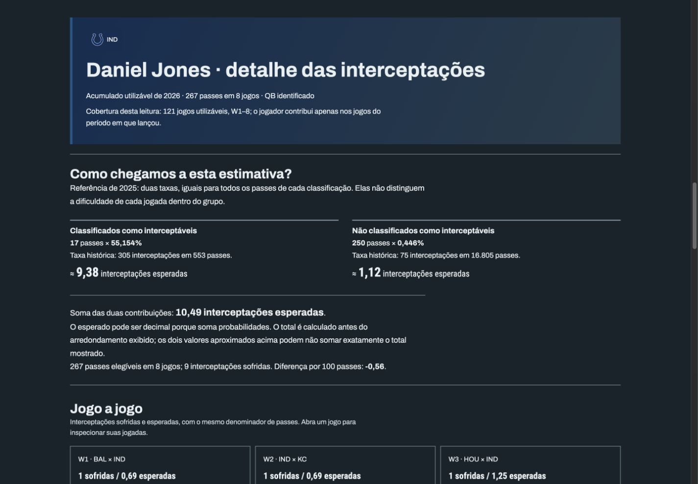

# Capturas da integração local

Capturas reais do navegador integrado em 05/11/2026. JPEGs; dados dos pacotes pinados, sem exemplos escritos no frontend. As capturas de texto 200% usam fonte raiz 32px temporária, removida ao final. Toque identificado como sintetizado, sem aparelho físico.

| Evidência | Captura |
| --- | --- |
| Abertura B2 no desktop, duas perguntas e fonte/referência | [Desktop](captures/b2-opening-desktop.jpg) |
| Gráfico amplo sem identificações permanentes | [Gráfico B2](captures/b2-chart-desktop.jpg) |
| Daniel Jones nas duas leituras | [M3](captures/daniel-m3-desktop.jpg) / [B2](captures/daniel-b2-desktop.jpg) |
| Conta transparente de Daniel, valores completos antes de arredondar | [Desktop](captures/daniel-b2-calculation-desktop.jpg) / [390 px](captures/daniel-b2-calculation-390.jpg) |
| Abertura e escolha das perguntas a 320 px | [320 px](captures/b2-opening-320.jpg) |
| Navegação com texto 200%, antes e após ajuste de reflow | [Antes](captures/text200-320-before.jpg) / [Depois](captures/text200-320-opening.jpg) |
| Gráfico e cálculo a 320 px com texto 200% | [Gráfico](captures/text200-320-chart.jpg) / [Cálculo](captures/text200-320-calculation.jpg) |
| M3 preservado com texto 200% | [M3 em 320 px](captures/m3-text200-320.jpg) |
| Foco/seleção por teclado, prévia sob o gráfico | [390 px](captures/keyboard-preview-390.jpg) |
| Toque sintetizado em região densa; 20 nomes próximos sem soma | [390 px](captures/touch-dense-390.jpg) |
| Evidência de Rodgers, grupo não classificado/interceptado | [390 px](captures/rodgers-evidence-390.jpg) |
| Cruzamento vazio explícito de Cousins | [390 px](captures/empty-cross-390.jpg) |
| Carregamento e falha simulados, recuperação conferida | [Carregamento](captures/loading-390.jpg) / [Falha](captures/load-failure-390.jpg) |

O desenho permanece centrado na distribuição, com nomes sob demanda e resumo/lista abaixo. Não há caixas permanentes ou deslocamento de pontos. As duas contribuições são contagens esperadas, com taxas históricas identificadas; não se inferem causas ou qualidade do jogador. A limitação de calibração está na metodologia, sem transformar a abertura em relatório estatístico.
