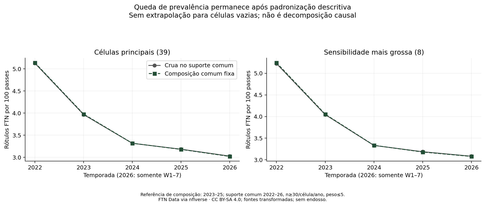

# Diagnóstico de queda temporal — composição não explica a maior parte

População v1 preservada integralmente: 18.008/941 em 2022; 18.248/738 em 2023; 17.740/591 em 2024; 17.358/553 em 2025; 7.106/219 em 2026 W1–7. Todos os números posteriores à W7 continuam fora deste diagnóstico. [População por ano](evidence/population.csv), [funil/joins independentes da v1](evidence/integrity_v1_reconciled.json). Foram reconstruídos os 84 artefatos científicos da referência em destino novo, com igualdade de bytes. Não houve redefinição da população nem download novo de PBP/FTN. Join completo não prova completude absoluta ou verdade dos rótulos.

## Integridade, cobertura e esquema

271 jogos REG em 2022, 272 em cada ano de 2023–25 e 107 em 2026 W1–7, exatamente os universos do calendário pinado. As chaves permanecem únicas, joins 1:1, sem rótulo elegível ou passer ausente. Sacks/scrambles, spikes, anuladas/no_play, conversões e POST continuam excluídos; throwaways, receiver desconhecido, overtime e penalidades com tentativa válida continuam presentes. Grupos de exclusão e contagens por semana/jogo/ID estão preservados na v1 e no replay local `reference-v1/build/audit/`.2022 tem menos linhas FTN fora do universo de passes elegíveis; isso não foi tratado como perda de rótulos elegíveis.

PBP tem 372 colunas em todos os cinco arquivos; `goal_to_go` muda int32→double em 2024–26, sem uso na baseline. FTN tem 29 colunas e os mesmos tipos Arrow em todas as temporadas, inclusive alvo bool. Estabilidade de schema não demonstra estabilidade semântica. Frequências de `read_thrown` revelam primárias NA em 2022 e código0 desde 2023; existe ` CHK` com espaço em uma linha de 2022. Campo não usado no modelo. [Comparação de esquemas](evidence/schema_comparison.json).

Manifestos conservam aquisição original da v1 em 04/11/2026, hashes e `date_pulled` disponível. `date_pulled` é a data em que jobs nflverse retiraram dados da API FTN, não data de anotação nem recibo de disponibilidade no kickoff. Há apenas uma revisão congelada por arquivo neste experimento; não estimamos alterações de rótulos entre revisões a partir de um snapshot único. Sem certificação histórica em tempo real. PBP2026 continua o congelado aprovado W1–7; FTN pinado tem W8 já exposta em agregados, nunca W9–13.

## Composição observada

[Composição completa](evidence/composition.csv): descida, distância, posição de campo, quarto, relógio, placar, profundidade, throwaway, penalidade, roof e presença de vento. Cada linha traz n, positivos, taxa, jogos e fração da população. Suporte descritivo n>=200 e positivos>=10; categorias abaixo disso não viram descobertas. As categorias de throwaway mantêm o nome/descrição pública, mas sua estabilidade operacional não foi certificada.

| Ano | Profundidade | n | FTN positivos | % dos passes | Taxa do rótulo |
| --- | --- | --- | --- | --- | --- |
| 2022 | 0-9 | 9125 | 330 | 50.67% | 3.62% |
| 2022 | 10-19 | 3771 | 290 | 20.94% | 7.69% |
| 2022 | 20+ | 2046 | 257 | 11.36% | 12.56% |
| 2022 | <0 | 3065 | 64 | 17.02% | 2.09% |
| 2025 | 0-9 | 8524 | 192 | 49.11% | 2.25% |
| 2025 | 10-19 | 3737 | 185 | 21.53% | 4.95% |
| 2025 | 20+ | 2000 | 150 | 11.52% | 7.50% |
| 2025 | <0 | 3097 | 26 | 17.84% | 0.84% |
| 2026 | 0-9 | 3510 | 77 | 49.39% | 2.19% |
| 2026 | 10-19 | 1508 | 83 | 21.22% | 5.50% |
| 2026 | 20+ | 810 | 53 | 11.40% | 6.54% |
| 2026 | <0 | 1278 | 6 | 17.98% | 0.47% |

A fração de passes profundos (20+) permanece perto de11,4–11,5%, enquanto a taxa FTN nesse grupo cai de12,56% a7,50% e6,54%. Isso é diagnóstico dentro de faixas, não prova sobre a causa. Throwaways passam de3,80% dos passes em 2022 a4,16% em 2025 e4,48% em 2026; a maioria dos rótulos é de não-throwaways. Não excluímos esses passes. A distribuição de relógio e situação de placar também está documentada, sem selecionar features novas.

Vento/temperatura presentes em34,58%,54,39%,63,04%,63,61%,41,09% por ano; cobertura depende de estádio/roof. Ausência não é zero. Dados de ambiente por estádio permanecem na auditoria v1 e são referenciados como disponibilidade, não mecanismos explicativos de mudança do alvo. Ambiente, profundidade e throwaway não entram em M0–M3.

## Composição comum predefinida

Principal: down2 × distância3 × campo3 × quarto2 × placar2 =72 células possíveis. Frequências de referência pooled2023–25; suporte exige pelo menos30 passes em **cada um dos cinco períodos**, sem usar positivos para excluir células. Restam39 células;33 removidas por suporte. Não houve retirada adicional por teto de peso5. As frações dentro do suporte são renormalizadas e os pesos são densidade referência/ano. Sem preenchimento de taxa de célula vazia, sem extrapolação e sem clipping de alguns indivíduos. Sensibilidade única mais grossa:8 células down2×distância2×placar2, todas com suporte e100% da população. [Contrato/células](evidence/standardization_contract.json), [principal](evidence/standardization_cells_primary.csv), [sensibilidade](evidence/standardization_cells_coarse.csv).

| Células | Ano | n comum / total | Taxa crua no suporte | Taxa padronizada | Peso máx. | ESS |
| --- | --- | --- | --- | --- | --- | --- |
| primary | 2022 | 16789/18008 | 5.128% | 5.141% | 1.255 | 16705.9 |
| primary | 2023 | 17091/18248 | 3.967% | 3.978% | 1.180 | 17041.7 |
| primary | 2024 | 16670/17740 | 3.317% | 3.319% | 1.132 | 16645.9 |
| primary | 2025 | 16271/17358 | 3.184% | 3.180% | 1.172 | 16233.8 |
| primary | 2026 | 6639/7106 | 3.028% | 3.020% | 1.317 | 6570.0 |
| coarse | 2022 | 18008/18008 | 5.225% | 5.247% | 1.066 | 17985.8 |
| coarse | 2023 | 18248/18248 | 4.044% | 4.054% | 1.045 | 18232.0 |
| coarse | 2024 | 17740/17740 | 3.331% | 3.334% | 1.025 | 17728.1 |
| coarse | 2025 | 17358/17358 | 3.186% | 3.179% | 1.052 | 17348.7 |
| coarse | 2026 | 7106/7106 | 3.082% | 3.077% | 1.033 | 7091.3 |

De2022 a2025, na população integral, queda de2,040 pontos percentuais. **No mesmo suporte principal**, queda crua de1,945 p.p. versus1,961 p.p. padronizada: ajuste amplia a queda em0,016 p.p. (fração associada à composição −0,83%). Sensibilidade completa:2,040 p.p. crua versus2,068 p.p. padronizada (diferença−0,028 p.p.; −1,39%). Até2026, no suporte principal,2,101 p.p. crua versus2,120 p.p. padronizada. Portanto, esta composição observada **não explica a queda**; não interpretar percentuais negativos como evidência causal de agravamento. São estimativas descritivas condicionadas às células/referência.

Limites: cerca de6–7% retirado na especificação principal; relógio, profundidade, defesa e diferenças contínuas dentro de células não são ajustados; referência e suporte são convencionais. Não há IC causal ou atribuição de parcela restante a anotadores/QBs. ESS e pesos são diagnósticos de estabilidade, não correção de variáveis omitidas.

## O que a documentação oficial confirma

[Loader FTN](https://nflreadr.nflverse.com/reference/load_ftn_charting.html): charting manual, subconjunto público desde2022, disponibilização informada em até48h e licença CC BY-SA4.0 com atribuição **FTN Data via nflverse**. [Agenda](https://nflreadr.nflverse.com/articles/nflverse_data_schedule.html): atualização FTN quatro vezes ao dia dependente do provedor; participação FTN pós2023 somente após a pós-temporada. Essas agendas não certificam completude de cada arquivo.

[Dicionário](https://nflreadr.nflverse.com/articles/dictionary_ftn_charting.html): alvo descrito somente como passe interceptável; não traz protocolo operacional detalhado ou concordância entre avaliadores. [Revisão oficial de01/09/2026](https://github.com/nflverse/nflreadr/commit/b32d434012) adicionou `n_defense_box` ausente no dicionário e detalhou `read_thrown`. O patch muda a ordem da linha do alvo, mas **mantém a mesma descrição**, não documenta alteração de critério de interceptável. O histórico do dicionário consultado tem introdução2023 e revisão2026; NEWS do pacote não documenta mudança de anotadores ou regra do alvo. Ausência de registro encontrado não prova ausência de mudança.

Fontes oficiais, patch e metadados de release foram congelados com URL/instante/hash em `additional-sources.json` e `provider-revision-source.json`. Não contatamos terceiros. Não sabemos qual parte da queda corresponde a jogo real, seleção não observada, execução, charting ou revisão. Tabelas/figuras FTN transformadas: CC BY-SA4.0, sem endosso; restrições de distribuição e limites jurídicos da [NOTICE v1](../qb-interception-risk-baseline-v1/NOTICE.md) continuam pertinentes.
