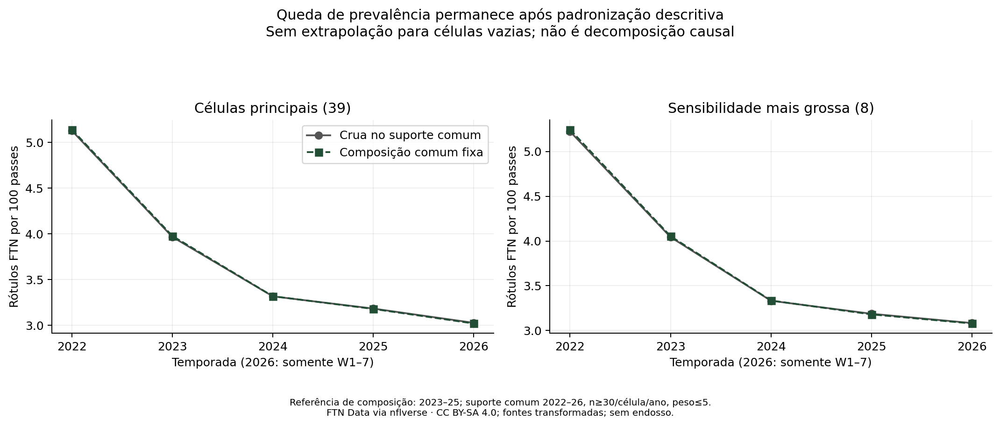
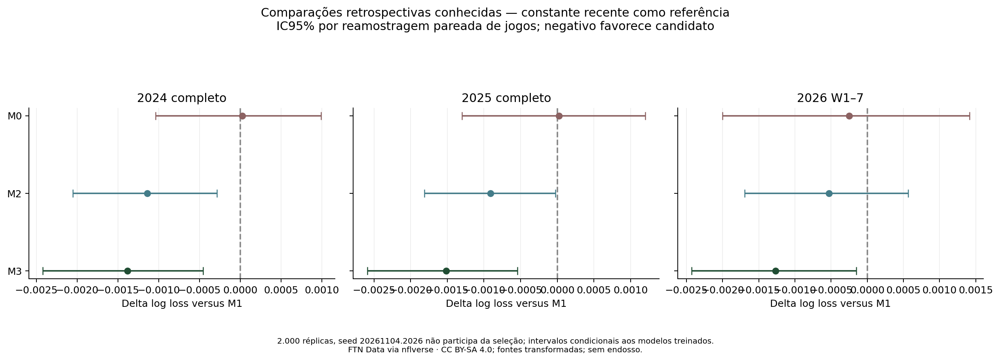
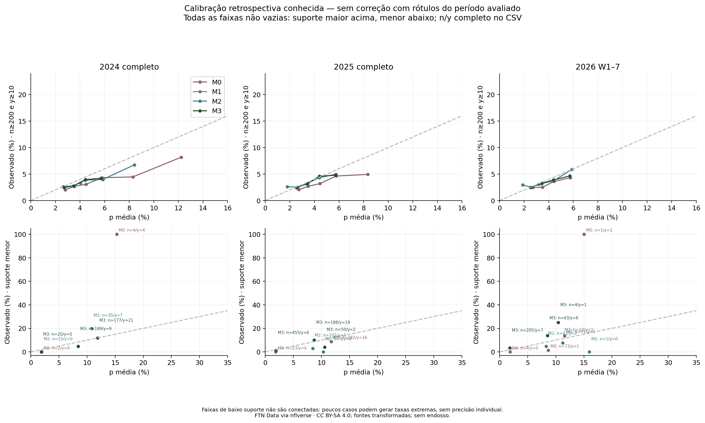
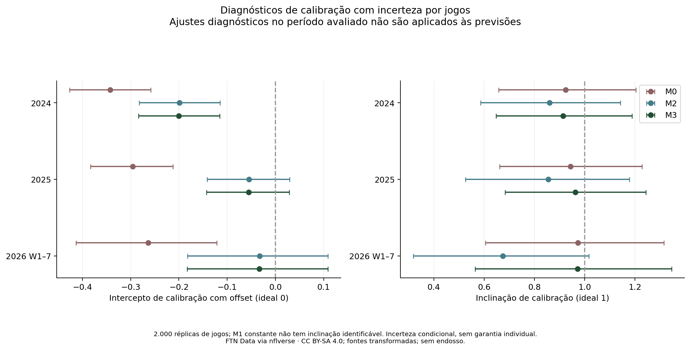

# Diagnóstico temporal e calibração — entrega v2

**Estado A: diagnóstico concluído, M3 congelado para avaliação nova, reserva ainda pendente.** A composição contextual medida não explica a queda de prevalência. Uma constante recente resolve a maior parte do problema de nível da v1; M3 mantém uma vantagem retrospectiva modesta sobre essa referência. Isso não é validação final nem ranking de QBs.

## Achado retrospectivo: queda permanece com composição comum

De5,225% em2022 a3,186% em2025 (e3,082% em2026 W1–7). Nas39 células comuns, com93,2–94,0% de retenção e pesos máximos até1,317, a queda2022→2025 é1,945 p.p. crua versus1,961 p.p. padronizada. Especificação de8 células com100% da amostra produz2,040 versus2,068 p.p. Não estimamos parcela positiva explicada pela composição; mudanças observadas associam-se a diferenças muito pequenas e de sinal contrário. Não extrapolamos taxas para células ausentes. [Auditoria completa, exclusões, suporte e limites](DRIFT-AUDIT.md).

Não há mudança de schema FTN que explique mecanicamente os números; existe revisão documental de `read_thrown`/defense box, sem alteração documentada da definição do alvo. Não conhecemos estabilidade de anotadores/critério, revisões históricas ou causas da queda. Não atribuímos a parcela restante a melhora dos QBs nem a anotadores. O diagnóstico conserva alvo/população e todos os rótulos da v1.

## Referência recente e quatro candidatos delimitados

| Período conhecido | Modelo | LL ↓ | Brier ↓ | AP ↑ | AUC ↑ | Observados | Esperados | O/E |
| --- | --- | --- | --- | --- | --- | --- | --- | --- |
| 2024 | M0 | 0.14680295 | 0.03227239 | 0.057770 | 0.573713 | 591 | 820.12 | 0.721 |
| 2024 | M1 | 0.14677663 | 0.03225550 | 0.033315 | 0.500000 | 591 | 717.46 | 0.824 |
| 2024 | M2 | 0.14563726 | 0.03217296 | 0.048773 | 0.570050 | 591 | 715.23 | 0.826 |
| 2024 | M3 | 0.14539418 | 0.03214285 | 0.054561 | 0.572271 | 591 | 715.95 | 0.825 |
| 2025 | M0 | 0.14120157 | 0.03087377 | 0.044762 | 0.584272 | 553 | 734.47 | 0.753 |
| 2025 | M1 | 0.14117772 | 0.03084566 | 0.031859 | 0.500000 | 553 | 578.27 | 0.956 |
| 2025 | M2 | 0.14026540 | 0.03078537 | 0.042402 | 0.570951 | 553 | 582.83 | 0.949 |
| 2025 | M3 | 0.13966077 | 0.03074278 | 0.045524 | 0.585908 | 553 | 583.27 | 0.948 |
| 2026 W1–7 | M0 | 0.13734305 | 0.02984317 | 0.052824 | 0.578097 | 219 | 282.19 | 0.776 |
| 2026 W1–7 | M1 | 0.13759546 | 0.02987029 | 0.030819 | 0.500000 | 219 | 226.39 | 0.967 |
| 2026 W1–7 | M2 | 0.13706474 | 0.02984047 | 0.040229 | 0.559587 | 219 | 226.02 | 0.969 |
| 2026 W1–7 | M3 | 0.13632541 | 0.02977043 | 0.051078 | 0.574272 | 219 | 226.12 | 0.969 |

M0 é a previsão v1 preservada. M1 é a prevalência da temporada anterior; M2 usa contexto da temporada anterior; M3 usa estrutura mais antiga e um ano separado para intercepto. Não houve novos algoritmos ou busca de C. O retrospecto comum foi fixado em2024/2025;2026 W1–7 não participa da escolha.

Em2025, o erro de contagem esperado−observado cai de181,47 em M0 para25,27 em M1 (redução descritiva de86,1% do excesso); em2026 de63,19 para7,39 (88,3%). M0 fica praticamente empatado com M1 em LL/Brier, mostrando por que a constante antiga da v1 era uma referência insuficiente. M3 acrescenta informação pequena porém consistente nos anos completos, sem depender somente de superar M0.

| Ano | M3−M1 LL | IC95% jogos | M3−M1 Brier | IC95% jogos |
| --- | --- | --- | --- | --- |
| 2024 | -0.00138245 | [-0.00241914; -0.00045358] | -0.00011265 | [-0.00023149; -0.00000889] |
| 2025 | -0.00151695 | [-0.00259206; -0.00054188] | -0.00010289 | [-0.00019062; -0.00002367] |
| 2026 | -0.00127005 | [-0.00242924; -0.00015241] | -0.00009987 | [-0.00020243; -0.00000779] |

M2 e M3 cumpriram a regra versionada; M3 teve menor LL pooled2024/2025 e foi escolhido. Delta LL pooled M3−M1−0,001449 [−0,002152;−0,000772]; Brier−0,00010782 [−0,00017580;−0,00004294]. A vantagem relativa pooled de LL é cerca de1,01%, não um grande salto. AP/AUC separam situações mais que uma constante. Não afirmamos superioridade estatística de M3 sobre M2; escolhemos pelo critério fechado. [Decisão](evidence/selection.json).

## Calibração: melhora de nível com limites

M3 em2025 prevê583,27/553 (p médio3,360% vs3,186%); em2026 W1–7 prevê226,12/219 (3,182% vs3,082%). Intercepto diagnóstico offset−0,055 [−0,143;0,029] e−0,033 [−0,183;0,109], respectivamente; slopes0,963 [0,683;1,243] e0,971 [0,564;1,346]. Isso é compatível com correção de grande parte do desvio conhecido, mas intervalos amplos não provam calibração individual ou futura.2024 ainda superestima. M1 constante tem slope não identificável; não lhe atribuímos slope0/1 artificial.

Apenas deslocar o intercepto não muda a ordenação ou AP/AUC da mesma estrutura; verificação passou. As melhorias de ranking versus M1 vêm da estrutura contextual; a adaptação corrige nível aprendido no passado. Nenhuma regressão diagnóstica de avaliação é aplicada às previsões. Faixas com n/positivos, intervalos e grupos estão nos [artefatos](evidence/metrics.json), [suporte das curvas](figures/calibration_support.csv) e [model card](MODEL-CARD.md). Há perdas em alguns grupos relevantes; não escondemos isso no agregado.

## Identidade e incerteza: apresentação separada da população

| Classificação semanal agregada | IDs | Passes |
| --- | --- | --- |
| QB_identified | 53 | 7097 |
| other_position | 9 | 9 |
| unknown/conflicting | 0 | 0 |

Roster semanal2026 NFL.com via nflverse, adquirido e pinado nesta entrega, casado por **GSIS+temporada+semana+time**, apenas REG W1–7; não usamos posição atual fora do contexto como substituto. Campo `position` é a posição primária; `depth_chart_position` não foi tomado como verdade. São53 QBs identificados/7.097 passes e9 lançadores de outras posições/9passes; nenhum desconhecido/conflitante encontrado aqui, mas os casos são representados e testados. Todos62 continuam no dataset/modelos. [Classificação semanal](evidence/position_by_week.csv), [tabela interna alfabética](evidence/passer_presentation.csv), [dicionário oficial](https://raw.githubusercontent.com/nflverse/nflreadr/main/data-raw/dictionary_rosters.csv).

V2 **omite todos os intervalos comparativos por jogador**, inclusive com eventos. Zero positivos não permite interpretar bootstrap empírico degenerado como intervalo de risco/habilidade; poucos jogos, dependência e incerteza do modelo também comprometem os outros casos. Evidência v1 preservada, sem reescrita retroativa. Suporte e estimativas M0 continuam apenas para diagnóstico interno; sem ordenação pública de qualidade/decisão, sem hub visual ou modelo hierárquico novo.

## Reserva e confirmação independente

2025 e2026 W1–7 são conhecidos. W8 também teve agregados de rótulos expostos na v1, embora sem desempenho de modelo. Antes de novos rótulos, commit94e2b82 reservou **2026 REG W9–13**, sem escolha por positivos. M0/M1/M3 ficam fixos; não há métricas parciais, stopping favorável ou reajuste após abertura. Nenhum rótulo W9–13 foi adquirido/aberto neste trabalho.

Estado executado: **PREMATURE**, exit3, sem abrir PBP/FTN nem adquirir dados futuros. Último kickoff pinado08/12/2026 01:15 UTC; buffer de8dias implica não antes de16/12/2026 01:15 UTC (**15/12 às22:15 em Fortaleza**). Data é piso operacional condicionado ao calendário atualizado, scores completos e auditoria de todos os jogos/joins; não garantia de completude. Adiamento pode empurrar o piso; mudança de universo suspende abertura. [Protocolo reservado](RESERVED-EVALUATION.md), [recibo executado](evidence/reserved-status.json), [freeze](evidence/frozen/freeze.json).

## Reprodução, preservação e tentativas

V1 reconstruída com seu código inalterado em destino novo:84 arquivos científicos iguais byte a byte. V2 reconstruída offline em destino novo, incluindo a v1, modelos, splits e previsões. Igualdade de bytes, equivalência numérica e registro de ambiente são separados na verificação; não prometemos identidade entre BLAS/plataformas. Logs e saídas intermediárias ficam duráveis, sem sobrescrever referência. [Execução e recuperação](README.md).

Uma primeira chamada de replay foi feita antes de o preparo assíncrono criar o store; recusou o path de log e foi repetida após conclusão, sem ler dados. A primeira comparação completa da v2 encontrou120/124 arquivos iguais: os4SVGs diferiam por IDs de paths porque o renderer v1 alterou `svg.hashsalt` global no mesmo processo. Dataset/modelos/previsões/métricas e PNGs já eram idênticos. Corrigimos o estado local do renderer e repetimos **somente a etapa de figuras e comparação**, preservando a comparação falha; não afrouxamos tolerância nem retreinamos para melhorar resultado. A revisão gráfica também separou faixas de baixo suporte em painéis próprios para não recortar taxas extremas; a rechecagem das figuras revisadas voltou a confirmar124/124 bytes iguais. O recibo final informa o resultado exato. Refinamentos de guardas (clock, manifesto, semanas, repetição de abertura, zero classe) não mudaram candidatos/regra ou métricas.

Produto, snapshots, backend, banco/ETL, v1 e servidor aprovado preservados. Sem Gemini/serviço pago/credenciais, terceiros contatados, merge/push/deploy/publicação, automação ou espera por semanas. Testes novos e v1, regressões legadas e hashes constam de [verificação](evidence/verification.json).

## Próxima ação

Revisar esta entrega; manter M3 e referências congelados. Quando a janela estiver madura, executar aquisição pública gated e **uma avaliação integral W9–13** com os comandos do README. Um resultado ruim deve permanecer registrado, não disparar tuning nesta reserva. Até lá, não promover residual contextual ao site ou a julgamento de decisão. Continuação: avaliação independente pendente, sem processo rodando à espera do calendário.
