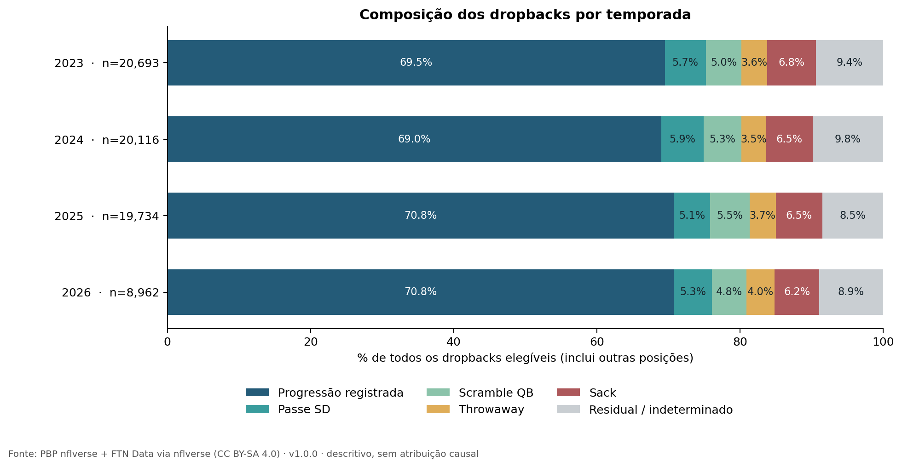
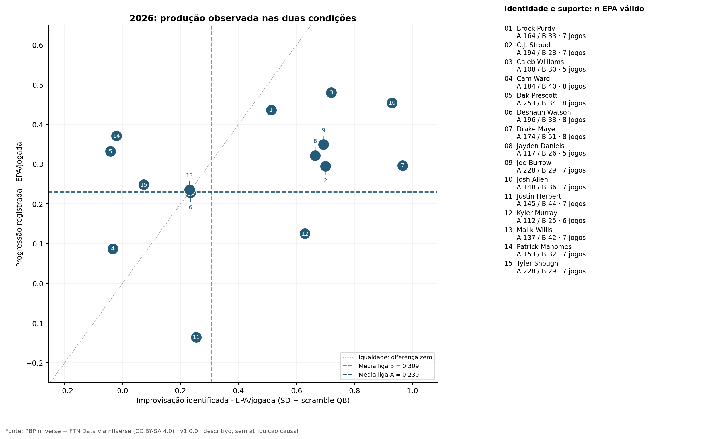
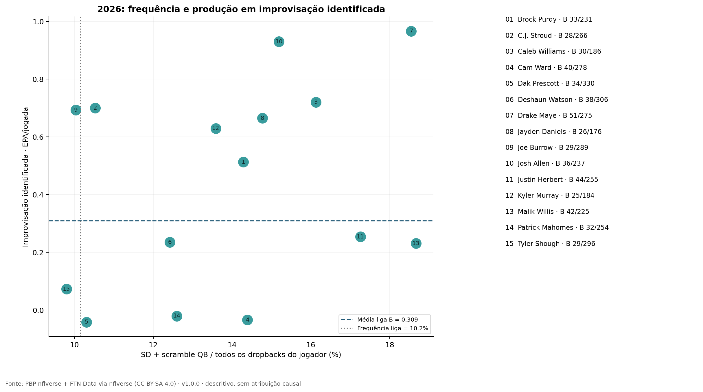
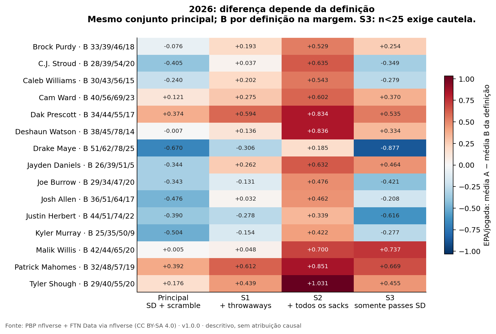
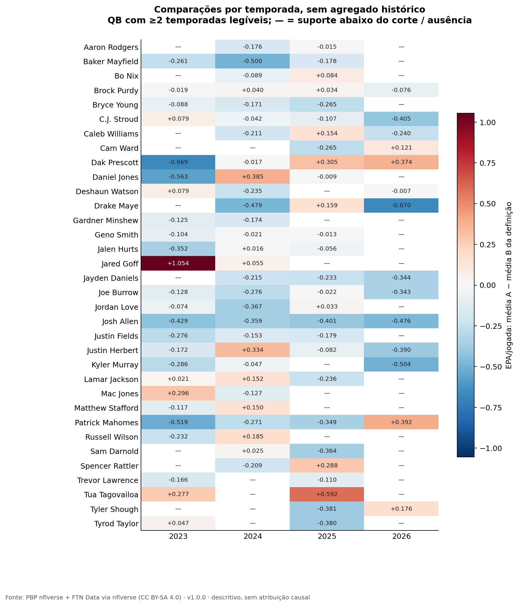

# Produção dos quarterbacks na progressão e em improvisação

**Entrega de pesquisa v1.0.0 · 05/11/2026 · sem integração ou publicação.** A comparação operacional é utilizável, mas **sensível à definição**. Ela mede a produção observada em passes com progressão registrada e em passes SD + scrambles verificados de QB. Não mede uma partição perfeita de todos os dropbacks dentro/fora da estrutura, nem dependência causal da estrutura ofensiva.

A principal evidência é que incluir scrambles, throwaways e sacks muda substancialmente a leitura. Em 2026, a média ponderada dos QB é **0,230 EPA/jogada em A** e **0,309 em B**. Só passes SD produzem **0,163**; com throwaways B cai para **0,009**; com throwaways e sacks, para **−0,519**. Não há justificativa para escolher apenas a definição que sustenta uma narrativa sobre um jogador.

## População e procedência

| temporada | dropbacks | lançamentos | sacks_PBP | scrambles_PBP | jogos | dropbacks_QB | dropbacks_outras_posições | FTN_ausente | EPA_ausente |
| --- | --- | --- | --- | --- | --- | --- | --- | --- | --- |
| 2023 | 20693 | 18248 | 1410 | 1035 | 272 | 20649 | 44 | 0 | 0 |
| 2024 | 20116 | 17740 | 1314 | 1062 | 272 | 20074 | 42 | 0 | 0 |
| 2025 | 19734 | 17358 | 1287 | 1089 | 272 | 19708 | 26 | 0 | 0 |
| 2026 | 8962 | 7970 | 557 | 435 | 121 | 8951 | 11 | 0 | 0 |

A comparação principal contém 69.505 dropbacks de 2023–2026. Há 20.210 dropbacks de 2022 em auditoria separada; nenhuma média ou correlação principal inclui 2022. O recorte atual contém 121 jogos REG encerrados, W1–8, até 02/11/2026; 151 jogos futuros e zero jogos encerrados pendentes no gate de encerramento. Sem espera por semana completa. Fontes próprias copiadas após conferir os 27 hashes do manifest XINT; nenhum cache derivado de passes foi usado como universo.

Todas as jogadas elegíveis encontram FTN e EPA finito nestas fontes. Em 2026 são 57 QB com 8.951 dropbacks e 11 outros participantes com 11 jogadas, mantidos nas tabelas; os 435 eventos PBP de scramble incluem um WR, que fica no residual, com identidade preservada. Sacks PBP são 557, um deles de WR; a referência da liga usa 556 sacks de QB. Os totais brutos reproduzem as pistas iniciais, mas as categorias finais diferem por regras explícitas. [Auditoria](DATA-AUDIT.md) · [fontes/hashes](evidence/sources.json) · [cobertura por jogo](evidence/package-coverage.json).

## Categorias e cobertura da comparação

A classificação aplica checagem de corrupção/aborto e depois sack → scramble verificado → throwaway em lançamento → passe SD → leitura registrada (`0,1,2,CHK`) → residual. Indicadores originais permanecem; um throwaway com código de leitura não vira passe de progressão. `DES` não representa uma progressão: é lançamento desenhado sem progressão e permanece como subtipo conhecido do residual. [Contrato congelado](RESEARCH-CONTRACT.md) · [regras completas](CLASSIFICATION.md).

Em 2026, todos os participantes:

| category | n | n_epa | sum_epa | mean_epa | pct_all |
| --- | --- | --- | --- | --- | --- |
| progression | 6342 | 6342 | 1453.688 | 0.229 | 70.765 |
| scramble_drill | 475 | 475 | 77.501 | 0.163 | 5.300 |
| scramble | 434 | 434 | 203.095 | 0.468 | 4.843 |
| throwaway | 355 | 355 | -268.883 | -0.757 | 3.961 |
| sack | 557 | 557 | -957.262 | -1.719 | 6.215 |
| indeterminate | 799 | 799 | -28.946 | -0.036 | 8.915 |

O residual de 799 jogadas contém 797 `DES`, um aborto e um scramble de WR. Logo, 8,92% de residual **não significa** 8,92% de charting ausente. Nos QB são 791/8.951 = 8,84% residuais, dos quais 790 `DES` e um aborto. A+B dos QB cobre 7.249/8.951 = 80,99%; outros blocos continuam visíveis. Não esconder o residual usando somente o denominador classificável.

## Produção principal e sensibilidades

Médias da liga são ponderadas por jogadas de QB verificados, usando toda a população elegível da temporada, inclusive QB com pouco suporte individual. A figura principal mostra somente o corte de legibilidade congelado: ≥100 EPA válidos em A, ≥25 em B e ≥5 jogos com A/B. Em 2026 passam 15 dos 57 QB; 37 têm pouco suporte e cinco não têm oportunidades em pelo menos um dos lados. Isso não garante robustez; as tabelas completas conservam todos os participantes e zeros de oportunidade como indisponíveis.

| temporada | definição | n_A | media_A | n_B | media_B | diferença |
| --- | --- | --- | --- | --- | --- | --- |
| 2023 | main | 14372 | 0.172 | 2215 | 0.348 | -0.177 |
| 2024 | main | 13866 | 0.224 | 2247 | 0.346 | -0.122 |
| 2025 | main | 13956 | 0.221 | 2086 | 0.277 | -0.055 |
| 2026 | main | 6340 | 0.230 | 909 | 0.309 | -0.079 |

A diferença é **média A − média B**. Positivo significa maior produção observada em A. Uma diferença alta pode vir de A excepcional; sempre mostrar os dois níveis e volumes. Não concluir incapacidade de improvisar. A diagonal do scatter indica diferença zero, sem interpretação de desempenho ideal. As referências de liga são médias condicionais de populações diferentes de jogadas, não uma comparação pareada de oportunidades equivalentes.

Em 2026, a frequência B dos QB é 909/8.951 = 10,16%, formada por 475 passes SD (5,31%) e 434 scrambles (4,85%). Scrambles somam 203,095 EPA e os passes SD 77,501. Assim, 47,7% dos eventos de B fornecem 72,4% de sua soma de EPA. É parte substantiva da definição, não um detalhe descartável.

| temporada | definição | n_A | media_A | n_B | media_B | diferença |
| --- | --- | --- | --- | --- | --- | --- |
| 2026 | main | 6340 | 0.230 | 909 | 0.309 | -0.079 |
| 2026 | S1 | 6340 | 0.230 | 1264 | 0.009 | 0.221 |
| 2026 | S2 | 6340 | 0.230 | 1820 | -0.519 | 0.749 |
| 2026 | S3 | 6340 | 0.230 | 475 | 0.163 | 0.067 |

S1 acrescenta descarte sem afirmar que todo throwaway decorreu de quebra de estrutura. S2 acrescenta todos os sacks como hipótese ampliada; não identifica em qual momento cada sack ocorreu. S3 retira scrambles e compara só lançamentos. Todas as versões mantêm A fixo e são reconstruídas das seis categorias.

No conjunto dos 15 QB legíveis de 2026, S1 muda o sinal de seis diferenças; S2 muda dez; S3 muda três, mas **14 dos 15 ficam abaixo de 25 passes SD**. Não tratar S3 como ranking igualmente sustentado. Nos anos completos, S2 muda o sinal em 24/34 (2023), 23/33 (2024) e 21/32 (2025). [Tabela completa das inversões](tables/sign_sensitivity.csv).

## História, composição e extremos

As quatro temporadas são mostradas separadamente; não há agregado histórico que misture calendários ou esconda 2026 parcial. Pares adjacentes exigem o mesmo suporte em ambos os anos:

| season | next_season | field | n_pairs | pearson | spearman |
| --- | --- | --- | --- | --- | --- |
| 2023 | 2024 | a_mean | 22 | 0.427 | 0.370 |
| 2023 | 2024 | b_mean | 22 | 0.025 | 0.110 |
| 2023 | 2024 | difference | 22 | 0.039 | 0.029 |
| 2023 | 2024 | b_pct_all | 22 | 0.799 | 0.748 |
| 2024 | 2025 | a_mean | 22 | 0.142 | 0.025 |
| 2024 | 2025 | b_mean | 22 | 0.451 | 0.508 |
| 2024 | 2025 | difference | 22 | 0.024 | 0.020 |
| 2024 | 2025 | b_pct_all | 22 | 0.752 | 0.763 |
| 2025 | 2026 | a_mean | 12 | 0.361 | 0.503 |
| 2025 | 2026 | b_mean | 12 | 0.163 | 0.217 |
| 2025 | 2026 | difference | 12 | -0.113 | -0.063 |
| 2025 | 2026 | b_pct_all | 12 | 0.677 | 0.657 |

A frequência B apresenta correlações maiores que a diferença de produção em todos os pares. A diferença tem Pearson 0,039; 0,024; −0,113. Os níveis A/B variam de modo desigual: não há uma medida de habilidade persistente estabelecida por essas correlações. Mesmo a correlação da frequência pode refletir desenho ofensivo, utilização, adversários e estabilidade da anotação. São populações de jogadores selecionadas por volume, com 2026 parcial.

A proporção de scrambles PBP marcada SD muda de 252/1.035 (24,35%) em 2023 e 293/1.062 (27,59%) em 2024 para 962/1.089 (88,34%) em 2025 e 415/435 (95,40%) em 2026. A regra fixa de scramble usa PBP e roster, portanto não depende desse SD; isso não certifica estabilidade completa do charting de passes SD. Não interpretar `read_thrown` em corridas/sacks como leitura lançada.

O contexto de B já difere de A: em 2026, terceiras/quartas descidas são 38,94% de B e 29,53% de A; primeiras são 28,82% versus 37,15%. Distância média: 8,79 versus 8,92 jardas; distância média até a end zone adversária: 48,39 versus 51,11; placar pré-jogada: −2,99 versus −2,94. B aparece um pouco mais no Q4 (29,04% versus 27,97%). As distribuições por descida, distância, campo, quarto, relógio e placar de **cada ano** estão em [faixas](tables/context_bins.csv) e [médias/medianas](tables/context_summary.csv). Isso não iguala proteção, defesa, recebedores ou alternativas não observadas. Nenhuma regressão foi adicionada.

A métrica principal conserva todos os EPA, inclusive extremos. Como diagnóstico, subtrair os cinco maiores |EPA| **de cada lado** faria a diferença de Stroud passar de −0,405 para +0,018, Willis de +0,005 para +0,104 e Mahomes de +0,392 para +0,231; em Maye permanece negativa (−0,670 → −0,330). Esse exercício não é uma estimativa corrigida nem uma forma de estabilizar ordenação: muda o universo e evidencia concentração. Os cinco eventos de maior |EPA| de B concentram 39,5% da soma absoluta em Stroud, 27,2% em Maye e 90,3% em Stafford. [Todos os diagnósticos e somas assinadas](tables/group_extremes.csv).

## Exemplos selecionados sem nomes

Os critérios foram congelados antes das comparações: maior diferença com A acima da liga; maior nível B; menor diferença absoluta; maior deslocamento S2; menor B positivo com A≥100 e B<25. Desempate por GSIS; não houve substituição posterior para confirmar o vídeo.

| critério | jogador | GSIS | n_A | EPA_A | n_B | EPA_B | diferença | frequência_B | status |
| --- | --- | --- | --- | --- | --- | --- | --- | --- | --- |
| high_A_gap | Patrick Mahomes | 00-0033873 | 153 | 0.371 | 32 | -0.021 | 0.392 | 12.598 | legible |
| high_B | Drake Maye | 00-0039851 | 174 | 0.297 | 51 | 0.966 | -0.670 | 18.545 | legible |
| near_zero | Malik Willis | 00-0038128 | 137 | 0.235 | 42 | 0.231 | 0.005 | 18.667 | legible |
| sack_sensitive | C.J. Stroud | 00-0039163 | 194 | 0.295 | 28 | 0.700 | -0.405 | 10.526 | legible |
| low_support | Matthew Stafford | 00-0026498 | 265 | 0.210 | 7 | -0.292 | 0.502 | 2.215 | low_support |

Mahomes combina A acima da liga com B próximo de zero neste recorte; isso não mede dependência causal. Maye tem maior B entre os elegíveis, e a diferença troca de sinal em S2. Willis fica próximo de zero na principal, embora S3 dê diferença +0,737 com só 20 passes SD. Stroud é o caso mais sensível a S2: −0,405 → +0,635; já S1 muda para +0,037. Seus 15 sacks somam −28,445 EPA; de S1 para S2, B cai de +0,258 para −0,340 EPA/jogada. Stafford tem só sete eventos B (três SD e quatro scrambles), volume inadequado para a figura principal, apesar de 265 A.

### Patrick Mahomes · 00-0033873

| categoria | jogo | jogada | regra | descida | distância | quarto | relógio | campo | EPA |
| --- | --- | --- | --- | --- | --- | --- | --- | --- | --- |
| indeterminate | 2026_01_DEN_KC | 1897 | 06_designed_without_progression | 1.000 | 10.000 | 2.000 | 01:46 | DEN 13 | 2.527 |
| progression | 2026_08_KC_DEN | 1780 | 05_registered_read | 3.000 | 10.000 | 2.000 | 07:54 | KC 27 | 7.019 |
| sack | 2026_08_KC_DEN | 4572 | 01_sack | 4.000 | 6.000 | 4.000 | 00:04 | DEN 6 | -2.617 |
| scramble | 2026_01_DEN_KC | 379 | 02_scramble_verified_rusher | 2.000 | 15.000 | 1.000 | 08:20 | DEN 15 | 2.815 |
| scramble_drill | 2026_06_LAC_KC | 1559 | 04_SD_throw | 3.000 | 2.000 | 2.000 | 08:37 | LAC 2 | -5.853 |
| throwaway | 2026_08_KC_DEN | 100 | 03_throwaway_preserve_read | 3.000 | 6.000 | 1.000 | 13:54 | KC 39 | -1.542 |

Uma jogada por categoria, escolhida por maior |EPA|, somente para localizar contribuições. [Todas as 254 jogadas e descrições da fonte](</Users/pedrocollet/Downloads/NFL Sideline/editorial/local-artifacts/qb-structure-production-v1/20261105-v1/package-release/examples/high_A_gap_all_plays.csv>) · [12 extremos com descrição literal](tables/high_A_gap_extremes.csv). As regras e evidências brutas constam em cada linha. Não inferir intenção ou culpa a partir do texto.

### Drake Maye · 00-0039851

| categoria | jogo | jogada | regra | descida | distância | quarto | relógio | campo | EPA |
| --- | --- | --- | --- | --- | --- | --- | --- | --- | --- |
| indeterminate | 2026_02_PIT_NE | 2721 | 06_designed_without_progression | 3.000 | 1.000 | 3.000 | 04:38 | PIT 27 | -2.376 |
| progression | 2026_03_NE_JAX | 3110 | 05_registered_read | 1.000 | 10.000 | 3.000 | 01:03 | NE 27 | -7.130 |
| sack | 2026_03_NE_JAX | 687 | 01_sack | 1.000 | 10.000 | 1.000 | 03:58 | JAX 35 | -5.802 |
| scramble | 2026_04_NE_BUF | 1526 | 02_scramble_verified_rusher | 2.000 | 10.000 | 2.000 | 06:25 | BUF 27 | 2.846 |
| scramble_drill | 2026_06_NYJ_NE | 661 | 04_SD_throw | 2.000 | 10.000 | 1.000 | 04:18 | NYJ 42 | 4.119 |
| throwaway | 2026_05_LV_NE | 1460 | 03_throwaway_preserve_read | 3.000 | 6.000 | 2.000 | 11:08 | LV 30 | -2.884 |

Uma jogada por categoria, escolhida por maior |EPA|, somente para localizar contribuições. [Todas as 275 jogadas e descrições da fonte](</Users/pedrocollet/Downloads/NFL Sideline/editorial/local-artifacts/qb-structure-production-v1/20261105-v1/package-release/examples/high_B_all_plays.csv>) · [12 extremos com descrição literal](tables/high_B_extremes.csv). As regras e evidências brutas constam em cada linha. Não inferir intenção ou culpa a partir do texto.

### Malik Willis · 00-0038128

| categoria | jogo | jogada | regra | descida | distância | quarto | relógio | campo | EPA |
| --- | --- | --- | --- | --- | --- | --- | --- | --- | --- |
| indeterminate | 2026_07_MIA_NYJ | 1714 | 06_designed_without_progression | 2.000 | 5.000 | 2.000 | 00:35 | NYJ 20 | 1.359 |
| progression | 2026_02_MIA_SF | 3614 | 05_registered_read | 3.000 | 4.000 | 4.000 | 02:41 | MIA 23 | 7.011 |
| sack | 2026_04_MIA_MIN | 1684 | 01_sack | 2.000 | 8.000 | 2.000 | 05:50 | MIA 48 | -4.714 |
| scramble | 2026_05_CIN_MIA | 3183 | 02_scramble_verified_rusher | 3.000 | 13.000 | 4.000 | 14:28 | MIA 17 | 4.159 |
| scramble_drill | 2026_03_KC_MIA | 3682 | 04_SD_throw | 4.000 | 1.000 | 4.000 | 02:03 | MIA 48 | -3.343 |
| throwaway | 2026_08_NE_MIA | 1923 | 03_throwaway_preserve_read | 2.000 | 1.000 | 2.000 | 00:17 | NE 1 | -0.855 |

Uma jogada por categoria, escolhida por maior |EPA|, somente para localizar contribuições. [Todas as 225 jogadas e descrições da fonte](</Users/pedrocollet/Downloads/NFL Sideline/editorial/local-artifacts/qb-structure-production-v1/20261105-v1/package-release/examples/near_zero_all_plays.csv>) · [12 extremos com descrição literal](tables/near_zero_extremes.csv). As regras e evidências brutas constam em cada linha. Não inferir intenção ou culpa a partir do texto.

### C.J. Stroud · 00-0039163

| categoria | jogo | jogada | regra | descida | distância | quarto | relógio | campo | EPA |
| --- | --- | --- | --- | --- | --- | --- | --- | --- | --- |
| indeterminate | 2026_04_DAL_HOU | 3957 | 06_designed_without_progression | 3.000 | 14.000 | 4.000 | 02:34 | DAL 27 | 2.876 |
| progression | 2026_06_HOU_JAX | 4024 | 05_registered_read | 2.000 | 4.000 | 4.000 | 03:59 | JAX 4 | -6.019 |
| sack | 2026_01_BUF_HOU | 313 | 01_sack | 3.000 | 12.000 | 1.000 | 09:40 | HOU 34 | -4.251 |
| scramble | 2026_01_BUF_HOU | 1230 | 02_scramble_verified_rusher | 3.000 | 12.000 | 2.000 | 10:06 | HOU 38 | 2.595 |
| scramble_drill | 2026_05_HOU_TEN | 3175 | 04_SD_throw | 3.000 | 8.000 | 4.000 | 14:17 | TEN 9 | 3.222 |
| throwaway | 2026_02_CIN_HOU | 3647 | 03_throwaway_preserve_read | 3.000 | 11.000 | 4.000 | 10:55 | MID 50 | -1.998 |

Uma jogada por categoria, escolhida por maior |EPA|, somente para localizar contribuições. [Todas as 266 jogadas e descrições da fonte](</Users/pedrocollet/Downloads/NFL Sideline/editorial/local-artifacts/qb-structure-production-v1/20261105-v1/package-release/examples/sack_sensitive_all_plays.csv>) · [12 extremos com descrição literal](tables/sack_sensitive_extremes.csv). As regras e evidências brutas constam em cada linha. Não inferir intenção ou culpa a partir do texto.

### Matthew Stafford · 00-0026498

| categoria | jogo | jogada | regra | descida | distância | quarto | relógio | campo | EPA |
| --- | --- | --- | --- | --- | --- | --- | --- | --- | --- |
| indeterminate | 2026_08_LAC_LA | 2855 | 06_designed_without_progression | 2.000 | 6.000 | 3.000 | 03:48 | LAC 18 | 2.209 |
| progression | 2026_03_LA_DEN | 4110 | 05_registered_read | 3.000 | 6.000 | 4.000 | 05:01 | DEN 38 | -9.322 |
| sack | 2026_07_LA_LV | 213 | 01_sack | 3.000 | 5.000 | 1.000 | 12:37 | LA 25 | -2.450 |
| scramble | 2026_03_LA_DEN | 587 | 02_scramble_verified_rusher | 3.000 | 8.000 | 1.000 | 05:49 | DEN 15 | 2.095 |
| scramble_drill | 2026_04_LA_PHI | 2172 | 04_SD_throw | 1.000 | 10.000 | 2.000 | 00:34 | LA 28 | -2.527 |
| throwaway | 2026_06_ARI_LA | 103 | 03_throwaway_preserve_read | 3.000 | 1.000 | 1.000 | 13:49 | LA 44 | -1.881 |

Uma jogada por categoria, escolhida por maior |EPA|, somente para localizar contribuições. [Todas as 316 jogadas e descrições da fonte](</Users/pedrocollet/Downloads/NFL Sideline/editorial/local-artifacts/qb-structure-production-v1/20261105-v1/package-release/examples/low_support_all_plays.csv>) · [12 extremos com descrição literal](tables/low_support_extremes.csv). As regras e evidências brutas constam em cada linha. Não inferir intenção ou culpa a partir do texto.

## Limites e recomendação de apresentação

EPA é o `epa` da jogada PBP: produção do ataque, com contribuição de recebedores/YAC, adversários, proteção e penalidades válidas. Não isola o QB; `qb_epa`, WPA ou resultado de vitória não foram substitutos. Charting FTN é retrospectivo e revisável; `date_pulled` não comprova anotação cega. Não há medida completa de pressão; qb_hit, blitzers e saída do pocket não foram usados como tal. O pocket pode ser abandonado por desenho, e segunda/terceira leitura podem ocorrer dentro da estrutura. Não identificamos alternativas não escolhidas.

Não foram produzidos intervalos nesta versão. Volumes pequenos, heterogeneidade e definição operacional permanecem limitações; o corte não é certificação estatística. Uma futura reamostragem teria de selecionar jogos conjuntamente para A/B e reportar réplicas sem oportunidades em um lado. Não tratar os grupos como amostras independentes.

**Recomendação:** revisar este pacote como leitura experimental de “produção em progressão registrada e improvisação identificada”. Na futura integração, mostrar níveis A/B, composição de todos os dropbacks, volumes, residual separado por motivo, toggle das quatro definições e acesso às jogadas. Sacks/throwaways merecem blocos próprios. Evitar ranking de dependência do sistema, quadrantes valorativos e tradução automática em qualidade individual. Preservar M3/B2 como perguntas distintas. Nenhuma conexão à interface foi feita.

[Reprodução e atualização](README.md) · [cartão da métrica](METRIC-CARD.md) · [passagem de integração](HANDOFF.md) · [verificação independente](evidence/independent-reconciliation-final.json).
